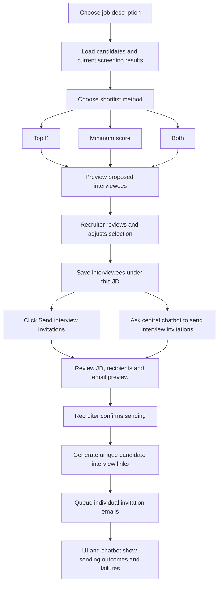

# Daily Work — 12 October 2026

**Pre-commit review — 12 October 2026:** Pre-commit review fixed the screening failure path to retain the job ID across rollback, and made score/evidence rendering tolerate invalid or incomplete score objects. Five real-results/worker PostgreSQL tests passed, including the new failure-path regression. Earlier SMTP/MCP focused checks remain recorded; no real email was sent. Live browser save/reload verification remains pending.

**Email MCP update — 12 October 2026:** Authenticated email MCP server/client and Docker service are implemented. Eight focused checks passed in the existing backend container, including an actual MCP protocol round trip with SMTP mocked; Compose configuration validated. No real email was sent and the new service was not started. Configure EMAIL_MCP_SECRET and the appropriate client URL before use. Invitation links, confirmation, durable queue, UI/chatbot sending and live shortlist browser verification remain pending.

**Latest email update:** Email transport switched to Gmail SMTP with an app password on 12 October 2026. The existing gmail.py adapter and its tests were replaced; OAuth settings/token loading were removed. Eleven focused fake-SMTP tests passed; no real email was sent. MCP transport/client, invitation links, queue and UI/chatbot sending remain pending. Earlier OAuth design notes below are historical and superseded.

## Today's objective

Build interviewee shortlisting so a recruiter can choose a job description, review the candidates who applied for it, and select recipients. Let the recruiter send invitation emails through either a button in the Interviews UI or the central chatbot, generating a unique interview link for each selected candidate application.

**Current status:** shortlist backend, persistence and UI implemented. Backend preview now includes never-assessed applications and explicit missing/invalid-score exclusions. Saves and screening-worker writes share a job lock; save previews use the save transaction. Latest checks passed: 29 focused tests, 14 selection/PostgreSQL tests, 4 real-results/worker-workflow PostgreSQL tests, frontend build and lint. Live browser login/navigation succeeded; complete live browser save/reload verification remains pending because the user requested validation stop. Email step 1 now uses personal Gmail SMTP with an app password; 11 focused fake-SMTP tests passed. MCP server/client is implemented with mocked-delivery checks; invitation links/queue and UI/chatbot sending remain pending. No real emails were sent.

This file tracks today's scope and progress. The broader project baseline is in [PROJECT_PROGRESS.md](PROJECT_PROGRESS.md).

## Requested feature

The recruiter should be able to:

1. Choose one of their saved job descriptions.
2. View the candidates/applications under that JD, with their screening scores and ranks.
3. Generate a proposed shortlist using **top K**, **minimum score**, or **both**.
4. Review the proposed interviewees and choose the final recipients.
5. Keep the final selection associated with the chosen JD for sending interview links.
6. Use a **Send interview invitations** button in the Interviews UI or ask the central chatbot to email invitations to the selected interviewees for a specific JD.
7. Review the recipients and invitation message, then confirm sending through the chosen UI or chatbot flow.
8. Receive a unique interview link per candidate application and track each email's sending outcome.

Filtering proposes interviewees; the recruiter makes the final selection.

Shortlisting belongs in the Interviews UI and its backend API; today's scope does not require a chatbot tool for shortlisting. After the final selection has been saved, invitations can be initiated through either the UI button or the central chatbot. Both paths use the same backend invitation service, recipient/message preview, confirmation rules, sending queue and status records.

## Working agreement

Before adding or changing code, explain what it does, which existing files/functions it connects to, and how data flows through the change. Show the proposed file or edits for review, then wait for the recruiter/developer's explicit instruction to add them. Keep implementation readable and proceed in small steps. Documentation updates can be made when requested.

The developer explicitly waived review for completing the Interviews UI: "Complete the UI code. No need for review." That authorization covers this UI implementation and its supporting frontend changes.

## Proposed user flow



## Filter behavior

The following are proposed implementation defaults. Update them if the recruiter workflow requires different behavior.

| Method | Input | Proposed behavior |
| --- | --- | --- |
| Top K | Positive whole number K | Select up to K eligible candidates, ordered by overall screening score descending |
| Minimum score | Score from 0 to 100 | Select all eligible candidates whose overall score is greater than or equal to the threshold |
| Both | K and minimum score | First keep candidates meeting the minimum score, then select up to K of them |

Example: scores are **92, 86, 81, 74, 65**.

| Rule | Proposed shortlist |
| --- | --- |
| Top 3 | 92, 86, 81 |
| Minimum 80 | 92, 86, 81 |
| Top 2 and minimum 80 | 92, 86 |
| Top 4 and minimum 80 | 92, 86, 81; do not fill remaining slots below the threshold |

### Eligibility and edge cases

- Use the existing overall screening score, comparing its full precision before display rounding.
- Use current, completed assessments for the selected JD. Failed, unfinished, missing-score or outdated assessments do not qualify for automatic filtering.
- Display excluded applications with a reason so the recruiter can see why they were not proposed.
- Top K means at most K candidates, rather than every candidate whose shared rank is at most K. Reuse the existing stable application-ID ordering for equal scores, and show ties at the cutoff for review.
- If fewer than K qualify, select the available qualifying candidates and show the resulting count.
- An empty result is valid; show that no candidates meet the rule.
- Require K to be a positive integer and the score threshold to be within 0–100. Zero is a valid threshold.
- Keep candidates scoped to the chosen JD and authenticated recruiter.
- Allow manual additions/removals among eligible candidates and show the final count before saving.
- Switching jobs must load that job's saved selection or reset the unsaved preview; candidates from another job must never carry over.
- Recheck screening freshness and ownership when saving. If inputs changed after preview, refresh the shortlist before confirmation.
- Treat selection as belonging to a candidate application for a JD. The same person can apply to multiple jobs independently.

## Existing functionality to reuse

| Existing capability | Source | Use in this feature |
| --- | --- | --- |
| Saved JD list | [JD API](../backend/app/jd.py), [JD list UI](../frontend/src/features/jd/MyJobDescriptions.tsx) | Job selection |
| Candidate/application storage and listing | [Models](../backend/app/models/cv.py), [CV source API](../backend/app/cv_routes.py) | Candidates under the chosen JD |
| Current ranked screening results | [Screening service](../backend/app/services/cv/screening.py) | Scores, stable ordering and assessment eligibility |
| Scoring and tie handling | [Scoring service](../backend/app/services/cv/scoring.py) | Existing score semantics |
| Evidence and score breakdown UI | [CV results](../frontend/src/features/cv/CVResults.tsx) | Recruiter review before selection |
| Interviews navigation | [Application routes](../frontend/src/app/App.tsx) | Opens the implemented job-scoped interviewee workspace |
| Central assistant and tool routing | [Assistant graph](../backend/app/workflows/assistant/graph.py), [Assistant tools](../backend/app/workflows/assistant/tools.py) | Invitation preview, confirmation, sending and status tools |

No new AI scoring is needed for shortlisting. The filter uses the screening results already produced by the project.

## Implementation checklist

### Backend and persistence

- [x] Define initial preview request and response shape: JD, filter mode, K, minimum score, proposed applications, count and exclusion reasons.
- [x] Implement validated filtering against the current ranked results returned by the existing screening service.
- [x] Extend backend preview to include never-assessed applications and explicitly exclude missing/invalid scores; include the owned application roster in the preview fingerprint and show exclusion labels in the UI.
- [x] Show ties at the cutoff in the Interviews UI using the existing exact backend ranks.
- [x] Add saved-selection models and migration associated with the JD/application and recruiter; import models in Alembic's environment.
- [x] Apply the migration to PostgreSQL and verify the actual schema. Applied by the developer; revision, columns, foreign keys, unique constraints and indexes checked.
- [x] Add service code to persist selection provenance: screening assessment/run, score snapshot, filter inputs and manual additions/removals. Synthetic PostgreSQL save/reload tests passed.
- [x] Add authenticated preview operation and register its router in FastAPI.
- [x] Add `SaveShortlistRequest` with filters, preview key, final application IDs and duplicate-ID validation; request-validation tests passed.
- [x] Return a preview fingerprint bound to recruiter, JD, run, filters, ranked/incomplete assessments and warnings.
- [x] Add `load_shortlist()` service to read saved members, candidate details and outdated indicators; synthetic PostgreSQL tests passed with mocked screening responses.
- [x] Add `save_shortlist()` with preview-key comparisons, ownership/membership/eligibility validation and reuse of existing member records; synthetic PostgreSQL persistence/rollback tests passed.
- [x] Expose authenticated save/load API routes. Ad hoc HTTP checks passed for request forwarding, null load, authentication, role restrictions, validation and service errors.
- [x] Verify save-time ownership, job membership, eligibility and changed-preview rejection using real PostgreSQL fixtures and mocked screening responses.
- [x] Verify freshness against actual worker workflow ranking writes with real PostgreSQL/results/save paths: earlier changes reject previews, writes during saves wait, later changes mark saved snapshots outdated. Only model-version discovery is substituted in these tests; full model inference was not rerun.
- [x] Verify repeated and simultaneous saves reuse records and prevent duplicate interviewees for a job using synthetic PostgreSQL fixtures.

### Unique interview links and email delivery

- [ ] Add invitation records associated with recruiter, JD, candidate application and confirmed recipient email.
- [ ] Generate cryptographically random, unguessable links unique to each application/invitation; never share one link across the shortlist.
- [ ] Define a reachable candidate interview entry page and backend token validation so emailed links open a working destination.
- [ ] Store token verification data securely, enforce configured expiry/revocation, and keep raw tokens out of logs and general chatbot history.
- [ ] Implement a custom email MCP server that sends through Gmail API using the developer's personal Gmail mailbox and OAuth credentials.
- [ ] Enable Gmail API, create an OAuth client, authorize the sender with `gmail.send`, and securely store/refresh its tokens. Existing Drive/Sheets service-account credentials cannot authorize personal Gmail sending.
- [ ] Build individual candidate emails containing the job title, interview instructions and that candidate's unique link.
- [ ] Persist a durable sending queue with per-recipient status, attempts, safe error codes and provider message IDs.
- [ ] Expose shared authenticated invitation preview, confirmed-send and status operations for both the UI button and chatbot tools.
- [ ] Prevent duplicate sends from repeated button clicks, chatbot calls or confirmation requests across both paths; retry failed sends against the existing invitation.
- [ ] Treat uncertain provider outcomes separately from definite failures to avoid blind duplicate sends.
- [ ] Support explicit resend/reissue behavior; invalidate superseded links when issuing a replacement.
- [ ] Distinguish queued, provider-accepted/sent, failed and uncertain outcomes. Claim delivered only if the provider confirms delivery.

### Central chatbot orchestration

- [ ] Add assistant tools for invitation preview, confirmed send, status lookup and failed-send retry.
- [ ] Resolve the selected JD and persisted interviewees; clarify ambiguous job references before preparing invitations.
- [ ] Example request: "Send interview links by email to the shortlisted candidates for JD 3."
- [ ] Present job title, selected candidate names/emails, recipient count, subject and email content before sending.
- [ ] Bind recruiter confirmation to the exact recipient/message preview; require a fresh preview if selection, email addresses or interview settings change.
- [ ] Validate recruiter ownership and saved selection server-side for every tool invocation.
- [ ] Return batch and per-recipient outcomes in chat, including actionable failures and retry options.
- [ ] Keep shortlist saving separate from sending; only a confirmed send action through the UI or chatbot queues emails.

### Frontend

- [x] Replace the Interviews placeholder with the initial interviewee-selection workspace.
- [x] Add JD selection and candidate/results loading, including existing paginated JD/application APIs.
- [x] Add Top K, Minimum score and Both filter modes with input validation.
- [x] Show preview count, names, scores, ranks and reused CV evidence/review details.
- [x] Load scores/ranks/evidence independently of preview generation; preserve them when filter edits clear the preview.
- [x] Add candidate checkboxes, manual adjustments and final selected count; disable automatic selection for incomplete/unassessed applications.
- [x] Save and restore the job's selected interviewees; switching jobs mounts a fresh job workspace.
- [x] Display saved interviewees separately from checkbox choices, with saved count, snapshot scores/ranks and unsaved-change indication.
- [x] Handle no jobs, no candidates, no current screening results, no matches, loading, stale selections and API errors.
- [ ] Enable the **Send interview invitations** button with recipient/message preview and explicit confirmation before queueing emails. The button is currently displayed disabled because delivery is not implemented.
- [ ] Show invitation status alongside saved interviewees and support both UI and chatbot preview/confirmation flows.

### Verification

- [x] Test top K, inclusive score threshold and combined filtering with sample screening results.
- [x] Test ties, fewer-than-K matches, zero threshold and full-precision score comparisons.
- [x] Test invalid filter inputs and exclusion reasons for failed/outdated assessments using sample results.
- [ ] Test missing-score and never-assessed applications explicitly.
- [x] Test FastAPI preview authentication, recruiter role, HTTP validation and forwarding of service ownership rejection with a fake user store and mocked preview service.
- [x] Run ad hoc preview-key checks for format, repeatability, incomplete-assessment order stability, and score/filter/status changes. Persistent regression coverage remains to add.
- [x] Test save-request validation and load-service behavior, including absent/empty selections, ownership and changed score/run references, using synthetic PostgreSQL fixtures and mocked screening responses.
- [x] Test recruiter ownership, cross-job selection rejection and changed results after preview with PostgreSQL fixtures and mocked screening responses.
- [x] Test real PostgreSQL persistence, manual adjustments, duplicate/concurrent saves, restoring selections after reload and rollback when preview changes before commit. Screening responses mocked; real worker concurrency remains pending.
- [ ] Test unique links across candidates and jobs, token validation, expiry, revocation and replacement.
- [ ] Test chatbot JD resolution, recipient preview, confirmation and changed-preview rejection.
- [ ] Test the UI button's invitation preview/confirmation flow and duplicate-send prevention when both UI and chatbot initiate the same invitations.
- [ ] Test repeated tool calls, duplicate confirmations, queue restart recovery, partial email failures and retry behavior.
- [ ] Verify every email contains only its intended candidate's link; test missing/invalid recipient emails and provider configuration errors.
- [ ] Verify provider acceptance is not reported as confirmed delivery.
- [ ] Use a test email transport or controlled test inboxes for verification and record results.
- [x] Run frontend build/lint and browser checks with mocked APIs for the implemented recruiter shortlist flow.
- [ ] Complete live browser save/reload verification. Login, JD listing and Interviews navigation succeeded against the real stack; further browser validation stopped at the user's request. Future invitation verification remains pending.

## Acceptance criteria

- The recruiter can select an owned JD and see only its candidates.
- All three automatic shortlist modes produce the defined eligible set.
- The recruiter can review and adjust the proposed interviewees before saving.
- The final interviewee list persists under the selected JD and reloads correctly.
- Invalid, stale and cross-job selections cannot be saved.
- The recruiter can send interview links to the saved interviewees for a chosen JD through either the **Send interview invitations** UI button or the central chatbot.
- Both flows preview the exact recipients and invitation content before the recruiter confirms sending.
- Each selected candidate application receives its own unique link in an individual email, opening a working interview entry page.
- Sending outcomes persist and are visible through the chatbot and interviewee list.
- Repeated requests do not silently duplicate invitations; failed sends can be retried with clear outcomes.
- Expired, revoked or replaced links cannot open an active interview session.

## Confirmed delivery scope and remaining configuration

Confirmed for today's plan: **unique interview links**, sent **by email**, initiated through either a **Send interview invitations button in the Interviews UI** or the **central chatbot**, to the recruiter's selected interviewees under a chosen JD. Both entry points share the same backend invitation service and require recipient/message review and confirmation before sending.

### Confirmed Gmail and custom MCP design

- **Provider and sender type:** Gmail API using the developer's **personal Gmail account**. The exact sender address has not been recorded here.
- **Authentication:** user OAuth consent with the send-only `https://www.googleapis.com/auth/gmail.send` scope and a securely stored refresh token. Access tokens are refreshed as needed; reconnect if authorization is revoked or expires.
- **Existing Google setup:** retain the current service account for Drive/Sheets. Reuse the existing Google Cloud project if appropriate, but create separate OAuth client credentials for personal Gmail. No Workspace domain-wide delegation is planned.
- **Custom email MCP server:** performs authenticated Gmail API calls and returns provider message IDs or safe error/uncertain outcomes. Do not use the Codex Gmail connector as the application's delivery backend.
- **Application backend:** remains responsible for owned JD/application selection, exact preview/confirmation binding, unique links, durable sending jobs, duplicate prevention, retry policy and persisted statuses. The MCP server receives authorized individual send jobs; its access must be authenticated and restricted.
- **Two entry points, one delivery path:** the UI button and chatbot both prepare/confirm invitations through the backend. After confirmation, the queue worker calls the custom MCP email tool; the chatbot does not bypass the queue or confirmation checks.
- **Current state:** this design is confirmed, but Gmail OAuth setup, refresh-token storage, the custom email MCP server and invitation sending have not been implemented or verified. Keep secrets and raw link tokens out of documentation, logs and general chatbot history.

```text
Saved interviewees under an owned JD
  -> UI send button OR central chatbot
  -> backend recipient/message preview
  -> recruiter confirmation
  -> unique per-application links and durable individual email jobs
  -> queue worker -> custom email MCP server -> Gmail API
  -> personal Gmail sender -> intended candidate
  -> persisted outcomes shown in the UI and chatbot
```

Gmail API acceptance is recorded as sent/provider-accepted, not confirmed recipient delivery. Reference: [Gmail OAuth](https://developers.google.com/workspace/gmail/api/auth/web-server) and [send-only scope](https://developers.google.com/workspace/gmail/api/auth/scopes).

Configuration/product details still to settle during implementation:

- Exact personal Gmail sender address, OAuth client/callback configuration, consent and secure refresh-token storage. Gmail API and custom MCP delivery are already selected.
- Public application URL and interview entry-page behavior.
- Interview type, instructions, scheduling information and link expiry duration.
- Final email subject/body and resend/reissue policy.

Full interview execution and assessment remain separate project scope unless added explicitly. Today's link destination must still provide a functional entry experience consistent with the interview flow that is available.


### Shortlisting gap follow-up — validation stopped at user request

User approved `SHORTLIST_GAPS_REVIEW.md`. Implemented roster exclusions, aggregate-score validation, matching frontend labels, shared transaction locks for screening writes/save/start/resume, and same-session save previews. Worker writes preserve previously invalidated run status. No invitation code was added.

Verification completed: 29 focused tests (10 screening results + 3 scoring + 9 filters + 7 routes), 14 request/selection PostgreSQL tests, 4 PostgreSQL tests using real screening-results/save and worker batch workflow paths; frontend build and lint passed. Worker tests substitute model-version discovery only and seed synthetic assessments; they do not establish fresh AI inference. Browser used actual frontend/API/database without response interception: synthetic recruiter login, JD listing and Interviews navigation passed. Complete browser save/reload and edge-case interaction checks remain pending. Temporary browser fixtures were removed.

Commands: focused suites via `unittest` with Windows Selector policy; `RUN_INTERVIEW_DB_TESTS=1` for `test_interview_selections.py` and `test_shortlist_live_database.py`; `npm run build`; `npm run lint`. Async/database tests ran outside the sandbox because of Windows socket restrictions. The idle development worker restart was requested to load changes.

This follow-up supersedes earlier statements below that backend score/roster handling and worker concurrency are pending. Historical checks and commit records remain unchanged.

## Today's progress log

| Item | Status | Evidence / next step |
| --- | --- | --- |
| Today's feature request and user flow | Documented | JD-scoped selection plus unique interview links emailed through either the UI button or central chatbot |
| Filtering semantics and edge cases | Implemented; some backend edge cases pending | Three filter modes and cutoff-tie UI verified; explicit missing-score/never-assessed handling in backend preview remains pending |
| Existing implementation review | Completed, static review | Confirmed reusable JD, application, score and ranked-result components |
| Screening-results readability | Implemented; focused tests passed | Three small helpers extracted in `get_screening_results()`; API response and existing behavior retained |
| Shortlist preview backend | Implemented; focused tests passed | `shortlisting.py` uses existing screening results and returns `preview_key`; `interview_routes.py` exposes `POST /interviews/jobs/{job_id}/shortlist/preview`; router registered in `main.py` |
| Saved-selection database definitions | Applied; schema verified | Developer applied the migration. Database is at `e7c142d9a630 (head)`; both tables, expected columns, foreign keys, unique constraints and indexes verified |
| Save-request contract | Added; validation tests passed | `schemas.py` validates filters, preview key and UUID IDs; empty selections accepted and duplicate/invalid IDs rejected |
| Load-selection service | Added; PostgreSQL tests passed | Reads saved members with names/emails and detects changed scores/runs using mocked screening responses; authenticated GET route added |
| Save-selection service | Added; PostgreSQL tests passed | Persistence, manual adjustments, repeated/simultaneous saves, ownership, cross-job rejection, stale previews and rollback tested; actual screening-worker concurrency pending |
| Save/load endpoints | Implemented; HTTP checks passed | Authenticated PUT/GET `/interviews/jobs/{job_id}/shortlist`; ad hoc HTTP checks used mocked services |
| Interviews UI | Implemented; build/lint and mocked browser checks passed | JD selection, all filter modes, candidate/evidence review, manual choices, save/restore, stale errors, cutoff ties, empty states and responsive layout; invitation button remains disabled pending delivery backend |
| Verification | Focused, PostgreSQL and mocked UI checks passed | 39 tests across five suites; ad hoc HTTP/fingerprint checks and schema inspection; production build and lint; desktop/mobile browser checks with synthetic mocked APIs. Actual worker concurrency and live full-stack UI checks pending |
| Interview-link sending | Planned; delivery design confirmed | Personal Gmail via OAuth and a custom email MCP server; button/chatbot share backend confirmation and queue. Unique links and delivery implementation pending |

### Commits recorded today

All three commits reference **Task #648356 — Candidate Shortlisting UI & Persistence**. These are implementation checkpoints; remaining verification items still apply.

| Commit | Message | Scope |
| --- | --- | --- |
| `31f42c5` | `feat(interviews): Add shortlist backend foundation` | Screening refactor, shortlist preview/fingerprint, storage models/migration, save/load services and initial tests/documentation |
| `8934622` | `feat(interviews): Verify shortlist persistence and expose save/load API` | PostgreSQL selection tests, authenticated save/load routes and frontend API helpers |
| `f9f1574` | `feat(interviews-ui): Add candidate shortlisting workspace` | Interviews screen/styles, evidence reuse, independent score/rank loading and visible saved-selection panel; 6 files, 449 insertions and 37 deletions |

The latest UI commit records passing production build, ESLint and desktop/mobile browser checks with mocked APIs, plus the read-only persistence check. It explicitly leaves live full-stack and actual screening-worker concurrency verification pending. It does not implement invitation delivery or complete Tasks #648358/#648359.

### Current implemented file flow

1. `App.tsx` opens `Interviews.tsx` from the Interviews navigation.
2. Existing `jd/api.ts` and `cv/api.ts` load owned JDs and imported applications. `interviews/api.ts` loads current screening results independently, so ranks/scores/evidence appear before a shortlist preview.
3. `interviews/api.ts` calls `interview_routes.py` for preview/save/load; `main.py` registers the router and existing recruiter authentication supplies the user identity.
4. `shortlisting.py` consumes current `screening.py` results, applies the chosen filter and returns a preview key.
5. `schemas.py` validates the final choices; `selections.py` checks ownership/membership/eligibility and preview freshness, then writes records defined in `models/interviews.py`.
6. The load service returns persisted members and outdated indicators. `Interviews.tsx` shows them in **Saved interviewees** and keeps unsaved checkbox changes separate.

### Files added or changed on 12 October 2026

| File | Connection to existing code |
| --- | --- |
| [Screening service](../backend/app/services/cv/screening.py) | Refactored freshness checks, parse validation and result formatting into helpers; existing route/frontend continue calling the same function |
| [Shortlisting service](../backend/app/services/interviews/shortlisting.py) | Validates filters and consumes `get_screening_results()`; returns proposed assessed applications, exclusions and a preview fingerprint using existing `indexing.digest()` |
| [Selection request schema](../backend/app/services/interviews/schemas.py) | Reuses `ShortlistRequest` and validates final application IDs plus the reviewed preview key for the implemented save service |
| [Selection service](../backend/app/services/interviews/selections.py) | Save/load functions use existing ownership/screening helpers, preview key, shortlist models and candidate/application models; authenticated routes call both services |
| [Interview routes](../backend/app/interview_routes.py) | Uses existing recruiter authentication to call preview, save and load services |
| [FastAPI application](../backend/app/main.py) | Registers the interview router beside existing feature routers |
| [Interview models](../backend/app/models/interviews.py) | Defines one saved shortlist per JD and unique application members, linked to existing jobs, users, screening runs, applications and assessments |
| [Shortlist migration](../backend/migrations/versions/e7c142d9a630_add_interview_shortlists.py) | Creates the two model tables, foreign keys, unique constraints and indexes when applied |
| [Alembic environment](../backend/migrations/env.py) | Imports the interview models so Alembic recognizes their metadata |
| [Screening-results tests](../backend/tests/test_cv_screening_results.py) | Regression tests using mocked database/model dependencies |
| [Shortlisting tests](../backend/tests/test_shortlisting.py) | Sample screening responses exercise filtering, precision, ties, exclusions and validation |
| [Interview route tests](../backend/tests/test_interview_routes.py) | Isolated FastAPI app uses real auth dependencies/JWT handling with a fake user store and mocked preview service |
| [Selection tests](../backend/tests/test_interview_selections.py) | Save-request validation and opt-in PostgreSQL service tests with synthetic fixtures and mocked screening responses |
| [Frontend Interviews API](../frontend/src/features/interviews/api.ts) | Uses the existing `apiRequest()` for preview, save and load; reuses exported screening assessment/score types |
| Screening display before preview | `loadScreeningResults()` reads the existing screening-results endpoint independently of shortlist preview. Scores, ranks and evidence stay visible when filters change or a stale preview is cleared; saving still requires a fresh preview |
| Saved interviewees display | Added a separate saved-selection panel with server-returned names/emails, score/rank snapshots, saved count and manual/outdated flags; checkbox edits are marked unsaved until a successful save |
| [Interviews workspace](../frontend/src/features/interviews/Interviews.tsx) | Connects existing JD and candidate APIs to preview/save/load, selection controls and current evidence details |
| [Interviews styles](../frontend/src/features/interviews/Interviews.css) | Responsive layout consistent with the recruiter workspace |
| [Frontend application routes](../frontend/src/app/App.tsx) | Replaces the Interviews placeholder with the new authenticated workspace |
| [CV evidence display](../frontend/src/features/cv/CVResults.tsx) | Exports existing assessment/score types and `AssessmentDetails` for reuse; criterion priority type now permits the existing nullable JD priority |

### Verification recorded on 12 October 2026

Commands were run from `backend/` using its existing virtual environment. Async test suites required execution outside the filesystem/network sandbox because Windows asyncio's local event-loop socket was blocked inside it.

| Command | Result |
| --- | --- |
| `.\.venv\Scripts\python.exe -m unittest discover -s tests -p test_cv_screening_results.py` | PASS — 8 tests |
| `.\.venv\Scripts\python.exe -m unittest discover -s tests -p test_cv_scoring.py` | PASS — 3 tests |
| `.\.venv\Scripts\python.exe -m unittest discover -s tests -p test_shortlisting.py -v` | PASS — 7 tests |
| `.\.venv\Scripts\python.exe -m unittest discover -s tests -p test_interview_routes.py -v` | PASS — 7 tests |
| Opt-in `test_interview_selections.py` run with Windows Selector event-loop policy (command below) | PASS — 14 tests: 2 request-validation and 12 PostgreSQL tests; mocked screening responses |
| `.\.venv\Scripts\python.exe -m alembic heads` | PASS — single repository head `e7c142d9a630` |
| `.\.venv\Scripts\python.exe -m alembic upgrade d6f120c8a941:e7c142d9a630 --sql` | PASS — generated PostgreSQL DDL for both tables and revision update; no database changes made |
| `.\.venv\Scripts\python.exe -m alembic current` | PASS — live database revision is `e7c142d9a630 (head)` after developer applied migration |
| Read-only SQLAlchemy schema inspection | PASS — both shortlist tables exist; columns, foreign keys, unique constraints and indexes inspected; required table links and duplicate-prevention constraints asserted |
| Shortlisting test suite rerun after adding `preview_key` | PASS — same 7 tests; does not increase the unique test count |
| Ad hoc preview-key checks with mocked screening results | PASS — hexadecimal key length, identical results, reordered incomplete assessments, changed score, changed filters and changed assessment status |
| Selection-service AST syntax check and shortlisting suite rerun after adding save | PASS — initial syntax/regression check; later supplemented by the 14 selection tests recorded above |
| Ad hoc save/load HTTP checks | PASS — forwarding, null load, missing login, wrong role, invalid preview key and 409/404 service errors; services mocked |
| `npm run build` from `frontend/` after completing UI | PASS — TypeScript and production build |
| `npm run lint` from `frontend/` after completing UI | PASS |
| Headless Chrome UI verification on temporary local Vite server | PASS — all filter modes, zero/invalid threshold, manual choices, save payload, saved selection restore, job isolation, evidence, cutoff ties, stale-save error, empty selection/jobs/candidates, desktop/mobile layout; API responses mocked |
| Browser regression for screening display before preview | PASS — rank and score visible with zero preview requests and remain visible while editing filters; existing mocked UI flows rerun successfully |
| Read-only persistence check after recruiter reported missing saved UI | PostgreSQL contained a saved shortlist for JD 81 with two members. Added a visible saved-interviewees panel; real data was not modified by this check |
| Saved-selection panel checks | PASS — production build, lint, and mocked browser checks for saved names/count, restoration, unsaved-checkbox indication and an explicitly saved empty selection |

Python AST syntax checks also passed for the shortlisting service, interview routes, FastAPI registration, interview models, save-request schema and save/load selection service. Selection tests verify real PostgreSQL persistence and ownership with mocked screening responses. Preview route tests mock the service ownership rejection. Save uses the existing per-job advisory lock, but screening workers do not share that lock; the second preview comparison is not yet verified against concurrent worker changes. UI browser verification used mocked API responses; live full-stack verification remains pending.

### Remaining work assessment

The shortlisting backend and UI are implemented, including database saving and a visible saved-selection panel. Focused tests and mocked browser checks passed; full live integration and specific backend edge/concurrency cases remain to verify. The invitation/link/email/chatbot subsystem is still unimplemented and is the largest remaining work block. File counts and passing test counts are not completion percentages.

| Remaining work block | Scope |
| --- | --- |
| Finish shortlist verification and backend edge cases | Close missing-score/never-assessed preview edge cases, verify actual screening-worker concurrency, add persistent save/load HTTP coverage and run the live full-stack recruiter flow |
| Interviews workspace integration | UI code completed; verify against the running backend and database with controlled records. Invitation send/confirmation/status controls still depend on the invitation backend |
| Build unique interview links | Invitation records/migration, secure token generation and verification, expiry/revocation/replacement, working candidate entry page |
| Build email delivery and controls | Configure personal Gmail OAuth and the custom email MCP server; settle exact sender/public URL/instructions/expiry; individual messages, durable queue, retries and outcome tracking; shared preview/confirmation API used by UI button and chatbot |
| Complete integration verification | Recruiter UI flow, candidate links, controlled email transport, confirmation changes, duplicate prevention across both entry points and queue recovery |

### Next step

Save/load verification now includes 14 passing tests in `backend/tests/test_interview_selections.py`: two request-validation tests and twelve PostgreSQL tests. Synthetic fixtures are removed after each test; screening responses are mocked. Coverage includes persistence/reload, manual additions/removals, empty selections, repeated and simultaneous saves, ownership and cross-job rejection, stale previews, changed-score/run indicators and rollback on a changed final preview. Actual screening-worker concurrency remains unverified.

The first database run failed before fixture creation because Psycopg cannot use Windows' default Proactor event loop. The successful rerun explicitly selected `WindowsSelectorEventLoopPolicy`. Run from `backend/`:

```powershell
.\.venv\Scripts\python.exe -c "import asyncio, os, unittest; asyncio.set_event_loop_policy(asyncio.WindowsSelectorEventLoopPolicy()); os.environ['RUN_INTERVIEW_DB_TESTS'] = '1'; suite = unittest.defaultTestLoader.discover('tests', pattern='test_interview_selections.py'); result = unittest.TextTestRunner(verbosity=2).run(suite); raise SystemExit(not result.wasSuccessful())"
```

Authenticated save/load routes, frontend API helpers and Interviews UI are now implemented. Next, verify the real frontend/backend/database integration and close remaining preview/freshness cases, then implement invitation records, secure unique links and the candidate entry page. Implement personal Gmail OAuth/custom email MCP delivery and shared preview/confirmation/queue operations for the button and chatbot. Review proposed backend code before adding it. The invitation button currently renders disabled and no emails are sent by this UI.

Update this log as work progresses; mark implementation and verification separately.
