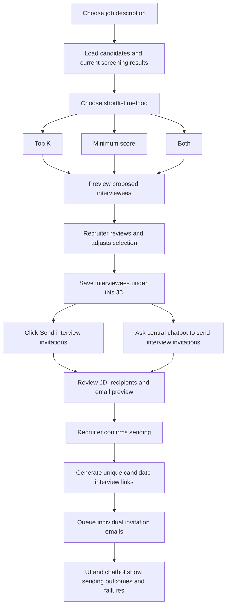

# Daily Work — 12 October 2026

## Today's objective

Build interviewee shortlisting so a recruiter can choose a job description, review the candidates who applied for it, and select recipients. Let the recruiter send invitation emails through either a button in the Interviews UI or the central chatbot, generating a unique interview link for each selected candidate application.

**Current status:** shortlist preview backend and preview fingerprint implemented; focused filtering/route tests and fingerprint checks passed. Screening-results readability refactor completed. Saved-selection tables applied and schema verified. Save-request schema and save/load selection service added with syntax checks. Save/load API routes, dedicated selection-service/database/concurrency tests, Interviews UI, unique links, email delivery and chatbot invitation tools remain pending.

This file tracks today's scope and progress. The broader project baseline is in [PROJECT_PROGRESS.md](PROJECT_PROGRESS.md).

## Requested feature

The recruiter should be able to:

1. Choose one of their saved job descriptions.
2. View the candidates/applications under that JD, with their screening scores and ranks.
3. Generate a proposed shortlist using **top K**, **minimum score**, or **both**.
4. Review the proposed interviewees and choose the final recipients.
5. Keep the final selection associated with the chosen JD for sending interview links.
6. Use a **Send interview invitations** button in the Interviews UI or ask the central chatbot to email invitations to the selected interviewees for a specific JD.
7. Review the recipients and invitation message, then confirm sending through the chosen UI or chatbot flow.
8. Receive a unique interview link per candidate application and track each email's sending outcome.

Filtering proposes interviewees; the recruiter makes the final selection.

Shortlisting belongs in the Interviews UI and its backend API; today's scope does not require a chatbot tool for shortlisting. After the final selection has been saved, invitations can be initiated through either the UI button or the central chatbot. Both paths use the same backend invitation service, recipient/message preview, confirmation rules, sending queue and status records.

## Working agreement

Before adding or changing code, explain what it does, which existing files/functions it connects to, and how data flows through the change. Show the proposed file or edits for review, then wait for the recruiter/developer's explicit instruction to add them. Keep implementation readable and proceed in small steps. Documentation updates can be made when requested.

## Proposed user flow

## Filter behavior

The following are proposed implementation defaults. Update them if the recruiter workflow requires different behavior.

| Method | Input | Proposed behavior |
| --- | --- | --- |
| Top K | Positive whole number K | Select up to K eligible candidates, ordered by overall screening score descending |
| Minimum score | Score from 0 to 100 | Select all eligible candidates whose overall score is greater than or equal to the threshold |
| Both | K and minimum score | First keep candidates meeting the minimum score, then select up to K of them |

Example: scores are **92, 86, 81, 74, 65**.

| Rule | Proposed shortlist |
| --- | --- |
| Top 3 | 92, 86, 81 |
| Minimum 80 | 92, 86, 81 |
| Top 2 and minimum 80 | 92, 86 |
| Top 4 and minimum 80 | 92, 86, 81; do not fill remaining slots below the threshold |

### Eligibility and edge cases

- Use the existing overall screening score, comparing its full precision before display rounding.
- Use current, completed assessments for the selected JD. Failed, unfinished, missing-score or outdated assessments do not qualify for automatic filtering.
- Display excluded applications with a reason so the recruiter can see why they were not proposed.
- Top K means at most K candidates, rather than every candidate whose shared rank is at most K. Reuse the existing stable application-ID ordering for equal scores, and show ties at the cutoff for review.
- If fewer than K qualify, select the available qualifying candidates and show the resulting count.
- An empty result is valid; show that no candidates meet the rule.
- Require K to be a positive integer and the score threshold to be within 0–100. Zero is a valid threshold.
- Keep candidates scoped to the chosen JD and authenticated recruiter.
- Allow manual additions/removals among eligible candidates and show the final count before saving.
- Switching jobs must load that job's saved selection or reset the unsaved preview; candidates from another job must never carry over.
- Recheck screening freshness and ownership when saving. If inputs changed after preview, refresh the shortlist before confirmation.
- Treat selection as belonging to a candidate application for a JD. The same person can apply to multiple jobs independently.

## Existing functionality to reuse

| Existing capability | Source | Use in this feature |
| --- | --- | --- |
| Saved JD list | [JD API](../backend/app/jd.py), [JD list UI](../frontend/src/features/jd/MyJobDescriptions.tsx) | Job selection |
| Candidate/application storage and listing | [Models](../backend/app/models/cv.py), [CV source API](../backend/app/cv_routes.py) | Candidates under the chosen JD |
| Current ranked screening results | [Screening service](../backend/app/services/cv/screening.py) | Scores, stable ordering and assessment eligibility |
| Scoring and tie handling | [Scoring service](../backend/app/services/cv/scoring.py) | Existing score semantics |
| Evidence and score breakdown UI | [CV results](../frontend/src/features/cv/CVResults.tsx) | Recruiter review before selection |
| Interviews navigation placeholder | [Application routes](../frontend/src/app/App.tsx) | Proposed location for job-scoped interviewee selection |
| Central assistant and tool routing | [Assistant graph](../backend/app/workflows/assistant/graph.py), [Assistant tools](../backend/app/workflows/assistant/tools.py) | Invitation preview, confirmation, sending and status tools |

No new AI scoring is needed for shortlisting. The filter uses the screening results already produced by the project.

## Implementation checklist

### Backend and persistence

- [x] Define initial preview request and response shape: JD, filter mode, K, minimum score, proposed applications, count and exclusion reasons.
- [x] Implement validated filtering against the current ranked results returned by the existing screening service.
- [ ] Extend preview to include applications never assessed, explicitly handle missing scores, and show ties at the cutoff for review.
- [x] Add saved-selection models and migration associated with the JD/application and recruiter; import models in Alembic's environment.
- [x] Apply the migration to PostgreSQL and verify the actual schema. Applied by the developer; revision, columns, foreign keys, unique constraints and indexes checked.
- [x] Add service code to persist selection provenance: screening assessment/run, score snapshot, filter inputs and manual additions/removals. Dedicated persistence tests pending.
- [x] Add authenticated preview operation and register its router in FastAPI.
- [x] Add `SaveShortlistRequest` with filters, preview key, final application IDs and duplicate-ID validation; syntax checked, dedicated validation tests pending.
- [x] Return a preview fingerprint bound to recruiter, JD, run, filters, ranked/incomplete assessments and warnings.
- [x] Add `load_shortlist()` service to read saved members, candidate details and outdated indicators; syntax checked, behavioral/database tests pending.
- [x] Add `save_shortlist()` with preview-key comparisons, ownership/membership/eligibility validation and reuse of existing member records; syntax checked.
- [ ] Expose authenticated save/load API routes.
- [ ] Verify save-time ownership, job membership, eligibility and freshness, including concurrent screening changes.
- [ ] Verify repeated saves are idempotent and prevent duplicate interviewees for a job.

### Unique interview links and email delivery

- [ ] Add invitation records associated with recruiter, JD, candidate application and confirmed recipient email.
- [ ] Generate cryptographically random, unguessable links unique to each application/invitation; never share one link across the shortlist.
- [ ] Define a reachable candidate interview entry page and backend token validation so emailed links open a working destination.
- [ ] Store token verification data securely, enforce configured expiry/revocation, and keep raw tokens out of logs and general chatbot history.
- [ ] Add an email-provider integration with configured sender identity and credentials.
- [ ] Build individual candidate emails containing the job title, interview instructions and that candidate's unique link.
- [ ] Persist a durable sending queue with per-recipient status, attempts, safe error codes and provider message IDs.
- [ ] Expose shared authenticated invitation preview, confirmed-send and status operations for both the UI button and chatbot tools.
- [ ] Prevent duplicate sends from repeated button clicks, chatbot calls or confirmation requests across both paths; retry failed sends against the existing invitation.
- [ ] Treat uncertain provider outcomes separately from definite failures to avoid blind duplicate sends.
- [ ] Support explicit resend/reissue behavior; invalidate superseded links when issuing a replacement.
- [ ] Distinguish queued, provider-accepted/sent, failed and uncertain outcomes. Claim delivered only if the provider confirms delivery.

### Central chatbot orchestration

- [ ] Add assistant tools for invitation preview, confirmed send, status lookup and failed-send retry.
- [ ] Resolve the selected JD and persisted interviewees; clarify ambiguous job references before preparing invitations.
- [ ] Example request: "Send interview links by email to the shortlisted candidates for JD 3."
- [ ] Present job title, selected candidate names/emails, recipient count, subject and email content before sending.
- [ ] Bind recruiter confirmation to the exact recipient/message preview; require a fresh preview if selection, email addresses or interview settings change.
- [ ] Validate recruiter ownership and saved selection server-side for every tool invocation.
- [ ] Return batch and per-recipient outcomes in chat, including actionable failures and retry options.
- [ ] Keep shortlist saving separate from sending; only a confirmed send action through the UI or chatbot queues emails.

### Frontend

- [ ] Replace the Interviews placeholder with the initial interviewee-selection workspace.
- [ ] Add JD selection and candidate/results loading.
- [ ] Add Top K, Minimum score and Both filter modes with input validation.
- [ ] Show preview count, names, scores, ranks and evidence/review details.
- [ ] Add candidate checkboxes, manual adjustments and final selected count.
- [ ] Save and restore the job's selected interviewees.
- [ ] Handle no jobs, no candidates, no current screening results, no matches, loading and API errors.
- [ ] Add a **Send interview invitations** button for the chosen JD's saved interviewees, with recipient/message preview and explicit confirmation before queueing emails.
- [ ] Show invitation status alongside saved interviewees and support both UI and chatbot preview/confirmation flows.

### Verification

- [x] Test top K, inclusive score threshold and combined filtering with sample screening results.
- [x] Test ties, fewer-than-K matches, zero threshold and full-precision score comparisons.
- [x] Test invalid filter inputs and exclusion reasons for failed/outdated assessments using sample results.
- [ ] Test missing-score and never-assessed applications explicitly.
- [x] Test FastAPI preview authentication, recruiter role, HTTP validation and forwarding of service ownership rejection with a fake user store and mocked preview service.
- [x] Run ad hoc preview-key checks for format, repeatability, incomplete-assessment order stability, and score/filter/status changes. Persistent regression coverage remains to add.
- [ ] Test save-request validation and load-service behavior, including absent/empty selections, ownership and stale assessment references.
- [ ] Test recruiter ownership, cross-job selection rejection and changed results after preview.
- [ ] Test persistence, duplicate saves and restoring selections after reload.
- [ ] Test unique links across candidates and jobs, token validation, expiry, revocation and replacement.
- [ ] Test chatbot JD resolution, recipient preview, confirmation and changed-preview rejection.
- [ ] Test the UI button's invitation preview/confirmation flow and duplicate-send prevention when both UI and chatbot initiate the same invitations.
- [ ] Test repeated tool calls, duplicate confirmations, queue restart recovery, partial email failures and retry behavior.
- [ ] Verify every email contains only its intended candidate's link; test missing/invalid recipient emails and provider configuration errors.
- [ ] Verify provider acceptance is not reported as confirmed delivery.
- [ ] Use a test email transport or controlled test inboxes for verification and record results.
- [ ] Verify the recruiter flow in the UI and run the relevant frontend/backend checks.

## Acceptance criteria

- The recruiter can select an owned JD and see only its candidates.
- All three automatic shortlist modes produce the defined eligible set.
- The recruiter can review and adjust the proposed interviewees before saving.
- The final interviewee list persists under the selected JD and reloads correctly.
- Invalid, stale and cross-job selections cannot be saved.
- The recruiter can send interview links to the saved interviewees for a chosen JD through either the **Send interview invitations** UI button or the central chatbot.
- Both flows preview the exact recipients and invitation content before the recruiter confirms sending.
- Each selected candidate application receives its own unique link in an individual email, opening a working interview entry page.
- Sending outcomes persist and are visible through the chatbot and interviewee list.
- Repeated requests do not silently duplicate invitations; failed sends can be retried with clear outcomes.
- Expired, revoked or replaced links cannot open an active interview session.

## Confirmed delivery scope and remaining configuration

Confirmed for today's plan: **unique interview links**, sent **by email**, initiated through either a **Send interview invitations button in the Interviews UI** or the **central chatbot**, to the recruiter's selected interviewees under a chosen JD. Both entry points share the same backend invitation service and require recipient/message review and confirmation before sending.

Configuration/product details still to settle during implementation:

- Email provider/SMTP service, sender address and credentials.
- Public application URL and interview entry-page behavior.
- Interview type, instructions, scheduling information and link expiry duration.
- Final email subject/body and resend/reissue policy.

Full interview execution and assessment remain separate project scope unless added explicitly. Today's link destination must still provide a functional entry experience consistent with the interview flow that is available.

## Today's progress log

| Item | Status | Evidence / next step |
| --- | --- | --- |
| Today's feature request and user flow | Documented | JD-scoped selection plus unique interview links emailed through either the UI button or central chatbot |
| Filtering semantics and edge cases | Initial backend implemented | Top K, inclusive minimum score and combined filtering tested; never-assessed applications, missing scores and cutoff-tie display remain to address |
| Existing implementation review | Completed, static review | Confirmed reusable JD, application, score and ranked-result components |
| Screening-results readability | Implemented; focused tests passed | Three small helpers extracted in `get_screening_results()`; API response and existing behavior retained |
| Shortlist preview backend | Implemented; focused tests passed | `shortlisting.py` uses existing screening results and returns `preview_key`; `interview_routes.py` exposes `POST /interviews/jobs/{job_id}/shortlist/preview`; router registered in `main.py` |
| Saved-selection database definitions | Applied; schema verified | Developer applied the migration. Database is at `e7c142d9a630 (head)`; both tables, expected columns, foreign keys, unique constraints and indexes verified |
| Save-request contract | Added; syntax checked | `schemas.py` reuses filter validation, requires a 64-character hexadecimal preview key and UUID application IDs, and rejects duplicate IDs; service/API integration pending |
| Load-selection service | Added; syntax checked | `selections.py` loads saved members with candidate names/emails and compares saved run, assessment, score and rank against current results; no load route or behavioral tests yet |
| Save-selection service | Added; syntax checked | `save_shortlist()` compares previews before writing and before commit, rechecks membership/ownership, stores final choices and snapshots, and reuses member records. Dedicated persistence/concurrency tests pending |
| Save/load endpoints | Pending | Expose the services to the frontend through authenticated routes |
| Interviews UI | Pending | Placeholder still present; connect JD selection, preview, manual adjustments and save/load |
| Verification | Focused checks passed; persistence/UI checks pending | 25 tests passed across four suites; shortlist suite rerun after preview-key change; ad hoc fingerprint checks and live schema inspection passed. No saved-selection persistence or UI verification yet |
| Interview-link sending | Planned; requested scope recorded | Unique per-candidate links and email delivery initiated by either the UI button or central chatbot through shared backend operations; implementation pending |

### Files added or changed on 12 October 2026

| File | Connection to existing code |
| --- | --- |
| [Screening service](../backend/app/services/cv/screening.py) | Refactored freshness checks, parse validation and result formatting into helpers; existing route/frontend continue calling the same function |
| [Shortlisting service](../backend/app/services/interviews/shortlisting.py) | Validates filters and consumes `get_screening_results()`; returns proposed assessed applications, exclusions and a preview fingerprint using existing `indexing.digest()` |
| [Selection request schema](../backend/app/services/interviews/schemas.py) | Reuses `ShortlistRequest` and defines final application IDs plus the reviewed preview key for the future save service |
| [Selection service](../backend/app/services/interviews/selections.py) | Save/load functions use existing ownership/screening helpers, preview key, shortlist models and candidate/application models; no save/load routes yet |
| [Interview routes](../backend/app/interview_routes.py) | Uses existing recruiter authentication to call the shortlist preview service |
| [FastAPI application](../backend/app/main.py) | Registers the interview router beside existing feature routers |
| [Interview models](../backend/app/models/interviews.py) | Defines one saved shortlist per JD and unique application members, linked to existing jobs, users, screening runs, applications and assessments |
| [Shortlist migration](../backend/migrations/versions/e7c142d9a630_add_interview_shortlists.py) | Creates the two model tables, foreign keys, unique constraints and indexes when applied |
| [Alembic environment](../backend/migrations/env.py) | Imports the interview models so Alembic recognizes their metadata |
| [Screening-results tests](../backend/tests/test_cv_screening_results.py) | Regression tests using mocked database/model dependencies |
| [Shortlisting tests](../backend/tests/test_shortlisting.py) | Sample screening responses exercise filtering, precision, ties, exclusions and validation |
| [Interview route tests](../backend/tests/test_interview_routes.py) | Isolated FastAPI app uses real auth dependencies/JWT handling with a fake user store and mocked preview service |

### Verification recorded on 12 October 2026

Commands were run from `backend/` using its existing virtual environment. Async test suites required execution outside the filesystem/network sandbox because Windows asyncio's local event-loop socket was blocked inside it.

| Command | Result |
| --- | --- |
| `.\.venv\Scripts\python.exe -m unittest discover -s tests -p test_cv_screening_results.py` | PASS — 8 tests |
| `.\.venv\Scripts\python.exe -m unittest discover -s tests -p test_cv_scoring.py` | PASS — 3 tests |
| `.\.venv\Scripts\python.exe -m unittest discover -s tests -p test_shortlisting.py -v` | PASS — 7 tests |
| `.\.venv\Scripts\python.exe -m unittest discover -s tests -p test_interview_routes.py -v` | PASS — 7 tests |
| `.\.venv\Scripts\python.exe -m alembic heads` | PASS — single repository head `e7c142d9a630` |
| `.\.venv\Scripts\python.exe -m alembic upgrade d6f120c8a941:e7c142d9a630 --sql` | PASS — generated PostgreSQL DDL for both tables and revision update; no database changes made |
| `.\.venv\Scripts\python.exe -m alembic current` | PASS — live database revision is `e7c142d9a630 (head)` after developer applied migration |
| Read-only SQLAlchemy schema inspection | PASS — both shortlist tables exist; columns, foreign keys, unique constraints and indexes inspected; required table links and duplicate-prevention constraints asserted |
| Shortlisting test suite rerun after adding `preview_key` | PASS — same 7 tests; does not increase the unique test count |
| Ad hoc preview-key checks with mocked screening results | PASS — hexadecimal key length, identical results, reordered incomplete assessments, changed score, changed filters and changed assessment status |
| Selection-service AST syntax check and shortlisting suite rerun after adding save | PASS — selection file parses and existing 7 filtering tests pass; save/load behavior itself not tested |

Python AST syntax checks also passed for the shortlisting service, interview routes, FastAPI registration, interview models, save-request schema and save/load selection service. These checks do not establish saved-selection persistence or a working recruiter UI. Route tests verify propagation of an ownership rejection, not real PostgreSQL ownership queries. The schema inspection confirms the storage exists; save/load behavior and save-request validation still need dedicated tests. Save uses the existing per-job advisory lock, but screening workers do not share that lock; the second preview comparison is not yet verified against concurrent worker changes.

### Remaining work assessment

The shortlist backend foundation is in place, but the full recruiter flow is not usable yet. Most of today's complete scope remains, particularly the UI and invitation subsystem. File counts and passing test counts are not completion percentages.

| Remaining work block | Scope |
| --- | --- |
| Finish shortlist backend | Verify save/load behavior, current-preview comparison, ownership/membership/eligibility, provenance, duplicate prevention and concurrency; expose save/load routes; close preview edge cases; test request validation and real persistence |
| Build Interviews workspace | JD selection, candidate/evidence review, filters, checkboxes, saved selection restore, stale-state handling and errors |
| Build unique interview links | Invitation records/migration, secure token generation and verification, expiry/revocation/replacement, working candidate entry page |
| Build email delivery and controls | Settle provider/sender/public URL/instructions/expiry; individual messages, durable queue, retries and outcome tracking; shared preview/confirmation API used by UI button and chatbot |
| Complete integration verification | Recruiter UI flow, candidate links, controlled email transport, confirmation changes, duplicate prevention across both entry points and queue recovery |

### Next step

Migration/schema verification, save-request schema, preview key and save/load services are added at their recorded verification levels. Next, review/add dedicated selection-service and database tests, including stale/cross-job rejection, empty selections, repeated saves and concurrency. Then review/add authenticated save/load routes before building the Interviews UI. Explain each change and obtain approval before adding code.

Update this log as work progresses; mark implementation and verification separately.
