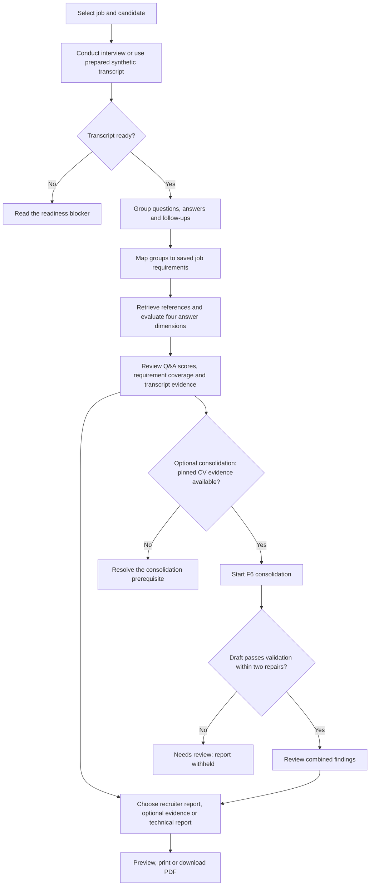
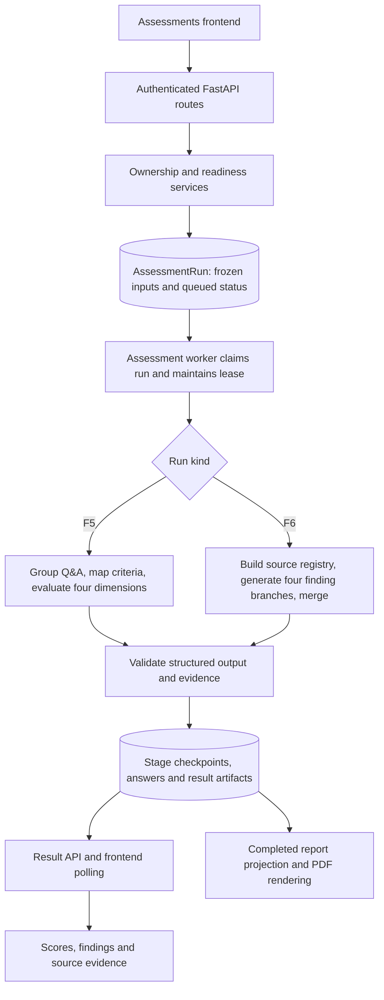

# Milestone 3 — AI Interview Analysis: User Journey and Code Flow

**Milestone date:** 19 October 2026  
**Code reviewed:** 21 October 2026 (Asia/Dhaka)  
**Milestone flow:** Interview → Transcription → Q&A Analysis → Requirement Mapping → AI Evaluation  
**Supporting review flow:** Review source evidence and requirement coverage → optionally consolidate with the saved CV assessment → preview, print or download a report

Read **Part 1** as a recruiter using the application. Read **Part 2** to follow the same information through the frontend, API, database, worker and AI workflows. The five milestone stages above are the primary scope; consolidation and reports are supporting sections. Section 13 records earlier local synthetic consolidation verification; sections 14–16 retain the workspace/report observations and checks from 19 October. Section 17 records the documentation review on 21 October. Historical synthetic results do not establish real-device capture quality or scoring accuracy.

## Part 1 — Follow the flow as a user

### Step 1 — Choose the job and candidate

Sign in as the recruiter who owns the job. Open **Interviews**, select the job, and choose a candidate from its saved interview selection. The job's approved screening criteria describe what the interview will be assessed against. An existing saved CV screening result is needed later to combine CV evidence with interview findings.

The historical local example in this guide is **JD 205 → Mahmuda Akhter — synthetic test**, with a short, invented transcript. Use it only if it remains available in the local database; otherwise choose a current candidate with a finalized transcript or an available synthetic sample. The example is not evidence of Mahmuda's real statements or qualifications.

### Step 2 — Conduct the interview

For a real interview, the recruiter opens the interview session and the candidate enters through their invitation link. Both check their camera and microphone. The candidate waits for admission; after admission, both join the interview room. The recruiter asks questions and the candidate answers, including any follow-ups or clarifications.

While the interview is running, the application captures each participant's microphone separately and displays saved speech text. Ending the interview completes the session, but a completed call alone does not make the transcript ready for analysis.

For the prepared synthetic example, skip this step and use the transcript already attached to the candidate's completed test session.

### Step 3 — Check that the transcript is ready

Open **Assessments** and select the same job. The candidate table shows separate **Interview**, **Transcript**, **Q&A analysis** and **Assessment** statuses. It displays five candidates per page; use Previous/Next for more candidates and scroll the page when needed. Search, status filters, metrics and displayed counts apply to the loaded candidate page.

The application checks that the session is completed, both speakers have usable saved speech, and the transcript has finalized content with a matching digest. A transcript can be finalized with validated common timing, or as saved text with explicit timing limitations. If analysis is blocked, read the candidate's explanation. Visible speech text alone is not proof of analysis readiness. Sample analysis and saved runs remain available under **Sample analysis and saved run history**.

**Current finalization behavior:** ending capture attempts automatic transcript finalization. Valid measured audio clocks produce aligned session times. If those checks cannot establish reliable timing, valid saved text can be finalized with `TEXT_ONLY_FINALIZED`; the UI discloses unknown common timestamps and unverified cross-speaker chronology. Empty or single-speaker saved text remains blocked from Q&A analysis. Real-device capture, recognition quality and semantic assessment still require acceptance testing.

### Step 4 — Start or open Q&A analysis

For a ready candidate with no saved run, click **Start Q&A analysis**. The application creates an F5 run or reuses an identical saved run. Existing runs instead offer an action such as **Open Q&A analysis**, **View progress**, **Review draft** or **View saved run**. The expanded **Sample analysis and saved run history** section offers **Analyze sample** when its local fixture files are installed.

The application groups the conversation into questions and answers, connects each group to the job requirements, and evaluates the answers. Follow-ups and later returns to an earlier answer remain with the relevant question. The page updates as complete answer groups are saved. Four questions generally need fewer evaluation calls than a long interview, but provider pacing and repairs also affect processing time.

**How the Q&A is paired:** the AI reads the full transcript and identifies the original question behind each answer. It does not simply pair each interviewer line with the next candidate line. One question can span several transcript segments, and its answer can include several replies, follow-ups and a later correction. A candidate asking “What do you mean?” is clarification, not a new interviewer question. If the recruiter returns to an earlier topic, the resumed answer goes back into that original group.

The code checks the proposed grouping before scoring. Every segment must belong to one group with a defined role, or be excluded with a reason such as greeting, logistics or closing. See **Part 2, section 6: How Q&A pairing works**, for a worked example and the exact code flow.

### Step 5 — Review what the candidate actually answered

Open the candidate's Q&A analysis or select the F5 history entry. Expand **Question, answer and follow-ups** to read a group, then **Score explanations and evidence** to understand its scores:

| Score | What you are reviewing |
| --- | --- |
| Relevance | Did the answer address the question? |
| Accuracy | Were the claims made correct? |
| Completeness | Did the answer cover what that question requested? |
| Articulation | Was the answer understandable and coherent in the transcript? |

These are scores for the answers to the questions asked. They are not general ratings of every skill in the job description. For example, a correct answer about handling a failed JavaScript request can receive full marks even if the candidate also admits they have not written browser tests.

Click **View transcript** to jump to the supporting words. Review the requirement coverage as well: **Not asked** means the interview did not explore that requirement, not that the candidate failed it. **Not assessed** means there was not enough assessable evidence; it is different from zero.

### Step 6 — Consolidate the saved results

After F5 completes, review its scores and source evidence. For a real candidate, confirm the review checkbox, then click **Generate consolidated assessment**. A synthetic entry instead offers **Consolidate synthetic sample**.

This starts F6, which combines the exact saved CV assessment with the selected F5 result. It keeps CV scores and interview scores separate. If consolidation is unavailable, the page explains the missing prerequisite, such as unavailable pinned CV evidence.

### Step 7 — Review the combined findings

Select the F6 entry. When it completes, read the suitability rationale and these four sections:

| Section | What it tells you |
| --- | --- |
| Strengths | Positive observations supported by CV or interview evidence. |
| Observed weaknesses | Supported mismatches or poor answer performance. |
| Evidence gaps | Information that is missing, unasked or not assessable. |
| Recommended areas to verify | Practical follow-up checks, including admitted learning needs. |

Open **Supporting evidence** beneath a finding to inspect its sources. Use **View original F5 analysis** to return to the answer scores. A learning need should not become a claim that a correctly answered question was answered badly. The conclusion remains provisional and needs human review; the system does not make an automatic hiring decision.

If the result says **Needs review**, the model's draft did not pass validation after two repair attempts. The error explains the failure where available. The draft report remains withheld rather than being presented as validated. The **Synthetic sample** warning itself does not prevent a successful result or download.

### Step 8 — Preview, print or download the candidate report

On a completed analysis or consolidated assessment, the **Candidate report** controls default to **Recruiter report**. Choose the format before using **Preview report**, **Print** or **Download PDF**. A report opened directly from the interview analysis can omit CV/consolidation findings and explain their absence. Browser printing can offer Save as PDF through the browser's own dialog.

| Option | Contents |
| --- | --- |
| Recruiter report — default | Candidate/job summary, separate CV and interview scores with assessed counts, selected key findings, follow-up topics, every requirement's coverage and a compact Q&A score overview. |
| Include evidence appendix | Adds deduplicated saved source text and evidence references to the recruiter report. Interview turns are reproduced in full in the appendix. |
| Full technical report | Retains all saved Q&A, detailed findings, complete transcript, source/provenance details and evidence appendix. The appendix checkbox is disabled because evidence is already included. |

The verified JD 205 synthetic example produces **two pages by default** and **three with the evidence appendix**. These are observed page counts, not a fixed limit for all candidates. The default report omits the full transcript, long score explanations and technical identifiers. Display scores are rounded to one decimal where needed; saved scores are unchanged, missing scores stay distinct from zero, and CV/interview scores are never combined.

For a text-only transcript, the source/technical report retains the timing limitation: saved order is a reading aid rather than verified cross-speaker chronology. Missing common timestamps must not be interpreted as measured interview times.

The controls require the selected assessment to be completed. Selecting an older failed F6 entry keeps them disabled even if a newer F6 entry for the same person has succeeded. Report viewing, printing and PDF export use saved results without model calls or database writes. Browser printing opens the browser's print dialog; downloading uses the server PDF renderer. Both use the selected report projection.



## Part 2 — Follow the same information through the code

Read each flow below from the first function to the visible result. Indentation shows the next call or value used. A line labeled **background worker** or **frontend request** crosses an execution boundary; it is not a direct Python call. The numbered sections then explain the checks and data involved.

#### Invitation link: where the public interview URL comes from

```text
delivery.confirm_invitations()
    → invitations.create_invitation()
    → invitations.new_link()
    → get_settings().public_app_url
    → "https://<cloudflare-host>/interview#<invitation-token>"
```

This is the create/reissue branch of confirmation. [delivery.py](../backend/app/services/interviews/delivery.py) first checks the owning recruiter, reviewed preview, expiration and unchanged recipients/message. It calls `create_invitation()` for each recipient needing a new link. A retry of an existing failed email reuses the encrypted message instead of generating a new link; confirming an already confirmed batch queues nothing extra.

In [invitations.py](../backend/app/services/interviews/invitations.py), `create_invitation()` checks that the candidate belongs to the job's saved shortlist and that their email still matches the reviewed recipient. It then calls `new_link()`, stores the token's SHA-256 hash and expiration, and returns the invitation record and raw link to the delivery service. Explicit reissue replaces the saved hash, invalidating the previous token.

`new_link()` reads `public_app_url` from [core/config.py](../backend/app/core/config.py), validates the base URL, removes its trailing slash and appends `/interview#` plus a token from `secrets.token_urlsafe(32)`. The token expires after the configured `interview_link_days`. The example above assumes the backend is configured with `PUBLIC_APP_URL=https://<cloudflare-host>`; Cloudflare's hostname is configuration, not something this function discovers. The local default is `http://localhost:5173`. Environment settings and the repository-root `.env` configured by `PROJECT_ROOT / ".env"` supply the value through `get_settings()`.

The link then travels through a separate delivery path:

```text
invitations.create_invitation() returns (invitation, link)
    → delivery.confirm_invitations() substitutes {interview_link} in the email body
    → delivery.encrypt_message() stores the private email payload
    → InvitationEmailJob.status = "queued"
    → transaction commits; response reports queued email count
```

Queueing is not proof of email delivery. The raw link stays in the private encrypted email payload rather than general recruiter/chat responses. The fragment after `#` is not included in the browser's initial HTTP URL request, but the frontend reads it and sends the token explicitly for validation:

```text
InterviewEntry() reads window.location.hash.slice(1)
    → POST /api/interviews/entry with { token }
    → invitations.validate_entry()
    → invitations.valid_invitation()
    → token_hash(token) matches an active, unexpired invitation
    → candidate sees job instructions and the interview waiting/join flow
```

Entry validation does not admit the candidate to the call. The session admission and room-credential checks described in section 3 still apply.

#### Candidate list: where the four status columns come from

```text
AssessmentWorkspace() → api.loadWorkspace()
    → GET /assessments/jobs/{job_id}?offset=0
    → assessment_runs.workspace()
    → five owned candidates + latest F5/F6 per candidate + transcript readiness
    → workspace.ts: candidateRows() → filterRows()
    → CandidateWorkspace(): statuses, row action and Previous/Next
```

The backend reads current stages independently of the latest-50 history list. Named synthetic runs use `inputs.test_application_id` to reach their candidate row. The frontend turns each stage into its own label; it does not infer a completed assessment from a completed interview. See section 14 for pagination and selection limits.

#### F5: from a click to saved answer scores

```text
AssessmentWorkspace.act() → api.startF5()
    → POST /assessments/jobs/{job_id}/f5
    → assessment_runs.start_run()
    → freeze validated inputs and queue AssessmentRun

background worker: assessment_worker.process(claim)
    → build_interview_analysis_graph().ainvoke(...)
    → nodes.load_transcript() → analysis.prepare_input()
    → nodes.segment_qa_pairs() → analysis.segment_questions()
    → nodes.classify_requirements() → analysis.classify_groups()
    → nodes.prepare_answer() → accuracy_references.prepare_references()
    → dimension evaluation nodes → analysis.evaluate_dimension()
    → saved answers, coverage and final artifact → assessment_store.finish()

frontend request: RunDetails() → api.loadResult()
    → GET /assessments/runs/{run_id}/result
    → assessment_runs.run_result()
    → AnswerCard(): question, answer, four scores and source evidence
```

The HTTP request queues work; the worker runs the model stages later. The frontend polls saved status/results. Sections 5–9 explain preparation, grouping, mapping, evaluation and checkpoint storage.

#### F6: combine the reviewed interview with the pinned CV

```text
AssessmentWorkspace.consolidate() → api.startF6()
    → POST /assessments/runs/{f5_run_id}/f6
    → consolidation_runs.start() → consolidation_runs.load_bundle()
    → pin completed F5 + exact CV assessment → queue F6 AssessmentRun

background worker: assessment_worker.process(claim)
    → build_consolidation_graph().ainvoke(...)
    → findings and suitability generation → evidence/support validation
    → valid saved assessment, or at most two repairs then Needs review

frontend request: api.loadResult() → assessment_runs.run_result()
    → ConsolidatedAssessment(): findings and separate saved scores
```

F6 preserves its source scores. Validation can withhold a draft even when model generation succeeded. See section 13 for support rules and repair diagnostics.

#### Report: from selected options to preview, browser print or PDF

```text
FullReport.act() → api.loadFullReport(reportType, includeEvidence)
    → GET /assessments/runs/{run_id}/report with selected query options
    → full_report.document() checks ownership, completion and source integrity
    → recruiter_report.assemble() for recruiter, or full_report.assemble() for technical
    → ReportDocument(): preview
    → print action: mount document portal → wait for fonts/layout → window.print()

FullReport.act() → api.downloadFullReport(reportType, includeEvidence)
    → GET /assessments/runs/{run_id}/report.pdf with selected query options
    → full_report.document() → report_pdf.render()
    → PDF response → browser download
```

The helper arguments above show the selected options; the actual API helpers also receive authentication, run ID and an optional abort signal. Both export paths project saved results without model calls or score changes. See section 15 for the options and rendering responsibilities.

Use this map for the corresponding source entry points:

| User action | Frontend entry | API and service | Information passed onward |
| --- | --- | --- | --- |
| Confirm reviewed invitations | Invitation confirmation UI/chat request | `delivery.confirm_invitations()` → `invitations.create_invitation()` → `new_link()` | Configured public application URL plus private token; encrypted email job queued after confirmation. |
| Select job and candidate page | `Assessments()`, `useRecruitmentJob()`, `AssessmentWorkspace()`, `CandidateWorkspace()` | `GET /assessments/jobs/{job_id}?offset=0` → `assessment_runs.workspace()` | Five owned candidates, independent stage statuses, readiness and run history. |
| Join, admit and end interview | `RecruiterInterviewPanel`, `InterviewEntry`, `InterviewRoom` → `sessionApi.ts` | Interview routes → `sessions.py` → `livekit.py` | Session state, role-scoped room credentials and trusted participant identities. |
| Capture and read transcript | `InterviewTranscript.tsx` | `live_transcription.py` → `transcription.py` → `transcripts.py` | Separate microphone streams become saved speaker-tagged text segments. |
| Start analysis | `act()` → `startF5()` in `api.ts` | `POST /assessments/jobs/{job_id}/f5` → `assessment_runs.start_run()` | Finalized transcript, criteria and model settings are frozen in an `AssessmentRun`. |
| Process answers | Frontend polls the run | `assessment_worker.process()` → F5 graph → `analysis.py` | Groups → criterion mappings → four validated evaluations per group → saved summaries. |
| Review F5 | `RunDetails()`, `AnswerCard()` | `GET /assessments/runs/{run_id}/result` → `run_result()` | Answers, explanations, coverage and exact transcript evidence. |
| Start consolidation | `consolidate()` → `startF6()` | `POST /assessments/runs/{run_id}/f6` → `consolidation_runs.start()` | The completed F5 artifact and exact pinned CV evidence become a new F6 run. |
| Review F6 | `ConsolidatedAssessment()` | Same result endpoint → F6 saved artifact | Findings, suitability rationale, separate component scores and source registry. |
| Preview, print or download report | `FullReport.act()` → `loadFullReport()` / `downloadFullReport()`; `ReportDocument()` renders preview/print | `/report` or `/report.pdf` → `full_report.document()` → `recruiter_report.assemble()` for recruiter format → `report_pdf.render()` for PDF | Selected read-only projection of completed, integrity-checked saved results; technical format retains the detailed assembly. |



**Where LLMs run:** F5 grouping, requirement mapping and answer evaluation use the configured model transport. F6 finding branches, suitability merge and repairs use it too. Ownership checks, evidence validation, score arithmetic, database persistence, report projection and PDF rendering run in application code.

### 1. Understand the overall flow

```text
Recruiter and candidate join a LiveKit interview
    ↓
Backend subscribes to each participant's microphone
    ↓
Deepgram returns speech text; final segments are saved
    ↓
Finalize saved content with validated common timing or explicit text-only limitations
    ↓
Recruiter starts F5 analysis in Assessments
    ↓
API saves an assessment run and immutable input snapshots
    ↓
Assessment worker executes the LangGraph workflow
    ↓
Group questions, answers, follow-ups, clarifications and revisits
    ↓
Map each Q&A group to saved job-description criteria
    ↓
Retrieve eligible saved-source reference passages for each group
    ↓
Evaluate relevance, accuracy, completeness and articulation
    ↓
Validate evidence, save answers and calculate dimension summaries
    ↓
Reviewer sees groups, requirement coverage, explanations and source text
```

**Current integration boundary:** live capture records measured PCM timing and attempts finalization after stopping. The finalizer validates audio-stream identity, drain state, timing and saved text; it can finalize attributable saved text with explicit limitations when common timing cannot be established. The analysis API still requires finalized, integrity-checked content and usable speech from both roles. It does not analyze an unfinished capture or invent missing timing. Synthetic fixtures remain a separate demonstration path, not proof of successful real-device capture.

The code calls interview analysis **F5**. **F6** combines saved interview analysis with CV assessment in a separate implemented workflow; see section 13 for its validation rules and the verified synthetic example.

### 2. How the layers fit together

| Layer | Responsibility | Main location |
| --- | --- | --- |
| React frontend | Interview controls, transcript display and assessment review | `frontend/src/features/interviews/`, `frontend/src/features/assessments/` |
| FastAPI routes | Receive HTTP requests and require recruiter authentication | `backend/app/interview_routes.py`, `backend/app/assessment_routes.py` |
| Services | Enforce ownership, validate data, prepare inputs and implement analysis | `backend/app/services/interviews/` |
| LangGraph workflow | Decide stage order, parallel evaluation and failure routing | `backend/app/workflows/interview_analysis/` |
| Worker | Claim queued runs and execute work outside the HTTP request | `backend/app/scripts/assessment_worker.py` |
| SQLAlchemy models | Define durable session, transcript and assessment records | `backend/app/models/` |
| Model integration | Send structured requests to the configured AI provider | `backend/app/integrations/cv_model.py` |

Paths below are relative to the repository root. Links open the corresponding source file from this guide.

### 3. Stage one: Interview

#### Frontend entry points

| File | Functions/components to study | Purpose |
| --- | --- | --- |
| [Interviews.tsx](../frontend/src/features/interviews/Interviews.tsx) | `Interviews()`, `LiveWorkspace()` | Select the recruitment job and render the interview workspace. |
| [RecruiterInterviewPanel.tsx](../frontend/src/features/interviews/RecruiterInterviewPanel.tsx) | `RecruiterInterviewPanel()`, `RecruiterSession()` | Select a candidate and coordinate recruiter session controls. |
| [InterviewEntry.tsx](../frontend/src/features/interviews/InterviewEntry.tsx) | `InterviewEntry()` | Candidate entry through an invitation link. |
| [DeviceCheck.tsx](../frontend/src/features/interviews/DeviceCheck.tsx), [InterviewRoom.tsx](../frontend/src/features/interviews/InterviewRoom.tsx) | `DeviceCheck()`, `InterviewRoom()`, `RoomContents()`, `StageRoom()` | Device selection, LiveKit connection, participant media and call controls. |
| [InterviewStage.tsx](../frontend/src/features/interviews/InterviewStage.tsx) | `InterviewStage()` | Live workspace with video, transcript, assistant, notes and profile. Notes are local screen state and are not saved. |
| [sessionApi.ts](../frontend/src/features/interviews/sessionApi.ts) | `startInterview()`, `admitCandidate()`, `joinRecruiterInterview()`, `joinCandidateInterview()`, `endInterview()` | Typed HTTP helpers for the interview lifecycle. |

#### Backend session lifecycle

Read [sessions.py](../backend/app/services/interviews/sessions.py):

| Function | What it does |
| --- | --- |
| `owned_session()` | Resolve a session within the owning recruiter's job/application scope. |
| `start_interview()` | Create or start the authorized interview session. |
| `recruiter_status()` / `candidate_status()` | Return lifecycle/admission information for the appropriate caller. |
| `admit_candidate()` | Validate the active invitation, persist admission, then start transcription. |
| `candidate_join()` | Require a valid invitation and matching admission before returning room credentials; also ensure capture is started. |
| `recruiter_join()` | Return recruiter room credentials and ensure capture is started when admission exists. |
| `end_interview()` | Move the session to `closing`, stop/flush transcription, close the room, then persist `completed`. Room-closure failures allow a retry. |

[livekit.py](../backend/app/services/interviews/livekit.py) supplies `create_join_token()` and `close_room()`. Participant identities encode the trusted role: `recruiter-{recruiter_id}` and `candidate-{application_id}`. Later capture uses these identities to determine who spoke.

The recruiter and candidate interview layouts also have responsive portrait/landscape handling in [InterviewStage.css](../frontend/src/features/interviews/InterviewStage.css), [InterviewLobby.css](../frontend/src/features/interviews/InterviewLobby.css) and [CandidateInterview.css](../frontend/src/features/interviews/CandidateInterview.css). Video, tools and call controls adapt to narrower screens; this UI behavior does not establish actual-device camera/microphone or network acceptance.

**Learning point:** interview completion and transcript readiness are separate states. Ending a call does not automatically make its transcript ready for AI analysis.

### 4. Stage two: Transcription

#### Capture lifecycle: [live_transcription.py](../backend/app/services/interviews/live_transcription.py)

| Function/class | What it does |
| --- | --- |
| `Capture` | Holds one session's task, stop signal, stream tasks, flags and error state in memory. |
| `start_transcription()` | Start a background capture task unless one is already active for that session. |
| `_run()` | Recheck the active/admitted session, join LiveKit as a subscriber, subscribe to recognized microphone tracks and connect them to transcription. |
| `_follow_microphone().emit()` | Route speech boundaries to `mark_speech_boundary()` and final text to `save_final_turn()` for the current stream. |
| `_follow_microphone()` / `_capture_stream()` | Retry recoverable microphone/provider interruptions with bounded delays; create a new stream identity on reconnect and persist its measured clock and completion state. |
| `capture_status()` | Report connection/listening/stopping status for the UI. |
| `stop_transcription()` | Signal shutdown and wait for bounded cleanup. |
| `_record_stop()` | Persist the stop/error flags, set `finalizing` or `needs_review`, then call `finalize_transcript(..., automatic=True)`. `FINALIZATION_PENDING` is an intermediate flag, not a permanent outcome for every live interview. |
| `shutdown_transcriptions()` | Stop active captures during application shutdown. |

Capture runs in the API process, with an in-memory task registry and durable transcript/audio-stream records. Microphone reconnect handling can preserve the transcript while starting a new stream. The assessment worker also calls `reconcile_finalization()` to revisit finalization after interruptions or restarts. This does not reconstruct speech lost during an outage or guarantee continuous recording.

#### Speech transport: [transcription.py](../backend/app/services/interviews/transcription.py)

`transcribe_microphone(track, role, emit, ...)` reads 16 kHz mono audio from a LiveKit microphone track, sends audio through a Deepgram WebSocket and emits transcript events through the callback. Nested functions send audio, maintain keepalives and receive results. This function does not itself write database records.

Speaker role comes from the authorized participant/track mapping, rather than guessing from the spoken words. Provider timestamps belong to each individual stream; they are not automatically a shared interview timeline.

#### Audio timing and finalization

[audio_timing.py](../backend/app/services/interviews/audio_timing.py) defines `AudioClock`, a 16 kHz PCM sample clock checked against monotonic backend reception time. It measures audio received by the backend, not the participant's original microphone hardware clock. It does not use transcript save order as a timing origin. `InterviewAudioStream` persists the stream origin, sample counts, skew, flags and drain state.

Read [transcript_finalization.py](../backend/app/services/interviews/transcript_finalization.py):

| Function | Responsibility |
| --- | --- |
| `aligned_content()` | Validate stream ownership, speaker identity, measured timing, drained audio, provider text ranges and both speakers before proposing aligned turns. |
| `finalize_transcript()` | Lock the transcript and save finalized content, digest and timestamp. If alignment fails but saved source text is valid, preserve it as text-only content with explicit limitations. Invalid source text fails finalization. |
| `retry_finalization()` | Allow the owning recruiter to retry the latest transcript version after the interview ends. |
| `reconcile_finalization()` | Revisit ended/finalizing records, identify lost capture processes and retry safe finalization. It does not guess missing audio clocks. |

Text-only finalization clears asserted common timestamps and keeps source/speaker identity. Empty text and text containing only one speaker may be finalized as records, but carry readiness flags that block Q&A analysis. Thus **transcript completed** and **usable for interview analysis** remain separate checks.

#### Persistence: [transcripts.py](../backend/app/services/interviews/transcripts.py)

| Function | What it does |
| --- | --- |
| `begin_transcript()` | Initialize or resolve transcript capture for an authorized interview. |
| `save_final_turn()` | Validate and persist a final speech event with source/stream identity. |
| `mark_speech_boundary()` | Mark a saved endpoint to support utterance display. |
| `get_transcript()` | Return the owned transcript snapshot and capture information for the recruiter UI. |

[interview_transcripts.py](../backend/app/models/interview_transcripts.py) defines `InterviewTranscript`, `InterviewTranscriptTurn` and `InterviewAudioStream`: the transcript header, saved speech segments and durable audio-clock/drain records.

#### Display: frontend transcript files

- [InterviewTranscript.tsx](../frontend/src/features/interviews/InterviewTranscript.tsx): `InterviewTranscript()` polls `loadTranscript()` every two seconds, shows capture/errors and renders saved segments with source details. The live snapshot can show the latest 500 segments while earlier segments remain stored.
- [transcriptGrouping.ts](../frontend/src/features/interviews/transcriptGrouping.ts): `groupTranscriptTurns()` combines adjacent compatible same-stream segments for readability, respecting speech boundaries and size/time limits.

**Do not confuse the two grouping operations:** `groupTranscriptTurns()` is a display helper. It does not identify interview questions, map requirements or score answers.

### 5. Bridge to analysis: preparation and readiness

Read [transcript_preparation.py](../backend/app/services/interviews/transcript_preparation.py):

| Symbol | Purpose |
| --- | --- |
| `SourceSegment` | Validate source text, IDs, speaker, stream times and optional session times. |
| `StreamOffset` | Describe an explicitly supplied synthetic stream origin. Its accepted `origin_source` is currently `synthetic_authoring_ground_truth`. |
| `AlignedTurn` | Require session start/end times and an explicit timing basis. |
| `SavedTextTurn` | Retain attributable saved text without asserting shared timestamps; common session times must be null. |
| `saved_text_content()` | Validate saved source identity/content for the text-only path without deriving common timing from database arrival order. |
| `ordered_turns()` | Use session times for aligned input, or saved order as a reading aid for text-only input; saved order is not verified dialogue chronology. |
| `align_segments()` | Add declared stream origins to stream-relative times, preserve overlaps, reject conflicting identities/times and sort aligned turns. Currently supports synthetic declared clocks. |
| `load_fixture()` | Load and validate a synthetic transcript and timeline into a prepared analysis input. |

For aligned content, `session_time_ms = stream_origin_ms + stream_time_ms`. Live capture and finalization supply measured stream origins through `AudioClock` and `InterviewAudioStream`. Database save order cannot substitute for a missing audio-clock mapping. `align_segments()` remains the declared-offset helper for synthetic fixtures; live finalization uses its own persisted-clock validation.

Read [assessment_runs.py](../backend/app/services/interviews/assessment_runs.py):

- `transcript_blocker()` requires completed/finalized metadata and a content digest. It rejects unusable/single-speaker text; timed inputs must also pass blocking capture/timing checks. Explicitly finalized text-only input has its own limitation-aware path.
- `real_prepared()` validates 1–1000 segments, trusted participant identities, both speakers and the saved content digest. It either creates aligned turns from validated timing or uses `saved_text_content()` and records `text_only=True` with a timing warning.
- `start_run()` additionally requires a completed interview session, owned job/application and saved screening criteria. It snapshots the inputs and reuses an existing identical run when available.
- `execution_options()` obtains the configured F5 provider/model limits.

These checks explain why a transcript can be visible in Interviews while **Start Q&A analysis** remains unavailable. In text-only analysis, the prompt explicitly warns against assuming adjacency establishes a question/answer pairing; uncertain attribution must remain unassessed.

### 6. Stage three: Q&A analysis

#### Workflow files

| File | What to read |
| --- | --- |
| [graph.py](../backend/app/workflows/interview_analysis/graph.py) | `build_interview_analysis_graph()` builds the topology; `after_load()`, `after_grouping()`, `after_mapping()`, `after_merge()` and `after_save()` choose the next stage. |
| [state.py](../backend/app/workflows/interview_analysis/state.py) | `InterviewAnalysisState` describes shared fields such as turns, groups, criteria, branch results, coverage and final artifact. |
| [nodes.py](../backend/app/workflows/interview_analysis/nodes.py) | Thin async stage functions call analysis services, update state and route failures. |
| [analysis.py](../backend/app/services/interviews/analysis.py) | Main prompts, semantic validation, evidence checking and model-stage caching. |
| [analysis_schemas.py](../backend/app/services/interviews/analysis_schemas.py) | Pydantic contracts for structured model responses. |

#### The main grouping call chain

```text
nodes.load_transcript() → analysis.prepare_input()
nodes.segment_qa_pairs() → analysis.segment_questions()
                         → analysis.request_validated()
                         → cv_model.generate_json()
```

`prepare_input()` checks readiness, transcript digests, IDs, speakers, criteria and model options. `segment_questions()` asks the model to assign every input turn exactly once to a Q&A group or an allowed exclusion.

Each group contains a root question, candidate answer segments and any follow-ups, clarifications or revisits. A candidate can return to an earlier answer after another topic; the original group must retain that continuation. Greetings, logistics and abandoned incomplete prompts can be excluded with explicit reasons.

The model returns compact ordered assignments. Python rebuilds the actual source-ID lists and validates complete coverage, allowed roles, root questions and revisit responses. Important contracts are `TurnGrouping`, `Grouping`, `QuestionGroup` and `ExcludedTurn`.

#### How Q&A pairing works

The unit being scored is a **conversation group**, not a single adjacent question line and answer line. One group has an original recruiter question and all of the candidate's related answer segments. The model decides which conversation parts belong together; Python validates the structure and reconnects those decisions to the saved source records.

The information moves through these steps:

1. **Prepare source turns.** `prepare_input()` uses `ordered_turns()`: aligned input is ordered by session start/end time and ID; text-only input uses saved order as a reading aid. Each turn retains its speaker and source identity. The model receives saved text rather than raw audio; common timing and cross-speaker chronology may be unknown.
2. **Give turns temporary labels.** `segment_questions()` labels the ordered turns `t001`, `t002`, and so on. The model receives rows containing the label, speaker role, text and session start/end times for the full conversation. These labels are temporary references to real saved turn IDs.
3. **Ask the LLM to identify root questions.** The prompt requests group descriptions such as `g1` and `g2`, each with a topic and answer state. It distinguishes a new question from a probe or return to an existing question. This is semantic grouping performed by the configured F5 model, not keyword matching or fixed alternating-speaker logic.
4. **Assign every turn exactly once.** The model returns one assignment string for each input turn, in the same order. For example, `g1:question` identifies the original question, `g1:answer` identifies part of its answer, and `exclude:closing` marks a closing remark. The model returns assignments rather than inventing database IDs.
5. **Rebuild and validate the groups.** Python zips the ordered labels with the assignments and builds the source-ID lists shown below. It checks assignment count and format, known group IDs, allowed roles, root questions and the handling of responses immediately after a revisit. Invalid grouping goes through the bounded repair path in `request_validated()`; unresolved errors stop the assessment from proceeding as a valid result.
6. **Send each group onward as a whole.** `group_context()` gathers its original question, answers, follow-ups, clarifications and revisits in prepared transcript order. That is chronological for aligned input, but only a reading order for text-only input. Requirement mapping and all four evaluators receive the context with the applicable limitations.

| Assignment kind | Stored group field | Meaning |
| --- | --- | --- |
| `question` | `question_turn_ids` | The recruiter's original question, including separate segments of that initial prompt. |
| `answer` | `answer_turn_ids` | Candidate answer segments, including responses to follow-ups and later extensions of the original answer. |
| `follow_up` | `follow_up_turn_ids` | Recruiter probes of the same question after the candidate starts answering. |
| `clarification` | `clarification_turn_ids` | A candidate's clarification question and the recruiter's clarification reply. |
| `revisit` | `revisit_turn_ids` | The recruiter explicitly returning to an earlier root question. The following candidate answer still uses `answer` in that original group. |
| `exclude:<reason>` | `excluded_turns` | A turn outside an assessable Q&A group, with an allowed exclusion reason. |

#### Worked example: one answer continues after another topic

This is invented dialogue to explain grouping, not a saved candidate transcript. Labels represent individual transcript segments.

| Turn | Speaker and text | Assignment |
| --- | --- | --- |
| `t001` | Recruiter: “How do you validate a product request in Laravel?” | `g1:question` |
| `t002` | Candidate: “Do you mean validating an API request?” | `g1:clarification` |
| `t003` | Recruiter: “Yes, a POST request to create a product.” | `g1:clarification` |
| `t004` | Candidate: “I use a Form Request to validate the name and price.” | `g1:answer` |
| `t005` | Recruiter: “How do you check the category?” | `g1:follow_up` |
| `t006` | Candidate: “I use an exists rule against the categories table.” | `g1:answer` |
| `t007` | Recruiter: “How would you resolve a Git merge conflict?” | `g2:question` |
| `t008` | Candidate: “Compare both changes, discuss the intent, resolve, and test.” | `g2:answer` |
| `t009` | Recruiter: “Back to product creation: what fields do you save?” | `g1:revisit` |
| `t010` | Candidate: “Only the validated fields, with explicit fillable fields on the model.” | `g1:answer` |
| `t011` | Recruiter: “Thank you, that is all.” | `exclude:closing` |

The assignment array has 11 entries in exactly that order. Python reconstructs these groups, translating the temporary labels back to saved turn IDs:

```text
g1 — Laravel product validation
  original question: t001
  answers:           t004, t006, t010
  clarification:     t002, t003
  follow-up:         t005
  revisit:           t009

g2 — Git conflict resolution
  original question: t007
  answer:            t008

excluded: t011, reason=closing
```

The Laravel group is evaluated using the context `t001–t006`, then `t009–t010`. The Git exchange is not included in that group's context. The later Laravel answer does not become a third question just because another topic appeared in between. For scoring evidence, only candidate `answer_turn_ids` can supply quoted answer evidence; interviewer statements and clarification turns provide context rather than proof of candidate performance.

#### Special cases and validation limits

- **Split speech:** multiple transcript rows can belong to one initial question or answer. The frontend's `groupTranscriptTurns()` only improves display readability; F5's `segment_questions()` performs the semantic Q&A pairing.
- **Interrupted and resumed answer:** keep the usable original and resumed answer together. `interrupted` is reserved for a complete question left without a usable answer because of interruption.
- **“I don't know”:** retain the original question and the candidate's explicit response, with `answer_state=explicitly_unanswered`. Do not discard it as chatter.
- **Abandoned incomplete question:** do not invent the missing subject. An unfinished lead-in such as “Could you explain how you would…” can be excluded as `aborted_prompt`, with phone or connection discussion excluded as logistics.
- **Wrong answer:** keep it paired to the question it addresses. Being incorrect does not by itself make the transcript unclear or unrelated.
- **Return to an earlier question:** assign the recruiter return as a revisit and attach the candidate response to that original group. `GROUP_ROOT_MISSING` and `REVISIT_RESPONSE_MISASSIGNED` catch specific invalid structures.

Structural validation cannot prove that every semantic pairing chosen by the LLM is correct. The reviewer should inspect **Question, answer and follow-ups** and the source transcript when a group looks wrong. Grouping runs before scoring; an incorrect grouping can affect the later context, requirement mapping and evaluation.

**Learning point:** Q&A grouping reconstructs the conversation. It does not score the candidate yet.

### 7. Stage four: Requirement mapping

```text
nodes.classify_requirements() → analysis.classify_groups()
                              → request_validated(..., Mappings, ...)
```

`classify_groups()` supplies the saved JD criteria and each group's actual context. `group_context()` selects the group's question, answer, follow-up, clarification and revisit turns in transcript order.

The model maps each group to zero or more supplied criterion IDs. Validation rejects invented criteria, duplicate criterion IDs and missing/duplicate group mappings. The result adds `criterion_ids` to each group.

After answer evaluation, `finalize_coverage()` lists each criterion's linked groups and labels it `explored` or `unasked`. It leaves `performance_score` as `None`.

**Learning point:** mapping means a requirement was explored. A wrong answer can still map to that requirement, and an unasked requirement is not a failed skill score.

### 8. Stage five: AI evaluation

#### Four independent dimensions

| Graph node | Question being judged |
| --- | --- |
| `evaluate_relevance()` | Does the response address the actual question? |
| `evaluate_accuracy()` | Are the technical claims correct? |
| `evaluate_completeness()` | Does the response cover what was requested? |
| `evaluate_articulation()` | Is the explanation coherent in the usable transcript text? |

All four wrappers call `evaluation()` → `analysis.evaluate_dimension()`. [rubric.py](../backend/app/services/interviews/rubric.py) supplies `DIMENSIONS`, `ANCHORS`, `POLICY`, `DIMENSION_GUIDANCE` and `RUBRIC_VERSION`.

#### Per-question RAG before evaluation

`nodes.prepare_answer()` first calls `accuracy_references.prepare_references()`. For new real runs, `start_run()` has already pinned eligible source versions through `snapshot_sources()`. The source scope is the owning recruiter's indexed technical references, company policies and ready, unarchived question banks; it is not automatically restricted to files explicitly attached to this JD. The retrieval query combines the group's question/follow-ups, topic and mapped JD criteria rather than treating the candidate's answer as a search instruction.

[accuracy_references.py](../backend/app/services/interviews/accuracy_references.py) reuses the existing reference-document and question-bank indexes. Retrieved passages are bounded, deduplicated and checkpointed as `references-{group_id}`. Each passage retains source ID, version, filename/location and text; the evaluation receives those saved passages. Replays reuse the checkpoint rather than silently retrieving newer material. Existing runs without the new source snapshot and synthetic fixtures keep their originally supplied references.

Retrieval reports `retrieved`, `partial`, `failed`, `no_relevant_matches`, `no_ready_sources` or `not_needed`. The UI exposes retrieval/reference notes. No match and retrieval failure are different outcomes, and neither proves an answer is wrong. A question-bank passage that contains only a question is not an answer key. The accuracy evaluator must cite actual supporting reference text or disclose model-knowledge limitations; the other three dimensions use transcript evidence without reference citations.

The graph evaluates **one Q&A group at a time**. Within that group, its four dimension nodes run in parallel and write separate state keys. A barrier waits for all four before `merge_evaluation()`. `save_answer()` persists the complete group and increments `group_index`; `after_save()` loops to the next group.

If any dimension is invalid, the merge routes to persistence with a failure/review status. It does not treat an incomplete group as fully evaluated.

#### Scores, nulls and evidence

- Each assessed dimension receives an integer from **0 to 4**. `score_100 = score × 25`.
- `null` means not assessable and is excluded from that dimension's average. Zero remains a valid assessed score.
- For an explicit “I don't know” with answer evidence, completeness is zero; relevance, accuracy and articulation are null. Interrupted or unclear responses receive unassessed handling.
- Articulation judges usable text organization, not accent, personality or audio delivery inferred from text.
- Accuracy can use supplied references or model knowledge. Model knowledge is labeled unverified; personal experience claims are not independently verified by sounding plausible.
- A personal-project self-report without testable technical explanation receives accuracy `null` with `SELF_REPORT_UNVERIFIED`; plausibility of the tools named does not verify the claimed work.

`DimensionEvaluation.valid_result()` enforces compatible scores, reason codes and accuracy bases. `materialize_evaluation()` then requires evidence to quote a uniquely located exact substring of a candidate answer turn in the current group. It adds character offsets, transcript identity and session times. Supplied reference excerpts must also match their reference text.

`dimension_summaries()` computes each dimension separately:

```text
dimension percentage = 100 × sum(assessed scores) / (4 × assessed count)

Example: [4, 2, null] → 100 × 6 / 8 = 75.00
```

There is no single combined hiring score in this F5 summary function.

#### Model calls and validation

`request_validated()` is the shared model-call boundary. It checks cached stages, bounds input size, requests schema-shaped JSON, validates the response and permits an initial attempt plus one schema/semantic repair. Persisted attempt tracking bounds repairs on replay. Transport failures have separate run-retry handling.

[cv_model.py](../backend/app/integrations/cv_model.py) provides `ModelExecution`, `generate_json()` and `model_version()`. Despite the filename, interview analysis reuses this transport. The active F5 provider/model comes from configuration rather than being selected by the grouping function.

The current configured defaults in [core/config.py](../backend/app/core/config.py) are Gemini `gemini-3.5-flash-lite` for interview analysis and consolidation. Environment configuration can override them; each run freezes its execution options and records the resolved model version. The interview-analysis prompt version is currently `interview-analysis-12`.

[gemini_rate_limit.py](../backend/app/integrations/gemini_rate_limit.py) shares a PostgreSQL-backed allowance across Gemini callers and caps it at 12 requests per minute (configuration may lower it). The four graph branches are logically parallel, but provider request starts are paced across processes. Rate-limit cooldowns, transport retries, reference retrieval and bounded validation repairs can extend processing time. A graph's parallel topology does not imply four simultaneous provider requests or a fixed completion time.

### 9. How execution and storage connect

The HTTP start request queues work; it does not run the entire analysis synchronously.

```text
Assessments.tsx → api.startF5()
    → assessment_routes.start()
    → assessment_runs.start_run()
    → saved AssessmentRun
    → assessment_worker.run_once() → store.claim()
    → assessment_worker.process() → graph.ainvoke()
    → nodes.persist_analysis() → store.finish()
    → api.loadResult() → RunDetails() / AnswerCard()
```

| File | Functions/classes | Responsibility |
| --- | --- | --- |
| [assessment_worker.py](../backend/app/scripts/assessment_worker.py) | `run_once()`, `process()`, `keep_alive()`, `main()` | Claim work, recheck source/access/version consistency, execute graph and maintain a lease heartbeat. |
| [assessment_store.py](../backend/app/services/interviews/assessment_store.py) | `claim()`, `leased()`, `heartbeat()` | Give one worker a leased claim and prevent stale workers from writing. |
| Same file | `read_stage()`, `write_stage()`, `save_answer()`, `finish()`, `fail()` | Persist reusable stages, answers, result artifacts and failure/retry state. |
| [assessments.py](../backend/app/models/assessments.py) | `AssessmentRun`, `AssessmentStage`, `AssessmentAnswer`, `AssessmentResult` | Queue/input metadata, stage checkpoints, per-group answers and final result records. |
| [assessment_runs.py](../backend/app/services/interviews/assessment_runs.py) | `workspace()`, `run_status()`, `run_result()`, `retry_run()`, `recover_run()` | Owned review data, retry and recovery operations. |

`stage_read()` and `stage_write()` in `analysis.py` select database storage for queued runs and JSON files for development runs. `nodes.persist_analysis()` builds the result artifact; the worker calls `store.finish()` to save the stored-run outcome. The artifact includes groups, results, coverage, dimension summaries and review warnings. Its `publishable` and `f6_ready` flags are set to false here; F6 has separate readiness checks.

Retry and recovery are distinct. **Retry from saved work** applies to eligible failed runs with attempts remaining and a compatible processing version. **Recover failed evaluation** is a narrower, one-time path for an eligible exhausted score/reason schema conflict: `recover_run()` creates a child run, copies validated checkpoints/answers and retries the affected evaluation with bounded guidance. It retains the original run and diagnostics; it does not generally reset every review failure or recalculate all earlier scores.

### 10. What the reviewer sees and which API supplies it

All routes below require the appropriate access checks. Assessment review uses the owning recruiter's account; this flow does not introduce a separate reviewer role.

| Action | HTTP endpoint | Backend route → service |
| --- | --- | --- |
| Read live transcript | `GET /interviews/jobs/{job_id}/applications/{application_id}/transcript` | `read_transcript()` → `transcripts.get_transcript()` |
| Retry latest transcript finalization | `POST /interviews/jobs/{job_id}/applications/{application_id}/transcript/finalize` | `finalize_saved_transcript()` → `retry_finalization()`; body identifies the transcript version. |
| List candidates and assessment history | `GET /assessments/jobs/{job_id}` | `workspace()` → `assessment_runs.workspace()` |
| Start F5 | `POST /assessments/jobs/{job_id}/f5` | `start()` → `start_run()` |
| Read run status | `GET /assessments/runs/{run_id}` | `status()` → `run_status()` |
| Read results and source data | `GET /assessments/runs/{run_id}/result` | `result()` → `run_result()` |
| Retry saved work | `POST /assessments/runs/{run_id}/retry` | `retry()` → `retry_run()` |
| Recover an eligible failed evaluation | `POST /assessments/runs/{run_id}/recover` | `recover()` → `recover_run()` |
| Start F6 consolidation | `POST /assessments/runs/{run_id}/f6` | `consolidation_runs.start()` |
| Read report document | `GET /assessments/runs/{run_id}/report` | `full_report.document()` |
| Download report PDF | `GET /assessments/runs/{run_id}/report.pdf` | `full_report.document()` → `report_pdf.render()` |

Read [assessment_routes.py](../backend/app/assessment_routes.py) and [interview_routes.py](../backend/app/interview_routes.py) for route definitions.

In [Assessments.tsx](../frontend/src/features/assessments/Assessments.tsx):

- `Assessments()` selects the recruitment job.
- `AssessmentWorkspace()` loads candidates/history and starts, retries or recovers a run.
- `RunDetails()` polls active results, displays progress, summaries, coverage and transcript evidence. Its nested `showEvidence()` opens the transcript and highlights the source turn.
- `AnswerCard()` displays a Q&A group's context, mapped requirements, four scores, explanations and exact supporting quotes.

[CandidateWorkspace.tsx](../frontend/src/features/assessments/CandidateWorkspace.tsx) renders the paginated candidate table and mobile cards. [workspace.ts](../frontend/src/features/assessments/workspace.ts) derives readable statuses, filters, attention flags, row actions and comparison-selection eligibility. [FullReport.tsx](../frontend/src/features/assessments/FullReport.tsx) owns format selection and export actions; [ReportDocument.tsx](../frontend/src/features/assessments/ReportDocument.tsx) renders the selected document for preview and browser print.

[api.ts](../frontend/src/features/assessments/api.ts) defines the frontend contracts and helpers such as `loadWorkspace()`, `startF5()`, `loadResult()`, `retryF5()` and `recoverF5()`. [format.ts](../frontend/src/features/assessments/format.ts) contains `scoreLabel()`, `timeLabel()`, `stageLabel()` and `errorLabel()` for readable values.

### 11. Suggested reading and demonstration order

1. Read `Assessments.tsx` to understand the reviewer's visible output.
2. Follow `startF5()` through `assessment_routes.py` into `assessment_runs.start_run()`.
3. Read the worker's `process()` and then `build_interview_analysis_graph()`.
4. Follow `segment_questions()`, `classify_groups()` and `evaluate_dimension()` in `analysis.py`.
5. Read `analysis_schemas.py` and `rubric.py` to understand validation and scoring.
6. Read `assessment_store.py` to understand durable checkpoints and recovery.
7. Trace the input backward through `real_prepared()`, transcript preparation, capture and session services.

For a review demonstration, show the interview workspace and saved transcript first. In Assessments, choose the job and use the candidate's row action, or expand the analysis tools to select the explicitly labeled synthetic sample. Open a Q&A group, its mapped criteria, dimension explanations and **View transcript** evidence link. Show requirement coverage, including unasked requirements. After consolidation, preview the default recruiter report, enable its evidence appendix, then switch to the full technical report to inspect the complete transcript. Synthetic sample availability depends on fixture files being installed.

Do not present synthetic results as proof of real microphone capture, accurate transcription or correct semantic evaluation. Live finalization and text-only analysis are implemented, but a demonstration must distinguish aligned content from text-only content and disclose any missing speech, timing or uncertain answer attribution.

### 12. Tests to study

These test sources explain the implementation. Execution evidence is recorded separately in sections 13 and 16; this documentation update does not rerun the application suites.

| Test file | What it helps you learn |
| --- | --- |
| [test_interview_sessions.py](../backend/tests/test_interview_sessions.py) | Session authorization, admission and lifecycle behavior. |
| [test_transcript_preparation.py](../backend/tests/test_transcript_preparation.py) | Explicit timing, overlaps, reconnect origins, duplicate detection and refusal to infer offsets from save times. |
| [test_interview_analysis.py](../backend/tests/test_interview_analysis.py) | Group coverage, revisit handling, parallel branches, invalid-output repair, mapping, evidence and null-score arithmetic. |
| [test_assessment_storage.py](../backend/tests/test_assessment_storage.py) | Ownership, immutable inputs, deduplication, worker leases, checkpoint replay, readiness and stored real-input graph execution. |
| [test_assessment_recovery.py](../backend/tests/test_assessment_recovery.py) | Recovering a failed evaluation while preserving earlier validated history and bounded recovery. |
| [test_f5_model_transport.py](../backend/tests/test_f5_model_transport.py) | F5 model transport behavior. |
| [test_consolidation_learning_gaps.py](../backend/tests/test_consolidation_learning_gaps.py) | Question-level scores versus admitted learning gaps, repair diagnostics, schema limits, unchanged source scores and withholding invalid reports. |
| [assessment-display.test.mjs](../frontend/tests/assessment-display.test.mjs) | Assessment labels, score formatting, transcript timing and specific F6 validation messages. |
| [test_assessment_workspace.py](../backend/tests/test_assessment_workspace.py) | Five-candidate pagination, latest stage lookup independent of history, synthetic candidate linkage and truthful stage statuses. |
| [assessment-workspace.test.mjs](../frontend/tests/assessment-workspace.test.mjs) | Candidate row statuses, filtering, actions and eligible selection limits. |
| [test_assessment_report.py](../backend/tests/test_assessment_report.py) | Stored-run report access and detailed technical projection. Requires its database test environment. |
| [test_report_print.py](../backend/tests/test_report_print.py) | Technical report source text, evidence deduplication, criterion coverage, long text pagination and footer labels. |
| [test_recruiter_report.py](../backend/tests/test_recruiter_report.py) | Compact defaults, optional evidence, score rounding/null handling, discrepancy flags, sample page counts and report query validation. |

The distinction to remember throughout the code is **captured text → trusted prepared input → validated analysis → human review**. Each transition has its own checks and storage state.

### 13. F6 consolidation: learning gaps and report validation

#### What F5 scores mean

Relevance, accuracy, completeness and articulation evaluate each actual interview question-and-answer group, including its follow-ups. They are not general proficiency scores for the job requirement. For example, a correct and complete answer about handling a failed JavaScript fetch can receive 4/4 even when the candidate also admits they have not written browser tests. That admission does not make the answer to the question incorrect or incomplete.

F6 combines the saved F5 result and the exact pinned CV assessment. It preserves their scores and generates strengths, weaknesses, evidence gaps, follow-up recommendations and a qualitative suitability conclusion. It does not rescore the interview or blend CV and interview scores.

#### Issue observed and corrected — 19 October 2026

The JD 205 Mahmuda Akhter synthetic test produced weaknesses about unfamiliarity with MySQL `EXPLAIN` and lack of browser-testing practice. Their citations pointed to interview accuracy/completeness results scored 4/4. The validator rejected these as `F6_FINDING_SUPPORT_INVALID`: the cited high scores did not support classification as observed poor performance. Two repair attempts retained the mismatch because they received the error code without the rejected finding and useful support diagnostics.

A fresh verification run also exposed a schema failure: Gemini returned 11 recommendations although the list permits at most 8. Repair feedback previously omitted the failing field and its size limit.

The fix keeps the evidence checks and F5 rubric in place:

- Model instructions distinguish admitted learning needs from poor answers. Unsupported learning-gap claims become actionable follow-up recommendations rather than observed weaknesses.
- Each source in the model context includes `eligible_sections`. Weakness support still requires a CV `unmet` decision or interview accuracy/completeness of 0–2 out of 4. A finding must also use evidence for the same job criterion that actually supports its text.
- Support failures identify the rejected finding, criterion, cited sources and eligible alternatives. Repairs must not substitute unrelated citations merely to satisfy validation.
- Suitability confidence failures provide the required `insufficient_evidence` position and the evidence conditions that triggered it.
- Schema failures provide field locations, error messages and limits without copying raw invalid input. Instructions explicitly limit finding lists to 8 items and ask the model to combine or prioritize related recommendations.
- Withheld results expose the specific validation error to the UI, including older results whose reason is stored in the validation checkpoint. Invalid draft findings remain private.

#### Code path to study

| File | Functions or components | Responsibility |
| --- | --- | --- |
| [consolidation_runs.py](../backend/app/services/interviews/consolidation_runs.py) | `load_bundle()`, `start()` | Pin validated F5/CV inputs and queue a deduplicated F6 run. |
| [consolidation.py](../backend/app/services/interviews/consolidation.py) | `supports()`, `context()`, `validate_draft()`, `request()` | Define support rules, expose source eligibility, validate findings and issue cached model requests. Current prompt version: `assessment-consolidation-6`. |
| [nodes.py](../backend/app/workflows/assessment_consolidation/nodes.py) | `validate_traceability()`, `repair_assessment()`, `persist()` | Supply detailed repair feedback, allow at most two repairs and withhold invalid reports. |
| [assessment_runs.py](../backend/app/services/interviews/assessment_runs.py) | `run_result()` | Return the validation reason for a withheld F6 result without exposing its private draft. |
| [format.ts](../frontend/src/features/assessments/format.ts), [Assessments.tsx](../frontend/src/features/assessments/Assessments.tsx) | `errorLabel()`, `RunDetails()` | Display specific validation failures and explain report/PDF availability. |
| [full_report.py](../backend/app/services/interviews/full_report.py), [report_pdf.py](../backend/app/services/interviews/report_pdf.py) | `document()`, `render()` | Assemble the completed report and generate its PDF. |

Changing the prompt version gives a new consolidation request a different input key. Existing failed history remains intact; select the completed F5 parent and start consolidation again to use the corrected instructions. Reopening an old failed F6 does not rerun it.

#### Report availability

The synthetic warning identifies invented test dialogue; it does not by itself block a report. Full report and PDF generation require the selected run to be completed. If validation still fails after two repairs, the run becomes `needs_review` and the report remains unavailable. Validation is retained because traceable citations do not automatically prove that every model interpretation is correct.

#### Historical verification recorded — 19 October 2026, before the report redesign

- Six new backend regression tests passed in the application Docker environment. They cover both Mahmuda-style learning-gap citations, valid follow-up recommendations, score preservation, confidence feedback, schema-limit feedback, successful repair and withholding unresolved findings.
- Four frontend assessment-display tests, the frontend production build and lint for the changed frontend files passed. The build reported a bundle-size warning.
- A fresh Gemini `gemini-3.5-flash-lite` consolidation for **JD 205 → Mahmuda Akhter — synthetic test** completed at **08:18:47 Asia/Dhaka**, after two repairs. Run ID: `bb0e1ea5-5def-4cc0-9a5a-752f4f4a6830`.
- The final validation checkpoint had no error. The saved CV and F5 dimension scores matched their original inputs. Full report assembly produced 9 sections; PDF generation produced 92,027 bytes with a valid PDF header. The older failed run also returned its specific support-validation reason through `run_result()`.

This verifies the local synthetic consolidation and report-generation path. The new tests use controlled model responses; the separate Gemini run supplies the live provider check. It does not guarantee that every future model response passes validation, and it does not verify newly captured real audio or browser download behavior end to end.

The nine-section report and byte count above describe that earlier implementation. The current report formats and subsequent verification are documented below.

### 14. Assessment workspace and shared UI

The assessment list now uses the shared [RecruitmentUI.tsx](../frontend/src/components/recruitment/RecruitmentUI.tsx) components for badges, actions, panels, notices, demo labels, citation chips and tabs. [App.tsx](../frontend/src/app/App.tsx) provides responsive navigation; the menu replaces the sidebar at narrower widths. The candidate workspace uses mobile cards at widths of 640 pixels or less.

`assessment_runs.workspace()` returns `page_size=5`, `offset` and `has_more_candidates`. It fetches one extra candidate to determine whether Next is available. The layout uses natural page scrolling and comfortable row sizes; five candidates per page does not promise that all five rows fit into a 1280×600 viewport. Search, filters and metrics operate on that loaded page. The saved run history is a separate latest-50 list.

Latest F5 and F6 statuses are queried separately per candidate and run kind, rather than inferred from the limited history list. Named synthetic runs deliberately have a null `application_id`; their frozen `inputs.test_application_id` links them to the candidate row. This fixes the JD 205 case where opening analysis found an existing run while the row incorrectly showed **Not started** and **Waiting**. Synthetic records remain labeled and excluded from comparison selection.

Each stage reports its own state: a completed interview does not finalize its transcript, a completed F5 does not complete F6, and missing pinned CV evidence can block F6 while F5 remains readable. Historical results remain readable and are marked outdated when the saved criteria version or digest differs. Opening a run hides the candidate workspace without unmounting it, preserving the current filters and selection for **All assessments**.

The selection UI accepts up to four completed, current, real assessments. **Comparison is not available yet.** The supplied comparison, summary, Q&A and coverage/evidence-drawer mockups are not all implemented by this workspace change. The existing run-detail review remains in use; report printing is implemented independently of those remaining screens.

### 15. Compact recruiter reports, evidence and technical exports

#### API contract and source protection

Both report endpoints accept the same query options:

| Query | Default | Meaning |
| --- | --- | --- |
| `report_type` | `recruiter` | `recruiter` or `technical`; unsupported values return HTTP 422. |
| `include_evidence` | `false` | Include the recruiter report's source appendix. Technical reports already include evidence. |

For example, `GET /assessments/runs/{run_id}/report.pdf?report_type=recruiter&include_evidence=true` downloads the recruiter PDF with its appendix. Omit both options for the compact default; use `report_type=technical` for the detailed export. Responses retain `Cache-Control: no-store`.

`full_report.document()` checks ownership, completion, artifact integrity and frozen F5/CV inputs before building either format. Export does not rerun F5/F6, alter saved findings or write new assessment records. The recruiter document uses schema `distill-recruiter-report-v1`; technical assembly retains its detailed sections, evidence registry and chronological transcript.

#### Code responsibilities

| File | Responsibility |
| --- | --- |
| [recruiter_report.py](../backend/app/services/interviews/recruiter_report.py) | Build the compact saved-data projection, readable criterion labels, separate score tables, key findings, coverage and optional evidence appendix. |
| [full_report.py](../backend/app/services/interviews/full_report.py) | Apply shared access/integrity guards and select recruiter or technical assembly. |
| [report_pdf.py](../backend/app/services/interviews/report_pdf.py) | Render the selected projection, table widths and repeated headers, section page breaks, long text and per-page labels. |
| [FullReport.tsx](../frontend/src/features/assessments/FullReport.tsx), [api.ts](../frontend/src/features/assessments/api.ts) | Pass selected options to preview/download, clear stale previews when options change and disable export until completion. |
| [ReportDocument.tsx](../frontend/src/features/assessments/ReportDocument.tsx), [ReportDocument.css](../frontend/src/features/assessments/ReportDocument.css) | Share preview/print rendering, evidence anchors and A4 print layout. |
| [Dockerfile](../backend/Dockerfile) | Install DejaVu fonts for readable Unicode in server PDFs; existing containers need the normal image rebuild to receive this dependency. |

The recruiter report puts scores and selected findings first, then starts requirement coverage and the Q&A overview on a new page. It retains every approved criterion, distinguishes unasked from unknown/unassessed performance, and shows assessed-answer counts. Findings use shortened extracts of saved text, with limits on the number displayed; the full technical report retains the complete detail. No new model summary is generated. A deterministic CV/interview experience discrepancy flag calls attention to conflicting saved evidence without changing scores or making a hiring decision.

The optional appendix deduplicates repeated source references and prints exact saved interview turns and CV excerpts. The default omits this appendix and its citation links. Technical exports retain source identifiers and the full transcript. Numeric presentation uses decimal half-up rounding to one decimal where needed; source arithmetic and stored scores remain unchanged.

Browser printing mounts a separate document portal under `document.body`, waits for fonts and layout, then invokes `window.print()`. Print styles hide navigation and controls, expand report content and avoid fixed-height scroll clipping. The browser and server paths use the same selected document data but different rendering engines, so pagination can differ. Both retain applicable demo/historical labels, source-version context and the hiring-decision disclaimer.

### 16. Workspace and report verification recorded — 19 October 2026

The following checks were performed during implementation, before this documentation update:

- Four backend workspace tests passed, covering pagination and current stage lookup, including named synthetic candidates.
- Seventeen frontend tests passed across workspace, display and authentication suites. The production build and lint passed; the build retained its bundle-size warning.
- Eleven report tests passed: six recruiter-report tests and five technical report/print tests. The database-backed report/storage suites were updated where needed but were not rerun as part of the report redesign.
- A read-only projection of completed synthetic run `bb0e1ea5-5def-4cc0-9a5a-752f4f4a6830` produced a two-page recruiter PDF and a three-page version with evidence, retaining nine criteria and four Q&A groups. The earlier detailed PDF was 23 pages. The recruiter PDF pages were rendered and visually inspected. These page counts describe this sample, not an enforced report limit.
- Browser fixture checks exercised the default format, optional appendix and technical switch, verified evidence links had valid targets, and checked that print was requested after the print document mounted. Incomplete assessments kept export disabled. The browser print call was intercepted for verification; the native Save as PDF dialog was not exercised end to end.

These checks do not establish live audio finalization, every future provider response or an implemented candidate-comparison screen. No model rerun or assessment score changes were needed for the report redesign.

### 17. Documentation review — 21 October 2026

This update compares the guide with current source code. It does not move the
19 October milestone date or treat the earlier synthetic test results as new
real-interview acceptance evidence.

- Kept the milestone's primary sequence explicit: **Interview → Transcription →
  Q&A Analysis → Requirement Mapping → AI Evaluation**. Consolidation and exports
  remain optional supporting material.
- Replaced the outdated statement that all real interviews permanently stop at
  `FINALIZATION_PENDING`. Capture now records audio-clock state and attempts
  finalization; valid saved text can instead be finalized with timing limitations.
- Documented measured timing versus text-only input, source/identity checks,
  empty/single-speaker blockers, reconnect handling and finalization reconciliation.
- Added the actual per-question RAG step, pinned source versions, retrieval status,
  exact reference citations and the distinction between question-only material,
  technical support and unverified personal self-report.
- Recorded current default Gemini configuration, shared request pacing, bounded
  repairs, and why parallel graph branches do not guarantee simultaneous requests.
- Updated sample/history and report button labels, separated device checking into
  its current component, and noted responsive interview layouts.

The functions and UI labels were checked in source. No application tests, model
requests, database changes, invitation delivery or Git commands were performed
for this documentation-only update. Earlier dated verification remains historical.
