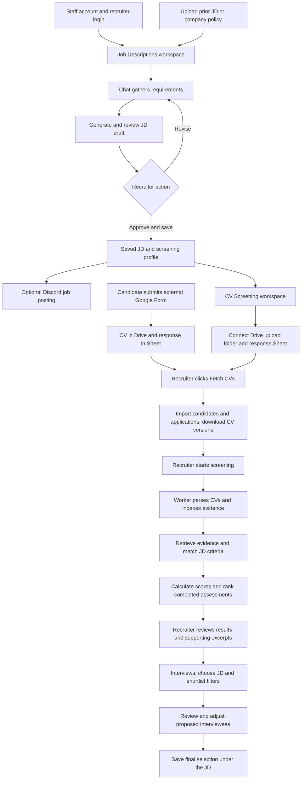

# Distill AI — Project Progress Tracker

## Latest checkpoint — 22 October 2026

This is the current feature and verification baseline. It supersedes the dated
planning statements in the historical record below, including descriptions of
Dashboard, email invitations, interview execution and assessments as placeholders.
Implemented means present in the current source; it does not by itself establish
production deployment, manual acceptance, a Git commit/push, or Redmine submission.
Dates and user-facing operational times use Asia/Dhaka.

### F7 candidate identification — 22 October 2026

F7 is implemented and enabled in the running development app. The final flow is:
required Form uploads -> device check -> consent pop-up -> automatic capture of
one camera frame -> recruiter comparison result/score -> recruiter admission.

- Required response columns are `Name`, `Email`, `CV File`, and `Image`. Each
  response needs a CV and exactly one Image Drive link. `Timestamp` is optional;
  extra fields are ignored. Missing/invalid/multiple image links reject the row.
  Field-mapping controls and the preview API were removed at the user's request.
- The post-device-check modal explains capture, use, retention and alternatives.
  Consent v2 is saved before the verification camera opens. Agreement captures
  one frame automatically when video is ready; retakes remain explicit. Previous
  consent requires the updated explanation before another comparison.
- Recruiter-only endpoints expose similarity and the configured threshold. The UI
  displays cosine similarity scaled by 100, explicitly distinguished from identity
  confidence. Without `FACE_MATCH_THRESHOLD`, a numerical comparison is still
  available for recruiter judgment; no automatic match verdict is asserted.
- UI and backend prevent admission while consent/comparison is pending. A
  completed attempt, declined/withdrawn consent, or recorded manual review allows
  the recruiter to decide. Low similarity never automatically rejects a candidate.
  Reissued invitations reset previous consent/results/manual review.
- Existing candidate profiles are reused. Source photos remain in protected Drive;
  frames and embeddings stay in memory. Application-scoped results, consent,
  retention/deletion and reimport-prevention tombstones remain implemented.
- Migration `f4b830d927ae` is applied locally. The development backend was rebuilt
  and reloaded with OpenCV and both checksum-verified YuNet/SFace models mounted.
  Runtime checks confirmed comparison availability and consent v2. The existing
  Cloudflare tunnel stayed running; public frontend/API returned HTTP 200 and
  database health returned `connected` after reload.

Verification: 22 F7 checks and 13 interview-session checks passed, including real
PostgreSQL persistence, admission controls, reissued links and mocked media
services. Seven invitation checks and 25 frontend unit checks also passed during
today's work. Offline browser acceptance covered the consent modal, no capture
before consent, exactly one automatic capture, retakes, mobile layout, withdrawal,
fixed Form columns, recruiter score and manual review. TypeScript, lint and build
passed; the existing bundle-size warning remains. These are separate focused
checks, not a claim that the whole application regression suite was run.

Real Form/Drive and real-device walkthrough acceptance, representative face-pair
calibration, and production acceptance remain open. See the
[F7 setup, storage and verification guide](F7_CANDIDATE_IDENTIFICATION.md).

### Assessment updates — 22 October 2026

**F6 comparison modal:** Assessments now supports selecting two candidates with
completed F6 results and opening **Compare selected**. Selection survives list
pagination and filtering. The modal reuses saved assessments and the exact
interview-performance result referenced by each combined score; opening it starts
no model calls or processing jobs. It shows component/combined scores, performance
dimensions, competency evidence/coverage, findings, verification recommendations
and original transcript evidence. Changed criteria remain separate rows; historical
criteria, differing scoring policies and unavailable performance details are
disclosed. Sample candidates can be compared together, separately from real
candidates. Desktop uses a wide modal; mobile uses a full-screen dialog with
horizontal table scrolling. Existing dialog focus trapping, Escape and focus
restoration are reused.

Verification: 25 frontend unit tests passed, including four new comparison tests;
TypeScript compilation, ESLint and the production build passed. The new offline
comparison browser check passed for cross-page selection, sample separation,
version/policy warnings, zero versus missing scores, evidence navigation, retries,
wrong-job responses, unavailable performance details and mobile/keyboard behavior.
The existing assessment-redesign browser regression also passed. Browser checks
used fixture APIs, not a live database or model. The existing large-bundle warning
remains. Final acceptance with actual saved interview assessments remains open.

Implementation: [comparison modal](../frontend/src/features/assessments/CandidateComparison.tsx),
[comparison rules](../frontend/src/features/assessments/comparison.ts),
[candidate selection](../frontend/src/features/assessments/CandidateWorkspace.tsx),
[unit checks](../frontend/tests/assessment-comparison.test.mjs),
[browser checks](../frontend/tests/assessment-comparison.smoke.mjs).
No backend routes, database migrations, N19 deletion, Git delivery or F10
cross-candidate process analysis were added by this change.

The candidate assessment now uses five sections: **Summary**, **CV findings**,
**Interview Q&A**, **Criteria coverage** and **Verify next**. Findings and answers
expand to show explanations and saved evidence; source links open the transcript.
CV support and interview coverage remain separate, and missing/unassessed scores
are distinct from an assessed zero. Scores display at most two decimal places.

- **Final score:** Summary displays the provisional combined score using
  `30% × saved CV score + 70% × saved interview performance score`, with component
  scores and contribution breakdown. This uses F9 performance rather than a second
  average of the F5 Q&A marks. Both components must exist; interview evidence must
  cover at least 80% of scoring weight, four dimensions and essential dimensions,
  including technical competency. Insufficient evidence leaves the final score
  incomplete. Source artifacts remain unchanged; the projection validates source
  hashes and uses the latest matching interview-performance run. The result is for
  recruiter review, not an automatic hiring decision.
- **Post-interview evidence:** revised analysis guidance handles ambiguous claims
  and transcript limitations more explicitly, with source warnings and diagnostics.
  The combined **Run all post-interview insights** action requests CV claim review,
  interview performance and interview quality together. Individual reruns remain
  available. This does not establish that every assessment stage runs automatically
  from the initial F5 action or that poor transcript evidence has been repaired.
- **Reports and secondary details:** **Report & export** opens a centered modal
  with report type, evidence options, preview, print and PDF download. Transcript,
  run history, saved rationale and post-interview insights are available through
  **More details**, replacing the bottom accordion clutter.
- **Interaction polish:** assessment tabs reuse the Job Description tab indicator
  and content animation; modals animate on opening and respect reduced motion.
  The redundant header review button is removed. Review confirmation remains
  beside analysis/consolidation actions where the backend requires it. Dialogs
  support Escape, contained keyboard focus and focus restoration.
- **Saved-analysis selector:** widened the control, removed clipping and matched
  the shared border, focus, picker and green selection styles. The full selected
  text and chevron fit on desktop and mobile. Shared animation duration parsing
  now handles both milliseconds and seconds after production CSS optimization.

Implementation: [candidate assessment UI](../frontend/src/features/assessments/CandidateAssessment.tsx),
[styles](../frontend/src/features/assessments/CandidateAssessment.css),
[final-score policy](../backend/app/services/interviews/final_score.py),
[analysis](../backend/app/services/interviews/post_interview_analysis.py),
[shared motion](../frontend/src/components/motion/useWorkspaceMotion.ts).

| Check | Recorded result | Practical limit |
| --- | --- | --- |
| Final-score and post-interview analysis checks | Six final-score tests and ten post-interview analysis tests passed during this work | Focused policy/evidence checks; not a complete backend regression suite or proof of model judgment. |
| Frontend unit checks | `npm test`: 21 passed | Covers score semantics, findings/history/coverage helpers and existing frontend regressions. |
| Production build and lint | `npm run build` and `npm run lint` passed after the final UI changes | Existing large-bundle warning remains. |
| Assessment browser checks | `node tests/assessment-redesign.smoke.mjs` passed with no browser errors at desktop and mobile sizes | Local fixture APIs; five tabs, evidence/source navigation, history, combined-analysis request, review gates, modal preview/download/print, tab/modal motion, reduced motion and responsive layout checked. Not a live model or real-data report acceptance test. |

Browser screenshots are saved under `output/assessment-redesign/`. Real-interview
semantic calibration, transcript recognition/speaker-order quality and complete
report acceptance remain open. These local changes do not imply a commit, push,
deployment or Redmine update. Earlier dated verification below remains historical.

### Current product position

The application now supports the recruiter journey from account creation and JD
authoring through CV ingestion, evidence-based screening, saved shortlists,
invitation delivery, live interviews, transcription, F5 interview analysis, F6
consolidation and assessment reports. Dashboard provides an owned-data overview
and entry points into those workspaces. Recruiters host their own interviews;
calendar scheduling and a separately assigned interviewer workspace are not part
of the current flow. Candidate profiles reuse saved CV/screening data and do not
constitute biometric identification.

### Current feature inventory

#### F8–F10 update — 21 October 2026

The first post-interview implementation is now present locally. Existing F5/F6
workflows and CV scores remain separate. Recruiters can open a completed F5 (or its
F6 assessment) and use **Post-interview insights**:

- **F8 CV claim review:** bounded atomic CV claims, exact CV spans/candidate quotes,
  five evidence states, context checks for potential contradictions, neutral
  follow-up prompts and a separate append-only recruiter review trail.
- **F9 interview performance:** six dimensions with exact evidence, deterministic
  scoring, null handling, assessed-weight disclosure and provisional partial
  coverage. Approved default weights are 25/15/10/20/20/10; the default gate is
  four assessed weighted dimensions including technical competency.
- **Job scoring settings:** editable per-job weights, minimum coverage and required
  dimensions; whole percentages must total 100. Revisions retain author/time and
  reject stale concurrent edits. New runs pin the saved revision; old results are
  unchanged. The UI reuses recruitment buttons, badges, notices and card styling.
- **F10 interview quality:** saved F5 competency coverage, evidence-backed process
  observations/improvements and measured speech intervals only when common timing
  is validated. Text-only or unaligned transcripts show time as unavailable.
- **Runtime/reports:** independent child runs with source checks, durable stage
  replay, retry budgets and per-feature failures. Optional report results pin exact
  child IDs and use the same data in preview/PDF without starting model calls.

Implementation: [analysis](../backend/app/services/interviews/post_interview_analysis.py),
[run service](../backend/app/services/interviews/post_interview_runs.py),
[scoring policy](../backend/app/services/interviews/performance_rubric.py),
[settings](../backend/app/services/interviews/scoring_settings.py),
[results UI](../frontend/src/features/assessments/PostInterviewAssessment.tsx),
[settings UI](../frontend/src/features/assessments/InterviewScoringSettings.tsx).
Additive migrations `c9a810b4d237` and `ca9174e803b2` were applied locally.
The naming migration `cb0472a19e36` was subsequently applied: runtime API, worker,
frontend and result identifiers now use `cv_claim_review`, `interview_performance`
and `interview_quality`. Legacy saved metadata is migrated with integrity hashes
and reviewer references kept consistent. After direct source review, 18 assessment/
migration tests, 11 scoring-policy tests, frontend build and lint passed.

Verification: 11 scoring-policy tests and 17 post-interview evidence/database/
worker/replay/PDF checks passed; settings ownership/history/conflict checks passed
with all verification writes rolled back; three real Gemini synthetic-content
smokes passed schema/citation validation. Settings and result tabs were checked
at 320, 390, 768 and 1440 pixels, including notes, transcript links and report
selection. Frontend build and lint passed with the existing bundle-size warning.

These checks establish the tested software behavior, not perfect model judgment.
Recruiter-reviewed real-interview calibration, broader claim ambiguity fixtures,
large-input/latency acceptance and manual complete-report review remain open.
The first release reuses pinned F5 RAG passages; it does not run extra retrieval.
F7 face identification/consent is implemented locally; setup and acceptance limits are in [the F7 guide](F7_CANDIDATE_IDENTIFICATION.md). Cross-candidate process comparison is not implemented.
No Git commands, commits, pushes or invitation emails were performed for this work.

| Area | Present in the project | Evidence and remaining limits |
| --- | --- | --- |
| Application and runtime | React/TypeScript/Vite frontend, FastAPI, PostgreSQL, Alembic, Chroma, local Ollama embeddings, health endpoints and persistent storage | [API lifecycle](../backend/app/main.py), [Compose](../compose.yaml). Local services have run and health checks passed; clean-machine reproducibility is still pending. |
| Authentication | Recruiter signup/login, password hashing, short-lived JWT access, persistent revocable cookie sessions, refresh/logout, origin checks, active-user and role restrictions | [Authentication](../backend/app/auth.py), [login/signup UI](../frontend/src/features/auth/LoginForm.tsx). Shared responsive authentication layout and password visibility controls are present. |
| Dashboard | Owned job/application counts, latest screening states and review flags, interview/assessment attention, active sessions, hiring by job and recent activity; minute refresh with loading/error/empty states | [Dashboard API](../backend/app/dashboard.py), [Dashboard UI](../frontend/src/features/dashboard/Dashboard.tsx). Invitation counts mean provider-accepted messages, not confirmed delivery; synthetic assessment results are excluded from the dashboard projection. |
| Shared recruiter UI | Mint workspace styling, Roboto, shared focus/dropdown styles, responsive sidebar, reduced-motion support and accessible navigation | [Application shell](../frontend/src/app/App.tsx), [shared styles](../frontend/src/styles/index.css), [motion](../frontend/src/components/motion/motion.css). Device/browser acceptance remains distinct from fixture checks. |
| Persistent assistant | Saved conversations, history, JD workflow handoff, tool-mediated Discord posting and invitation preview/confirmation/status; contextual interview question assistance | [Assistant graph](../backend/app/workflows/assistant/graph.py), [conversation service](../backend/app/services/assistant/conversations.py), [chat UI](../frontend/src/features/jd/RecruiterChat.tsx). Available tools remain scoped; general CV management is not automatically exposed to central chat. |
| Streaming and composer | User-facing text streaming, tool/structured-output exclusion, stop/reload handling, Dashboard assistant dock and retained drafts; inputs grow to eight visible lines and then scroll | [Streaming](../backend/app/workflows/streaming.py), [composer](../frontend/src/components/chat/AutoGrowingTextarea.tsx), [Dashboard dock](../frontend/src/features/dashboard/Dashboard.tsx). Enter sends, Shift+Enter adds a line, and IME composition is respected. |
| Chat model | Gemini 3.5 Flash-Lite replaces Groq for JD gathering/drafting/revision, edit suggestions and central/interview assistant calls | [Chat adapter](../backend/app/integrations/chat_model.py), [settings](../backend/app/core/config.py), [requirements](../backend/requirements.txt). Uses the existing Gemini key and `GEMINI_CHAT_MODEL`; shared pacing, bounded retries, tool calls, structured output and real streaming are implemented. |
| JD lifecycle | Conversational requirement gathering, reference retrieval, drafting/revision, review, approval/save, cancellation and failed-save recovery; stable JD numbers and saved-description pagination | [JD graph](../backend/app/workflows/jd/graph.py), [JD conversations](../backend/app/services/jd/conversations.py), [saved descriptions](../frontend/src/features/jd/MyJobDescriptions.tsx). Explicit approval/save remains separate from publishing. |
| Reviewed manual JD editing | Edit description/criteria for eligible unposted jobs, preview matching changes, review/save, stale-version protection and posting locks; reviewed baseline informs later chat | [Editing service](../backend/app/services/jd/editing.py), [editor](../frontend/src/features/jd/JobEditor.tsx). AI proposals are not silently adopted. |
| Screening profiles | Versioned atomic criteria across technical skills, work experience, qualifications and additional criteria, Must-have/Preferred priorities, confirmed weights and application-form URL | [Profile contracts](../backend/app/services/jd/screening_profiles.py). The benchmark exposed an extra fresher-eligibility criterion and an earlier false Form URL update confirmation; these remain follow-ups, not assumed fixed by changing model provider. |
| Reference documents and question banks | PDF/DOCX prior JDs, company policies and technical/answer references; extraction, embedding, indexing status/retry and scoped retrieval; separate question-bank upload/index/archive | [Reference routes](../backend/app/jd_reference_routes.py), [question banks](../backend/app/question_bank_routes.py). A question-only source does not prove answer correctness. |
| Discord posting | Explicitly requested posting of saved approved JDs through a tool, persisted posting state/receipt and duplicate/uncertain-outcome handling | [Posting service](../backend/app/services/jd/discord_job_posts.py). Approval of a JD alone does not authorize posting. |
| Google Forms/Drive/Sheets intake | JD-scoped upload-folder/response-tab configuration, source checks for new files, explicit sync/import, candidate/application mapping and versioned CV download/integrity checks | [CV routes](../backend/app/cv_routes.py), [ingestion](../backend/app/services/cv/ingestion.py), [source setup](../frontend/src/features/cv/CVSourceSetup.tsx). Source connectivity and import outcomes must be checked rather than inferred. |
| CV parsing and profiles | PDF/DOCX extraction, local OCR where needed, Gemini/Ollama model selection, structured profiles, source-checked claims, versioned reuse/retry and source inspection | [Parsing](../backend/app/services/cv/parsing.py), [model transport](../backend/app/integrations/cv_model.py), [profile UI](../frontend/src/features/cv/CandidateProfile.tsx). Missing or unreadable evidence is not proof of inability. |
| CV evidence and screening | Authenticated MCP evidence search, indexing, durable runs/checkpoints, sequential per-criterion semantic matching, exact evidence validation, deterministic scoring/ranking, outdated-input detection and resumable partial results | [Screening graph](../backend/app/workflows/cv_screening.py), [matching](../backend/app/services/cv/matching.py), [scoring](../backend/app/services/cv/scoring.py). Matching batches/concurrency optimization is not implemented. |
| Screening review UI | Candidate search/filter/sort, progress, ranked/incomplete results, score dimensions, criterion decisions, original excerpts, must-have flags, source files and earlier-run information | [Screening workspace](../frontend/src/features/cv/ScreeningWorkspace.tsx), [results](../frontend/src/features/cv/CVResults.tsx). Must-have gaps produce review flags, not an automatic rejection gate. |
| Validation repair and diagnostics | Invalid match responses receive bounded repair with the specific safe validation code and rejected response as untrusted context; final failure retains a safe diagnostic for review | [Matching repair](../backend/app/services/cv/matching.py), [diagnostic labels](../frontend/src/features/cv/screeningMessages.ts). Quote/source/criterion validation remains strict; up to three validation attempts, without logging candidate text or raw model responses. |
| Saved shortlists | Top K/minimum-score/combined preview, explicit manual selection, persisted shortlist members, score/rank snapshots and stale-preview controls | [Selection service](../backend/app/services/interviews/selections.py), [shortlisting](../backend/app/services/interviews/shortlisting.py), [workspace](../frontend/src/features/interviews/ShortlistWorkspace.tsx). Complete live acceptance remains separate. |
| Invitations and email | Shared preview/confirmation/queue services for UI and assistant, expiring candidate links, retry/reissue/status behavior, invitation worker and custom email MCP delivery | [Invitations](../backend/app/services/interviews/invitations.py), [delivery](../backend/app/services/interviews/delivery.py), [email MCP](../backend/app/mcp_email.py), [sending UI](../frontend/src/features/interviews/InvitationSending.tsx). Current transport uses configured Gmail SMTP credentials; older Gmail OAuth/API plans are historical. Provider acceptance is not confirmed inbox delivery. |
| Interview sessions and media | Recruiter-owned unscheduled Start/Status/Admit/Join/End flow, persisted admission, room-scoped LiveKit credentials, closure retry, candidate entry and device selection/preview | [Sessions](../backend/app/services/interviews/sessions.py), [LiveKit adapter](../backend/app/services/interviews/livekit.py), [candidate entry](../frontend/src/features/interviews/InterviewEntry.tsx), [room controls](../frontend/src/features/interviews/InterviewRoom.tsx). Two-device media, permissions and device hot-plug still require manual acceptance. |
| Recruiter interview workspace | Preparation, waiting room, admission, live video, transcript, assistant, temporary notes and detailed candidate profile reused from CV Screening | [Recruiter panel](../frontend/src/features/interviews/RecruiterInterviewPanel.tsx), [stage](../frontend/src/features/interviews/InterviewStage.tsx), [candidate profile](../frontend/src/features/interviews/InterviewCandidateProfile.tsx). Notes stay on screen and are not saved. F7 verification is now shown alongside the profile; see [F7 setup](F7_CANDIDATE_IDENTIFICATION.md). |
| Mobile interview UI | Responsive recruiter/candidate preparation, waiting and live-call layouts; portrait preview ratios, landscape split tools, in-layout controls, smaller picture-in-picture tiles, wrapping device actions and retained notes on rotation | [Stage styles](../frontend/src/features/interviews/InterviewStage.css), [lobby styles](../frontend/src/features/interviews/InterviewLobby.css), [candidate styles](../frontend/src/features/interviews/CandidateInterview.css). Verified with browser fixtures; actual device/browser/media acceptance remains open. |
| Live transcription | Deepgram streaming from role-mapped LiveKit microphone sources, persisted final segments, separate interim display, audio-stream timing, bounded reconnect/rearm and startup/shutdown recovery | [Live capture](../backend/app/services/interviews/live_transcription.py), [transcription](../backend/app/services/interviews/transcription.py), [live transcript UI](../frontend/src/features/interviews/InterviewTranscript.tsx). Recognition quality, overlap/accent behavior and live recovery still need acceptance. |
| Transcript finalization | End-of-interview finalization, source/evidence references, retry/reconciliation and readiness validation; unavailable common timing is disclosed as text-only limitations | [Finalization](../backend/app/services/interviews/transcript_finalization.py), [transcript preparation](../backend/app/services/interviews/transcript_preparation.py). Empty or unusable/single-speaker inputs must not be treated as assessment-ready. |
| F5 interview assessment | Durable worker-dispatched analysis runs, question/answer grouping and criterion mapping, evidence-checked dimension evaluation, saved stages/results and retry/recover controls | [Assessment operations](../backend/app/services/interviews/assessment_runs.py), [analysis](../backend/app/services/interviews/analysis.py), [assessment routes](../backend/app/assessment_routes.py). Implementation is present; semantic calibration with reviewed real interviews remains open. |
| Q&A accuracy references | Per-question retrieval from pinned technical references, policies and ready question banks; saved source/version registries and exact supporting excerpts for replay | [Accuracy references](../backend/app/services/interviews/accuracy_references.py). Reference passages support accuracy evaluation; unsupported model-knowledge judgments retain limitations. |
| F6 consolidation | Synthesis of saved CV/interview evidence into strengths, weaknesses, gaps and recommended areas; deterministic traceability/eligibility validation and persisted results | [Consolidation](../backend/app/services/interviews/consolidation.py), [run service](../backend/app/services/interviews/consolidation_runs.py), [consolidated UI](../frontend/src/features/assessments/ConsolidatedAssessment.tsx). Existing CV and interview scores remain separate; unsupported results can be withheld. |
| Assessment workspace and reports | Job/candidate selection, search/status filters, stage/source versions, run history, analysis/consolidation actions, two-candidate F6 comparison modal, recruiter and technical reports, optional evidence and PDF export | [Assessments UI](../frontend/src/features/assessments/Assessments.tsx), [comparison modal](../frontend/src/features/assessments/CandidateComparison.tsx), [report projection](../backend/app/services/interviews/full_report.py), [PDF renderer](../backend/app/services/interviews/report_pdf.py). Comparison is implemented and fixture-verified; live comparison and final real-data report acceptance remain open. |
| MCP boundaries | Recruitment, CV and email servers; six recruitment tools, five CV tools and one worker email tool in current source | [Server registry](../backend/app/core/mcp_servers.py), [recruitment MCP](../backend/app/mcp_recruitment.py), [CV MCP](../backend/app/mcp_cv.py). Central assistant uses the authorized Recruitment facade; email sending remains worker-mediated. Broader planned MCP expansion is not claimed implemented. |
| Background operations | Separate CV-screening, source-check, assessment and invitation workers; persistent processing records and checkpoints | [Compose services](../compose.yaml), [CV worker](../backend/app/scripts/cv_screening_worker.py). Secrets remain local; clean build/start documentation and comprehensive operational acceptance are pending. |

### Current end-to-end flow

1. Recruiter signs up or signs in; Dashboard shows owned-data activity and attention items.
2. Recruiter creates/revises a JD in chat, reviews its criteria/priorities/weights,
   supplies the application form, then explicitly approves/saves it. Eligible
   unposted JDs can also use reviewed manual editing. External posting is separate.
3. Recruiter connects the job's Drive folder/Sheet tab and explicitly imports CVs.
   Downloaded file versions are extracted/parsed, evidence-indexed and screened.
4. Screening validates each decision against original CV sources, calculates
   deterministic dimension/aggregate scores and ranks completed assessments.
   Incomplete results remain visible for review/resume; no invented fallback score.
5. Recruiter reviews evidence and saves a shortlist. Invitations use a preview,
   explicit confirmation, durable queue and worker delivery to expiring links.
6. Recruiter and candidate prepare devices; candidate waits for admission.
   Recruiter admits, conducts and explicitly ends the LiveKit interview.
7. Microphone speech is transcribed with interim/final separation and source
   metadata. Finalization establishes readiness or reports limitations/failures.
8. Recruiter starts F5 analysis on eligible inputs, reviews evidence, requests F6
   consolidation, then views/exports the saved recruiter or technical report.

### Changes and verification completed on 21 October

| Work | Verified result | Practical limit |
| --- | --- | --- |
| Gemini chat replacement | Pinned Gemini LangChain adapter compatible with existing core; backend/worker images rebuilt and services restarted; dependency check passed and Groq package absent from the rebuilt backend | Quotas remain shared with other Gemini work. Provider replacement does not fix every routing or context-growth issue. |
| Chat/assistant regression checks | 76 checks: 75 passed, one previously documented JD-profile failure | The failing `test_incomplete_screening_does_not_override_draft_readiness` expects only technical skills while existing defaults address all four dimensions. Not counted as a new Gemini regression. |
| Live Gemini checks | Structured function extraction, text streaming and tool-call/result roundtrip passed; full benchmark extraction retained 16 criteria and 50/30/10/10 weights | Direct verification calls did not establish a saved job/profile or scoring accuracy. |
| Synthetic screening pack | Detailed JD and profile-confirmation prompts, eight one-page PDF CVs, criterion-level reference labels/scores and testing guide created | Pack is under `output/pdf/screening-benchmark-2026-10-21/`; do not ingest the answer key as candidate evidence. All CVs are fictional and text PDFs. |
| Current screening performance diagnosis | JD 117 initially processed Mira in about 2 minutes 10 seconds; candidate and criterion processing are sequential, with per-criterion retrieval/model requests under a shared 12 RPM cap | This is an observed run, not a latency guarantee. Batching and broader token optimization remain unimplemented. |
| Tara processing failure and recovery | Parsing/indexing succeeded; original failure followed 10 saved matches at the Docker/operations criterion. Added specific repair guidance, bounded attempts and safe diagnostics; resumed remaining work using the existing service | Original rejected outputs were not retained, so their precise initial validation defect cannot be reconstructed. No validation rule was weakened. |
| Recovered saved screening run | Run `ac427c67-1f8c-490b-9b51-f7a63425aa67` for JD 117 completed with all five candidates; Tara completed all 17 saved criteria and scored 39.7619/100; four already-completed candidates retained | This was a five-candidate run, not verification of all eight CVs. Its profile has an extra fresher-eligibility criterion, so the 16-criterion benchmark totals are not directly comparable. |
| Match-repair verification | Five focused repair checks and ten screening-result regressions passed; frontend build/lint passed | Separate from the 76-check Gemini run; do not add overlapping suites as a universal test total. |
| Public remote preview | Verified `PUBLIC_APP_URL=https://acids-boating-brands-shut.trycloudflare.com` and `VITE_ALLOWED_HOST=acids-boating-brands-shut.trycloudflare.com` in `.env` and the running frontend/backend/invitation worker; public HTTP 200 and database `connected` confirmed after the F7 backend reload | Active Quick Tunnel on 22 October; temporary address. Existing delivered email links are not rewritten, and no invitation email was sent for these checks. |
| Growing chat input | Dashboard bar and shared expanded composer grow from one line up to eight visible lines, then scroll; shrink on deletion and wrap on resize | Build/lint and desktop/mobile browser checks passed with mocked APIs. Existing message-length rules remain. |
| Interview responsiveness | 63 state/viewport checks passed across 320×568, 360×640, 390×844, 667×375, 844×390, 768×1024 and 1280×800 | Checked recruiter preparation/waiting/live stage and candidate device, ready, live, finished and unavailable states. No horizontal page overflow; candidate call controls fit; portrait stage video ratio, tabs and rotation/note retention passed. Camera/microphone capture was not requested. |
| Latest frontend checks | Production build and ESLint passed after the final responsive changes | Existing large-bundle warning remains. Browser fixtures do not replace real-device media/permission acceptance. |

The original Tara failure was `MATCH_SCHEMA_OR_EVIDENCE_INVALID`, not a low
suitability score, unreadable PDF or Gemini quota failure. Her separate
`CV_SHEET_EMAIL_DISCREPANCY` warning did not cause that failure and remains an
identity-metadata review item, not a scoring criterion. The improved repair path
now retains safe validation codes such as `MATCH_QUOTE_INVALID` or
`UNREQUESTED_REQUIREMENT_ADDED` when a later failure occurs; it does not retain or
log rejected CV/model text. Successful scoring clears prior repair diagnostics.

### Remaining work and acceptance boundaries

- Fix and verify JD application-form update routing/persistence and prevent a
  conversational success claim before the profile actually changes. The earlier
  Google Form reply falsely confirmed an update; changing providers alone is not
  proof that this path is corrected.
- Reconcile the extra fresher-eligibility criterion in JD 117 before using the
  16-criterion reference totals. Review semantic disagreements, not just aggregate
  scores; one successful run does not establish perfect screening.
- Reduce screening request volume through reviewed multi-criterion batching and/or
  retrieval reuse, with per-criterion validation, durable recovery and shared quota
  pacing retained. No quota increase or batching change is claimed completed.
- General token-budgeted chat history, incremental summaries, context deduplication,
  model-stage usage measurement and broader MCP expansion remain planned work.
- Complete real two-device media, portrait/landscape browser checks on actual
  phones, permissions, unplug/reconnect, hidden transcription participants and live
  recovery/recognition acceptance. The latest 63 checks validate UI fixtures only.
- Calibrate Q&A accuracy and F6 synthesis with reviewed technical references and real
  interview evidence. Historical handoff notes recorded two report expectations
  failing on wording/section counts; those were not rerun or fixed in today's work.
- Finish report acceptance and verify the implemented F6 comparison modal against
  actual saved interview assessments. Offline comparison and existing assessment
  browser regressions passed; this does not establish live-data acceptance.
- F7 now adds fixed mandatory Name/Email/CV File/Image columns, application photo linking, explicit waiting-room
  consent, one-to-one face comparison, recruiter manual review and retention/deletion.
  See [F7 setup and limits](F7_CANDIDATE_IDENTIFICATION.md). Representative face calibration
  and real Form/video acceptance remain open. Voice matching and liveness are outside
  this increment. F11 scope is still unconfirmed.
- Calendar scheduling/rescheduling, a separately assigned interviewer workflow and
  a separate candidate-management workspace are not delivered here. The Candidates
  route redirects to CV Screening rather than providing a dedicated page.
- Implement complete candidate deletion across relational records, stored CV files
  and vector indexes. Existing foreign-key rules are not a complete deletion flow.
- Finish Docker startup/reproducibility documentation, clean-setup verification and
  migration-status review before schema work; do not reset databases or volumes.
- Reconcile older setup guides and module comments with the implemented runtime.
  Some older source/doc comments still describe integration work as pending.

### F6 comparison implementation and N19 deletion plan — 22 October 2026

Status: **F6 comparison implemented locally and fixture-verified; N19 deletion
remains planned and has not started.** The estimates below retain the original
planning ranges, not measured diffs. Live F6 acceptance and N19 implementation
remain separate work.

| Requirement | Placement and initial scope | Estimated change size, including tests |
| --- | --- | --- |
| F6 side-by-side candidate comparison | Assessments candidate list: select two candidates from the same job and choose **Compare selected** to open a wide comparison modal. Initially require completed F6 assessments. | Approximately 6–9 added/modified files and 400–700 lines. |
| N19 complete candidate-data deletion | CV Screening candidate row menu: **Delete candidate data** opens a confirmation listing affected data and applications before deletion. | Approximately 9–14 added/modified files and 700–1,200 lines. |

Combined estimate: approximately **14–22 distinct files and 1,100–1,900 lines**,
allowing for shared files. These are planning ranges, not measured diffs or a
delivery commitment; actual scope depends on existing cleanup and worker behavior.

#### F6 comparison scope and acceptance

- Reuse saved CV, F5, F6 and interview-performance results, existing evidence links,
  and modal patterns. Opening comparison must not start new AI analysis or rescore
  candidates. No new database tables are expected.
- Align rows by job criterion and display candidates in columns. Include CV,
  interview and combined scores, interview-performance dimensions, competency
  coverage, strengths, weaknesses, evidence gaps and verification recommendations.
- Preserve missing/unassessed values separately from zero. Display assessment,
  criteria and scoring versions; flag incompatible criteria or scoring revisions
  rather than presenting their results as equivalent.
- Reuse existing **Verify next** findings; recommendation generation is already
  implemented and must not be duplicated. This candidate comparison does not
  implement F10 cross-candidate interview-process consistency analysis.
- Use a wide modal on desktop and a full-screen dialog with horizontal scrolling
  on small screens. Retain keyboard focus, Escape handling and focus restoration.
- Verify same-job selection, recruiter ownership, criterion alignment, exact saved
  sources, version differences, missing scores and desktop/mobile interaction.

#### N19 deletion scope and acceptance

- Distinguish complete candidate-data deletion from removing one job application.
  Confirm the affected applications and scope explicitly. Enforce recruiter
  ownership; an owned application must not authorize deletion of another
  recruiter's applications or shared data they still require.
- Add an authenticated endpoint and deletion service covering applicable candidate
  and application records, CV files, extracted profiles, screening results,
  interview records/transcripts, assessments and vector-index entries. Existing
  foreign-key cascade rules alone do not satisfy N19.
- Revoke invitation access and coordinate pending/running workers so they cannot
  recreate deleted records or continue processing deleted candidate data.
- Make cleanup retryable and expose partial failures. Do not report complete
  deletion while required database, file or vector cleanup remains unfinished.
- Prevent ordinary source sync from silently re-importing the deleted application.
  Persist only the minimum suppression/cleanup metadata needed for this behavior.
- Explain that deletion from Distill AI does not itself remove the original
  submission from Google Drive/Sheets. Verify cleanup of any other retained
  candidate artifacts discovered during implementation.
- A migration will likely be needed for persistent deletion progress and/or
  re-import suppression. Review the live migration state before schema changes.
- Verify ownership, shared candidates across jobs/recruiters, active-worker races,
  invitation revocation, repeated requests, partial-cleanup retries, storage/index
  cleanup and subsequent source sync using synthetic data.

### Working and delivery policy

No new Redmine status, completion percentage or Git delivery is inferred from
these local checks. The user requires Git commands to be supplied for manual
execution; no Git commands have been run since that instruction. Documentation
and test-file changes remain local unless the user changes that policy. Keep
`.env`, credentials and invitation tokens out of commits and documentation.

The startup handoff records the prior M05 and recruitment UI merges into `dev`;
that is historical handoff context, not an independently rechecked branch state.
The saved docs/tests stash was not applied by the agent. No new module/feature
branch creation, staging, commit, push or Redmine update is claimed here.

## Historical record — 12–13 October 2026

The entries below are preserved as dated implementation history. Their feature
inventory, provider choices and pending-work lists describe that earlier point in
time; use the 22 October checkpoint above for current project status.

<details>
<summary>Expand the earlier checkpoints, feature inventory and verification history</summary>

## Checkpoint — 13 October 2026

This summary supersedes older pending/not-implemented statements below; earlier entries remain as the implementation history.

- **Session backend implemented:** Unscheduled interviews, JD-owner recruiter authorization, invitation validation, Start/Status/Admit/Join/End APIs, persisted admission/completion, room-scoped media tokens and retryable room closure. The recruiter who owns the JD conducts the interview; no interviewer assignment or scheduling CRUD was added.
- **Simple test UI implemented:** Recruiter and candidate device checks, candidate waiting/admission, camera/microphone controls, Leave/rejoin and explicit End. User reported joining the candidate through the emailed link in incognito while the recruiter used the recruiter workspace. Frontend container build and lint passed.
- **Verification recorded:** Six schema checks, five PostgreSQL unscheduled-session checks, two LiveKit adapter tests, 13 session tests and one real room create/delete/repeated-delete test passed. Separate invitation regression output and an explicit current Alembic revision remain unreported.
- **Remote testing configured:** Local Docker LiveKit, optional Cloudflare Quick Tunnel, exact Vite hostname allowance and environment overrides for LiveKit Cloud. User recreated backend/frontend/invitation-worker; backend settings returned the configured public HTTPS origin. Exactly one JD 180 in-progress invitation's stored encrypted email body was updated to that origin and reread; no email was resent. Cross-laptop media quality still needs user verification.
- **Backend audio reception verified:** The JD 180 20-second probe received one separate microphone source per role: recruiter and candidate each produced 1,961 frames / 19.61 seconds of 16 kHz mono PCM, with nonzero levels and no reported failures. No audio was saved and no Deepgram request was made. This establishes reception, not speech intelligibility or recording readiness.
- **Git checkpoint prepared:** Commands were supplied for five LiveKit commits (backend, UI, Docker/Cloudflare, audio probe and progress docs), plus separate assistant invitation-approval and sidebar fixes. The user requested commands only. No staging, commit or push was performed by the agent, and user completion is not yet reported. Credentials and invitation tokens are excluded.

**Next work:** Complete the Git checkpoint before Deepgram implementation; review separate durable audio capture with role mapping, segment offsets and recording lifecycle/failure state. Consent/private storage, reconnect segmentation, active invitation revocation/reissue disconnect enforcement, duplicate-tab behavior, closing recovery and signed webhook/reconciliation support remain unfinished. Recording and transcription are separate milestones; Google Calendar scheduling is deferred.

Full plan, test evidence and remaining tasks: [today's work](DAILY_WORK_2026-10-13.md).

## Backend audio reception verified — 13 October 2026

Approved media SDK/probe added and executed against JD 180's live room. The 20-second probe passed with separate recruiter and candidate sources: each one microphone track, 1,961 PCM frames and 19.61 seconds, nonzero levels and no failures. Probe disconnected normally. No audio file, transcript, database mutation or Deepgram request. Current container received the SDK in-place; requirements.txt includes it for future image builds. This verifies media reception, not speech accuracy or durable recording. Results and next recording/role/timeline work: [daily progress](DAILY_WORK_2026-10-13.md).

## Both interview microphone tracks confirmed

JD 180 metadata check confirms recruiter and candidate each publish an unmuted microphone/audio track, separate from their cameras and correctly matched to session roles. This confirms two-source publication only. Backend audio-frame reception, recording and Deepgram transcription remain pending. See [daily progress](DAILY_WORK_2026-10-13.md).

## Recruiter microphone track confirmed

JD 180 recheck confirms the recruiter publishes an unmuted MICROPHONE/AUDIO track alongside camera. Candidate currently publishes camera only. Separate audio publication is confirmed for the recruiter; backend audio-frame reception and transcription remain unverified. Details: [daily progress](DAILY_WORK_2026-10-13.md).

## Live participant tracks checked for JD 180

Read-only recheck found recruiter and candidate connected to the live room, each publishing an unmuted camera track. Neither has a published microphone/audio track yet. Enable microphones on both clients before audio-access validation. No audio was recorded or transcribed. See [daily progress](DAILY_WORK_2026-10-13.md).

## Deepgram audio-access precheck

Read-only inspection for JD 180 found no live room on the configured LiveKit server, although its database session remains in progress. Separate microphone tracks/PCM access cannot yet be verified; both participants must rejoin and enable microphones. No audio was recorded or sent to Deepgram. Next: microphone publication/role mapping check, followed by reviewed media-subscriber or egress validation. Details: [today's progress](DAILY_WORK_2026-10-13.md).

## JD 180 in-progress invitation URL updated

User authorized changing only JD 180's in-progress invitation. Exactly one stored encrypted email payload now uses the current Cloudflare origin; token/session/delivery fields were preserved and reread for verification. The completed interview was excluded. No email was resent/requeued, and already-delivered messages retain their original content. Details: [daily progress](DAILY_WORK_2026-10-13.md).

## Cloudflare tunnel startup confirmed

User-pasted logs show Quick Tunnel creation and registered QUIC connection, with connectivity prechecks passing. Public address: https://naturals-sought-ottawa-despite.trycloudflare.com (temporary). Public origin/host settings and application service recreation remain the next user steps; application/API and remote audio/video are not yet verified. Details: [daily progress](DAILY_WORK_2026-10-13.md).

## Cloudflare remote-test wiring added

Added optional cloudflared Compose service, exact Vite public-host allowance and environment-overridable backend LiveKit settings. Compose YAML/wiring checks passed. User reports configuring Cloud credentials locally; agent did not read credentials, start the tunnel or publish anything. Public hostname, service recreation and actual remote audio/video verification remain user steps. Invitation worker must pick up the public app URL for newly generated email links. Commands/limits: [today's progress](DAILY_WORK_2026-10-13.md).

## Minimal UI build and lint passed — 13 October 2026

User output confirms frontend production build (1.85s) and ESLint completed successfully after LiveKit UI additions. Bundle-size warning remains a later optimization item; it does not block local testing. This supersedes pending container compile/lint notes below. Actual browser/device/media/reconnect/completion checks are still pending; see [two-tab test steps](DAILY_WORK_2026-10-13.md). No recording or backend access-cleanup guarantees are implied.

## Minimal interview test UI implemented — 13 October 2026

User authorized a simple UI to test the backend now. Added shared LiveKit device check/room controls, recruiter candidate selection/Start/Admit/End/rejoin and candidate link-based waiting/Join/Leave/completion. Local lint passed before the final small display guard; container build/final lint and actual media checks are pending user commands. Local build cannot resolve Docker-installed SDKs in host node_modules; lockfile now resolves the declared packages. No recording, Deepgram or production access-revocation guarantees are claimed. Test commands, sequence and backend limits: [today's progress](DAILY_WORK_2026-10-13.md).

## Real LiveKit room API verified — 13 October 2026

User output confirms **1 real room API test passed in 0.259s**: backend connection/authentication, creation and deletion/repeated closure of a unique test room. This is not an audio/video or token-replay test. PyJWT warned that the default development secret is six bytes; prepare a reviewed environment-based credential replacement for both LiveKit and backend rather than suppress the warning. Separate invitation regression/current revision output remains unreported. Details in [today's progress](DAILY_WORK_2026-10-13.md).

## Backend-first priority and frontend API foundation

User directed focus back to today's backend work. Added frontend LiveKit dependency declarations and typed session API helpers only; UI/screens/styles are deferred. Frontend build/lint passed with existing installed dependencies; declared SDK installation and lockfile update await the user's npm command. Added an opt-in real LiveKit room create/list/delete/idempotent-delete test; syntax passed, execution pending. Backend next: run the live room check and outstanding invitation regressions, then review active-access revocation/reissue and closing recovery safeguards. Commands/limits in [today's plan](DAILY_WORK_2026-10-13.md).

## Session suite passed — 13 October 2026

User supplied **13 session tests passing in 4.132s, OK**, with no skips in the summary. This supersedes the pending session-suite execution note. The provided excerpt does not include Alembic current or separate invitation-regression results; those remain unreported. Session tests use synthetic fixtures and mocked LiveKit deletion, so actual media/room closure is not verified. Next: review frontend LiveKit integration, shared device/room UI and candidate/recruiter controls. Details in [today's progress](DAILY_WORK_2026-10-13.md).

## Session/API code implemented — 13 October 2026

Approved [session/API proposal](INTERVIEW_SESSION_API_REVIEW.md) is implemented: owning-recruiter start/status/admit/join/end controls, candidate invitation-based status/join, shared invitation validation, admission fields and retryable closing state. Migration d7f1b9036a42 is prepared but **not yet applied by the agent**. Syntax, model metadata and offline SQL checks passed; five HTTP/eight PostgreSQL tests and updated invitation regressions are prepared and pending user-run Docker commands. No UI, actual room/media or new end-to-end verification is claimed. User commands and known self-hosted/remaining safeguards are recorded in [today's progress](DAILY_WORK_2026-10-13.md).

## Backend adapter tests passed — 13 October 2026

User output confirms backend Docker rebuild/start succeeded and both LiveKit adapter tests passed in the container: missing credentials and signed SDK-generated token room/identity/media permissions/lifetime. Recorded in [today's progress](DAILY_WORK_2026-10-13.md). This supersedes the earlier pending rebuild/test note. Actual LiveKit room connectivity/deletion, authorized session APIs and audio/video remain unverified.

## Backend LiveKit adapter implemented — 13 October 2026

Approved settings/dependency/adapter/Compose changes are added. The adapter validates credentials, generates camera/microphone-only room tokens and closes rooms; job ownership and admission remain responsibilities of the next session/API checkpoint. Local syntax, YAML, settings parsing/masking and bounds checks passed. LiveKit SDK is not installed in the local venv; Docker rebuild and two added signed-token/configuration tests are pending user execution. No live room closure or media verification is claimed. Commands and limits: [daily progress](DAILY_WORK_2026-10-13.md).

## Local LiveKit startup confirmed — 13 October 2026

User-supplied Compose output confirms distill_ai-livekit-1 started on LiveKit **1.13.9** with expected development credentials and local API/TCP/UDP ports. Recorded in [today's progress](DAILY_WORK_2026-10-13.md). This confirms server startup only; backend SDK/settings, application authorization, tokens and actual media flow remain to implement/verify. User runs Docker commands.

## Local LiveKit service configured — 13 October 2026

Added development-only `livekit` service to compose.yaml for same-laptop testing: loopback-published API/TCP/UDP ports, local advertised IP and dev credentials. Backend will use the Compose service address; browsers use localhost. User will run Docker validation/pull/start/log commands recorded in [today's plan](DAILY_WORK_2026-10-13.md). No container startup, media or SDK integration is verified by this change. Internet testing via Cloudflare still needs LiveKit Cloud or a publicly reachable media deployment.

## Unscheduled sessions enabled — 13 October 2026

User approved the unscheduled session adjustment. InterviewSession now allows absent planned times/timezone and defaults new sessions to ready. New migration **c6e9a2048f73** applied after b4d2e9017c65; live Alembic revision is **c6e9a2048f73 (head)**. Existing records are not rewritten; the time constraint requires both planned times absent or both present with end after start. Five PostgreSQL checks on temporary table copies and six existing schema regression tests passed; offline upgrade/downgrade SQL generation passed. Downgrade protects unscheduled records with an explicit refusal instead of fabricating dates. Details: [daily progress](DAILY_WORK_2026-10-13.md). Next: secure session/LiveKit access and interview UI; no scheduling API, media connection or recording is verified yet.

## Latest scope — LiveKit and interview UI first

The user deferred scheduling/view-schedule/rescheduling/cancellation features to future Google Calendar integration. [Today's plan](DAILY_WORK_2026-10-13.md) now targets: saved selection -> invitation link -> device check -> waiting -> owning recruiter starts/admit -> live audio/video interview -> explicit end -> saved completion. Keep secure room tokens, application/job ownership, admission, reconnect and completion controls; prepare participant roles/recording metadata for later Deepgram work. Test locally first, then across two laptops through Cloudflare.

Foundation migration b4d2e9017c65 remains applied; its follow-up c6e9a2048f73 now enables unscheduled sessions and a ready state as recorded above. Scheduling service/API/UI work below is superseded as today's next step. LiveKit and interview UI remain to implement.

## Recruiter-host foundation applied — 13 October 2026

The user approved removing interviewer assignment and applying the migration. InterviewSession and its scheduling request now have no interviewer_id; recruiter_id identifies the host, to be enforced through authenticated JD ownership in the next service checkpoint. Six focused validation tests, model/migration consistency and revised offline SQL checks passed. Migration **b4d2e9017c65** applied successfully from a8b315c9e204. Read-only live inspection confirmed the revision, expected columns/nullability, foreign keys, unique/check constraints and indexes. The table is ready for scheduling-service work; scheduling endpoints and LiveKit/media UI are not implemented yet. See [today's execution record](DAILY_WORK_2026-10-13.md) and [approved amendment](INTERVIEW_FOUNDATION_REVIEW.md). This supersedes earlier pending-amendment/unapplied-migration entries below.

## Recruiter-host clarification and database recheck — 13 October 2026

The job-owning recruiter conducts its interviews. Today's flow has no interviewer assignment or separate interviewer workspace; the existing recruiter workspace will supply schedule/admission/host/end controls. Updated [today's plan](DAILY_WORK_2026-10-13.md) and prepared [concrete foundation simplification edits](INTERVIEW_FOUNDATION_REVIEW.md) to remove the currently implemented interviewer_id field. Source edits await review.

Read-only `docker compose exec -T backend python -m alembic current` succeeded after authorized Docker access and reported **a8b315c9e204**. The session migration **b4d2e9017c65 remains unapplied**. No migration was applied. This supersedes the earlier connection-timeout/unknown-live-revision result. Earlier assigned-interviewer notes below describe the initial design and are superseded by this clarification.

## Interview session foundation — 13 October 2026

The user approved the first reviewed foundation checkpoint. Implemented session storage model, timezone-aware scheduling request validation, migration `b4d2e9017c65` (after `a8b315c9e204`), Alembic model registration and explicit Windows timezone data dependency. Seven focused request tests passed; model/migration consistency and offline upgrade/downgrade SQL checks passed. Live PostgreSQL revision inspection failed with connection timeout after an outside-sandbox retry; the migration is **not applied**. Scheduling service/API, staff/candidate LiveKit UI and recording remain subsequent steps. Details: [daily progress](DAILY_WORK_2026-10-13.md) and [reviewed code](INTERVIEW_FOUNDATION_REVIEW.md).

## LiveKit interview plan — 13 October 2026

Prepared [today's LiveKit plan](DAILY_WORK_2026-10-13.md) for scheduling, authorized room access, candidate pre-join/live UI and recovery verification. The user confirmed **human interviewer using audio/video**; the plan now includes assigned-interviewer authorization, a staff workspace, candidate waiting/admission and real two-device checks. This is planning only; no LiveKit source implementation or new verification is claimed. The current candidate entry validates the invitation but always reports the interview unavailable. The newest 12 October invitation implementation note below supersedes older planned-invitation statements elsewhere in this tracker.

**Confirmed scope update:** Build the session foundation and LiveKit integration together today. Verify separate local browser sessions, then two laptops through Cloudflare Tunnel with public invitation/API routing. Prepare participant-to-role mapping and separate-audio recording manifests for later Deepgram transcripts. Actual recording must be enabled if today's calls need future transcription; Deepgram processing is deferred. The revised estimate is 7–10 focused hours before additional capture/storage work and setup blockers. Implementation and live verification have not started.

**Foundation review:** Added today's risk/protection/check matrix and prepared [concrete first-step code](INTERVIEW_FOUNDATION_REVIEW.md) for interview session storage, schedule validation and a migration. Reuse the existing application, shortlist, invitation and staff authentication records. The first checkpoint is now implemented as recorded above; scheduling services, LiveKit access, UI and recording metadata follow as explained checkpoints.

## Latest recruiter layout update — 12 October 2026

The shared recruiter workspace CSS was updated after the developer reported that the sidebar moved while scrolling Job Descriptions and CV Screening. The supplied CV Screening screenshot showed both an inner content scrollbar and an outer page scrollbar. [App.css](../frontend/src/app/App.css) now anchors the workspace to the viewport with `position: fixed` and `inset: 0`, retains `100dvh` and bounded grid rows, and removes the responsive rule that let the shell grow with page content. The main panel retains vertical scrolling with scroll containment. The sidebar itself no longer scrolls; on short screens its navigation links can scroll independently while the brand and account area stay in place. The mobile layout reserves a separate row for navigation and a bounded row for content.

**Verification:** `npm run build` from `frontend/` passed after the final viewport anchoring change. Live browser inspection was blocked by a saved permission denying access to `http://localhost:5173`; the developer's screenshot documents the reported issue before the final change. Post-fix desktop/mobile scrolling remains to be verified in the running UI. These changes are implemented, not live-verified.

**Development runtime:** Compose bind-mounts `./frontend` and runs Vite with polling, so this CSS update does not require rebuilding the frontend Docker image. Refresh the page; restart the frontend service if source updates are not picked up.

**Final invitation implementation — 12 October 2026:** Remaining invitation code implemented: exact recipient/message previews and ten-minute confirmations, encrypted durable email jobs, single-owner queue worker, duplicate prevention, definite-failure retries, explicit link reissue/revocation, UI review/send/outcome controls, and chatbot preview/confirmation/status tools. Chat sending now accepts clear natural-language approval after the displayed preview. The confirmation tool copies the latest human reply, requires a prior assistant preview response, and binds sending to the stored batch; backend freshness and duplicate checks remain in place. Links use localhost and expire after seven days. Queue migration a8b315c9e204 is added but not applied. cryptography is now an explicit dependency. No tests, build/lint, live browser checks or real email sends were run for this final code step, at the user's request. Runtime activation requires rebuilding the backend/email services, applying the queue migration and starting the invitation worker. Interview execution/assessments remain R&D scope. This update supersedes earlier notes below that invitation sending code is planned.

**Pre-commit review — 12 October 2026:** Pre-commit review fixed the screening failure path to retain the job ID across rollback, and made score/evidence rendering tolerate invalid or incomplete score objects. Five real-results/worker PostgreSQL tests passed, including the new failure-path regression. Earlier SMTP/MCP focused checks remain recorded; no real email was sent. Live browser save/reload verification remains pending.

**Email MCP update — 12 October 2026:** Authenticated email MCP server/client and Docker service are implemented. Eight focused checks passed in the existing backend container, including an actual MCP protocol round trip with SMTP mocked; Compose configuration validated. No real email was sent and the new service was not started. Configure EMAIL_MCP_SECRET and the appropriate client URL before use. Invitation links, confirmation, durable queue, UI/chatbot sending and live shortlist browser verification remain pending.

**Latest email update:** Email transport switched to Gmail SMTP with an app password on 12 October 2026. The existing gmail.py adapter and its tests were replaced; OAuth settings/token loading were removed. Eleven focused fake-SMTP tests passed; no real email was sent. MCP transport/client, invitation links, queue and UI/chatbot sending remain pending. Earlier OAuth design notes below are historical and superseded.

Last updated: **12 October 2026 (Asia/Dhaka)**
Baseline: review of the current source code, migrations, tests, and repository documentation.

This is the working record of what the project currently provides, how its flows connect, and what remains to be delivered. Update it after each meaningful feature or verification milestone.


## Latest shortlisting follow-up — 12 October 2026

Backend preview now includes never-assessed applications, explicitly excludes missing/invalid aggregate scores, and fingerprints the owned application roster. Worker writes and shortlist saves share the per-job transaction lock; save previews run in the save session. Actual batch-worker ranking concurrency was checked against PostgreSQL with real result/save services: prior changes reject previews, concurrent writes wait for save, and later changes mark persisted selections outdated. Only model-version discovery was substituted; synthetic assessments were seeded.

Latest checks passed: 29 focused backend tests, 14 selection/request PostgreSQL tests, 4 real-results/worker-workflow PostgreSQL tests, frontend build and lint. Live browser login, owned JD listing and Interviews navigation succeeded using the actual stack. User requested validation stop before complete browser save/reload and edge-case interactions; that gap remains open. Disposable browser fixtures were removed. Email step 1 now uses personal Gmail SMTP with an app password; 11 focused fake-SMTP tests passed. MCP server/client is implemented with mocked-delivery checks; invitation links/queue and UI/chatbot sending remain pending. No real emails were sent. This update supersedes older pending score/roster and worker-concurrency notes below.

See `DAILY_WORK_2026-10-12.md` for commands and limits.

## 1. Current project position

Distill AI is a recruitment and interview intelligence platform. The current implementation covers creating job descriptions (JDs), importing CVs, extracting candidate evidence, scoring/ranking applications, and reviewing/saving JD-scoped interviewee selections.

The implemented recruiter workspaces are **Job Descriptions**, **CV Screening**, and **Interviews** for shortlisting. Dashboard, Candidates and Assessments still show placeholders. The Interviews UI supports filters, manual selection, evidence review and saved-selection display; invitation sending is disabled pending its backend. Candidate records are displayed in CV Screening and Interviews; the dedicated Candidates workspace is unfinished. Live full-stack shortlisting verification and actual screening-worker concurrency checks remain pending.

**Status definitions**

- **Implemented:** connected source code exists; this does not by itself establish that the feature passed a live end-to-end check.
- **Partial:** some supporting functionality exists, with a remaining product or operational gap.
- **Planned:** a placeholder or documented future scope; no working flow identified.
- **Verified:** only use this label with a dated check and recorded result.

No overall completion percentage is assigned because the full acceptance criteria and milestone weights have not been reconciled with the planning artifacts.

## 2. Feature inventory

| Area | Status | What exists now | Evidence |
| --- | --- | --- | --- |
| Application foundation | Implemented | React/TypeScript/Vite frontend, FastAPI backend, PostgreSQL, logging, error handling, API and DB health endpoints | [App](../frontend/src/app/App.tsx), [API setup](../backend/app/main.py) |
| Recruiter workspace scrolling | Implemented; build passed, live verification pending | Viewport-anchored shell, bounded main content scrolling, stationary sidebar brand/account and short-screen navigation overflow | [Layout styles](../frontend/src/app/App.css) |
| Staff authentication | Implemented | Account creation script, password hashing, JWT login, active-user checks, recruiter access restrictions; recruiter and interviewer account roles | [Authentication](../backend/app/auth.py), [Account script](../backend/app/scripts/create_user.py) |
| Recruiter assistant | Implemented | Persistent chats and history; routes JD creation and approved-job posting through tools | [Assistant graph](../backend/app/workflows/assistant/graph.py), [Chat UI](../frontend/src/features/jd/RecruiterChat.tsx) |
| JD creation and revision | Implemented | Conversational requirement gathering, draft generation, review, revisions, approval/save, cancellation and recovery paths | [JD graph](../backend/app/workflows/jd/graph.py), [Conversation service](../backend/app/services/jd/conversations.py) |
| Saved JD management | Implemented | Stable JD numbers, paginated listing, viewing saved descriptions, reopening a JD in a conversation | [JD API](../backend/app/jd.py), [JD list UI](../frontend/src/features/jd/MyJobDescriptions.tsx) |
| JD reference knowledge | Implemented | PDF/DOCX upload for prior JDs and company policies, duplicate detection, extraction, embedding/indexing, scoped retrieval and indexing retry | [Reference API](../backend/app/jd_reference_routes.py), [Retrieval](../backend/app/services/jd/reference_retrieval.py) |
| Screening profile | Implemented | Versioned criteria across technical skills, work experience, qualifications, and additional criteria; Must-have/Preferred priorities and recruiter-confirmed dimension weights | [Profile validation](../backend/app/services/jd/screening_profiles.py) |
| Discord job posting | Implemented | Assistant tool posts a recruiter's saved approved JD to a configured webhook, with persisted posting state/receipt and duplicate controls | [Posting service](../backend/app/services/jd/discord_job_posts.py) |
| Google Drive/Sheets connection | Implemented | A JD can link a CV upload folder and response Sheet tab; service-account access and source validation | [Source API](../backend/app/cv_routes.py), [Connection UI](../frontend/src/features/cv/CVScreening.tsx) |
| Candidate import and CV download | Implemented | Imports response rows, maps candidates to job applications and CV files, downloads versioned files, checks integrity and records download outcomes | [Sheet import](../backend/app/services/cv/sheet_import.py), [Ingestion](../backend/app/services/cv/ingestion.py) |
| CV parsing | Implemented | PDF/DOCX extraction, local OCR when needed, structured model extraction, source-checked claims, versioned results, reuse/retry and profile inspection | [Parsing graph](../backend/app/workflows/cv_parsing.py), [Parsing service](../backend/app/services/cv/parsing.py) |
| CV model providers | Implemented | Ollama and Gemini adapters; configurable provider selection, structured output and bounded error handling | [Model integration](../backend/app/integrations/cv_model.py) |
| CV evidence search and MCP | Implemented | Evidence indexing and authenticated MCP tools for parsing, profiles, scoped evidence retrieval, screening start and results | [Indexing](../backend/app/services/cv/indexing.py), [MCP tools](../backend/app/mcp_cv.py) |
| Screening, scoring and ranking | Implemented | Durable screening runs, per-criterion semantic matching, evidence validation, deterministic weighted scoring, ranking and outdated-input detection | [Screening graph](../backend/app/workflows/cv_screening.py), [Scoring](../backend/app/services/cv/scoring.py) |
| Screening results UI | Implemented | Progress polling, start/resume action, ranked candidates, score breakdowns, excerpts, review flags, incomplete results and previous-run summaries | [Results UI](../frontend/src/features/cv/CVResults.tsx) |
| Processing recovery | Implemented | PostgreSQL checkpoints, persisted parsing/screening states, worker restart recovery and retry/resume paths | [Workflow runtime](../backend/app/workflows/runtime.py), [Worker](../backend/app/scripts/cv_screening_worker.py) |
| Development containers | Implemented; runtime verification pending | Compose services for PostgreSQL, ChromaDB, Ollama, backend, CV worker and frontend, with persistent volumes and health/dependency checks | [Compose](../compose.yaml) |
| Dedicated Candidates workspace | Partial | Candidate/application storage and CV Screening tables exist; dedicated page is a placeholder | [Candidate models](../backend/app/models/cv.py), [Routes](../frontend/src/app/App.tsx) |
| Dashboard | Planned | Navigation and placeholder page | [Routes](../frontend/src/app/App.tsx) |
| Candidate shortlisting and persistence | Implemented; verification gaps remain | Top K/minimum score/combined preview, preview fingerprints, authenticated save/load, applied shortlist tables, manual-adjustment provenance and saved score/rank snapshots | [Shortlisting](../backend/app/services/interviews/shortlisting.py), [Selections](../backend/app/services/interviews/selections.py), [Models](../backend/app/models/interviews.py) |
| Interviews shortlisting workspace | Implemented; mocked browser checks passed | JD selection, current ranks/scores before preview, filters, checkboxes, evidence reuse, save/restore, separate saved list, cutoff ties and stale/error/empty states | [Interviews UI](../frontend/src/features/interviews/Interviews.tsx), [API helpers](../frontend/src/features/interviews/api.ts) |
| Interview links and Gmail delivery | Planned; design confirmed | Personal Gmail OAuth and custom email MCP server selected; shared backend preview/confirmation/queue for button and chatbot. No link or email delivery implementation yet | [Daily plan](DAILY_WORK_2026-10-12.md) |
| Assessments and interview execution | Planned | Assessment placeholder and interviewer account role exist; full interview execution remains separate from invitation/entry-page scope | [Routes](../frontend/src/app/App.tsx) |
| Candidate data deletion | Pending | Foreign-key deletion rules exist, but no complete user-facing deletion workflow was identified | [Models](../backend/app/models/cv.py), [Root scope notes](../README.md) |

## 3. Current project flow

### 3.1 Recruiter journey



Google Form creation and submissions happen outside Distill AI. The application uses the resulting Drive files and response Sheet. Discord posting is optional and requires a configured webhook.

### 3.2 JD creation flow

1. The recruiter opens or starts an assistant conversation.
2. The assistant starts the JD workflow and gathers role requirements. Reference tools can retrieve relevant prior-JD or policy context.
3. The workflow builds a draft and associated screening criteria, preserving recruiter-supplied evidence and distinguishing authorized suggestions.
4. The recruiter reviews, requests revisions, cancels, or approves/saves the draft.
5. Saved JDs appear in the JD list and become available in CV Screening. Existing descriptions can be reopened in chat.
6. The assistant can post a selected approved job to Discord on request.

**Drafting and screening readiness are separate.** A JD can be drafted and saved with incomplete screening information. Starting screening requires a valid profile, explicit criterion priorities, and confirmed dimension weights totaling 100%, with criteria in every positively weighted dimension.

### 3.3 CV intake and parsing flow

1. Select a saved JD and link its Drive folder and Sheet tab. The response tab needs Name, Email and CV File columns; Timestamp is optional.
2. Share the sources with the configured Google service account. The upload folder must satisfy the configured parent-folder scope.
3. Click **Fetch CVs**. The backend imports rows, links candidate applications and documents, and downloads supported CV files.
4. Persist file versions, hashes, paths, statuses and errors. Show downloaded/skipped/failed counts and row-level import issues.
5. Parsing verifies the exact downloaded file, extracts native text, assesses readability, and uses local Tesseract OCR where needed.
6. Save text and source locations before model extraction. The configured CV model returns contact, education, work history, skills, certifications and projects.
7. Validate claims against source excerpts and persist the profile, evidence, warnings and processing versions. Unusable/incomplete text is routed to review; retained text supports later retry.

### 3.4 Screening and scoring flow

1. Validate the owned JD/profile and snapshot screening inputs, versions and rubric.
2. Create a durable queued run. The separate CV worker processes candidate applications using PostgreSQL-backed checkpoints.
3. Parse or reuse each candidate's CV results, then index the evidence. The current workflow limits an application to five CV documents.
4. Retrieve scoped evidence through MCP and match each criterion. Validate decisions and quoted evidence before scoring.
5. Apply the current `initial-1` rubric:

   | Decision or priority | Credit or weight |
   | --- | --- |
   | Met | 1 |
   | Partially met | 0.5 |
   | Unmet / insufficient evidence | 0 |
   | Must have | 2 |
   | Preferred | 1 |

6. Calculate each dimension's earned-credit percentage, then multiply by the recruiter's approved dimension weight to calculate the aggregate score.
7. Rank completed assessments by aggregate score. Equal scores share a rank; application IDs provide stable ordering within ties.
8. Show scores, contributions, justifications, checked excerpts, evidence coverage, warnings and Must-have review flags. Incomplete assessments are shown separately.
9. Resume failed/issue-bearing runs as supported. Changed inputs mark runs/results outdated and require a new screening run.

The initial rubric is not scientifically validated. Scores represent documented support in the supplied CVs; missing evidence is not proof of inability. Must-have flags prompt recruiter review and do not trigger automatic rejection.

### 3.5 Interviewee selection flow — implemented

1. Select an owned JD in Interviews and load its imported applications, current screening results and saved selection. Scores/ranks/evidence load independently of preview generation.
2. Choose Top K, minimum score or both; compare stored scores at full precision and preserve existing stable ranking order. Display cutoff ties for review.
3. Adjust eligible applications with checkboxes, including manual additions outside the filter's proposal.
4. Send filters, preview key and final application IDs to the authenticated save route. Recreate the preview, check ownership/membership/eligibility and reject changed previews.
5. Persist one shortlist per JD plus unique application members, assessment references, score/rank snapshots and original proposal IDs. Reload saved names/emails and flag outdated references.
6. Show saved interviewees separately from unsaved checkbox edits. Saving does not send emails.

The schema is applied and synthetic PostgreSQL tests passed with mocked screening responses. Missing-score/never-assessed backend preview cases, actual screening-worker concurrency and complete live frontend/backend/database verification remain pending.

### 3.6 Interview invitations — confirmed design, not implemented

```text
Saved interviewees -> UI button OR central chatbot
  -> backend recipient/message preview -> recruiter confirmation
  -> unique per-application links and durable email queue
  -> queue worker -> custom email MCP server -> Gmail API
  -> developer's personal Gmail mailbox -> candidate
  -> persisted sending outcomes in the UI and chatbot
```

The custom MCP server will authenticate to Gmail using **user OAuth**, the send-only `gmail.send` scope and a securely stored refresh token. Personal Gmail cannot use the existing Drive/Sheets service account for mailbox access. The same Google Cloud project can host separate Gmail OAuth client credentials; the service account continues supporting Drive/Sheets.

The application backend owns recipient authorization, exact-preview confirmation, link generation, queueing, duplicate prevention, retries and statuses. Both entry points use this shared path; the chatbot does not send directly around confirmation or the queue. The MCP server performs authenticated provider calls and returns message IDs and safe failure/uncertain outcomes. Gmail acceptance is not proof of recipient delivery.

The exact sender address, OAuth client/callback setup, token storage, public URL, instructions and expiry still need configuration. No Gmail credentials, custom email MCP implementation or invitation sending are currently added. See [Gmail OAuth](https://developers.google.com/workspace/gmail/api/auth/web-server) and [Gmail scopes](https://developers.google.com/workspace/gmail/api/auth/scopes). No credentials or raw link tokens belong in this tracker.

## 4. Technical flow and storage

```text
React UI -> FastAPI authenticated routes -> services / LangGraph workflows
                                      |-> PostgreSQL: users, conversations,
                                      |   JDs/profiles, sources, candidates,
                                      |   applications, file versions, parse
                                      |   results, screening results/checkpoints,
                                      |   interview shortlists and members
                                      |-> local CV storage: downloaded documents
                                      |-> ChromaDB: reference/CV evidence index
                                      |-> Ollama: embeddings and optional CV model
                                      |-> Gemini: optional CV model
                                      |-> Groq: JD/assistant model integration
                                      |-> Google Drive / Sheets: CV intake
                                      |-> Discord webhook: approved-job posting

Separate CV worker -> queued screening runs -> candidate workflow -> results

Planned: invitation queue worker -> custom email MCP -> Gmail API (personal OAuth)
```

Backend responsibilities are separated into routes, services, integrations, workflows, models, workers and scripts. See the [backend structure guide](../backend/README.md).

Compose defines the existing development stack. Services/models/credentials were not comprehensively runtime-checked for the original baseline. The later shortlist migration was applied by the developer and verified at `e7c142d9a630`; both new tables and their constraints/indexes exist. The planned email MCP server and invitation queue worker are not part of the implemented stack yet. Keep secrets in local configuration and out of this tracker.

## 5. Verification record

| Date | Check | Recorded outcome | Basis |
| --- | --- | --- | --- |
| October 2; year not stated | Authentication and role checks in Swagger | Passed, as reported in README | Historical documentation; not rerun here |
| October 3; year not stated | Dependencies, backend/DB health, users migration on home PC | Passed, as reported in README | Historical documentation; not rerun here |
| 2026-10-12 | Source review of routes, UI, services, workflows, models, tests and Compose | Current feature/flow baseline documented | Static review only; no runtime tests executed |
| 2026-10-12 | Screening-results regression, scoring, shortlist filters and preview HTTP tests | Passed: 8 + 3 + 7 + 7 tests | Focused suites; database/model/service dependencies mocked where appropriate |
| 2026-10-12 | Save-request and selection PostgreSQL tests | Passed: 14 tests, including 12 database checks | Disposable synthetic records; real ownership/storage queries; screening responses mocked; Windows Selector event loop |
| 2026-10-12 | Shortlist migration and live schema inspection | Passed; database at `e7c142d9a630` | Developer applied migration; read-only checks of revision, columns, table links, unique constraints and indexes |
| 2026-10-12 | Frontend build, ESLint and desktop/mobile browser checks | Passed for the Interviews UI | Browser API responses mocked; preview, save/restore, job isolation, evidence, ties, stale/empty states, independent score display and saved panel checked |
| 2026-10-12 | Read-only saved-selection lookup | JD 81 had two persisted shortlist members | Confirms existing database records; not a complete automated live UI/API/database check |

Existing verification assets include:

- JD profile/approval validation, chat actions, history, reference/model behavior and assistant error tests.
- CV document extraction/OCR, schema/evidence validation, provider adapter and scoring tests.
- PostgreSQL integration suites for JD and CV parsing, gated by `RUN_JD_DB_TESTS=1` and `RUN_CV_DB_TESTS=1`.
- Synthetic CV screening/UI verification scripts and an MCP verification script.

Their presence does not establish a current passing result. Record commands, environment, date, outcome and any skipped checks when they are run. Use synthetic data for verification.

## 6. Open work and next checkpoints

### Verify the implemented recruitment flow

- [ ] Confirm migrations and all required development services start from a clean setup.
- [ ] Verify configured JD/assistant model, CV provider, embedding model and OCR dependencies.
- [ ] Run relevant unit/integration checks and record results above.
- [ ] Verify JD draft -> revise -> approve -> reopen, including incomplete-profile behavior.
- [ ] Verify reference upload/retrieval/retry and recruiter ownership boundaries.
- [ ] Verify Drive/Sheets intake, repeated fetches, file changes and import/download failures.
- [ ] Verify parsing on native, scanned, malformed and unreadable synthetic CVs.
- [ ] Verify screening evidence, scoring, ties, partial failures, resume and worker restart recovery.
- [ ] Verify outdated-input handling and results display after profile or CV changes.
- [ ] Verify optional Discord posting and duplicate/error behavior in a test channel.

### Complete remaining product scope

- [x] Implement JD-scoped shortlist preview, manual selection, database save/load and recruiter UI. See [today's work file](DAILY_WORK_2026-10-12.md).
- [ ] Close shortlist backend edge cases and verify live full-stack flow and actual screening-worker concurrency before treating Task #648356 as fully verified.
- [ ] Implement unique invitation links, expiry/revocation/replacement and a functional candidate entry page (Task #648358).
- [ ] Configure personal Gmail OAuth and implement a custom email MCP server for Gmail API delivery; retain existing Drive/Sheets service-account setup.
- [ ] Implement backend invitation preview/confirmation, durable queue, duplicate prevention, statuses/retries, the UI send button and central chatbot tools using the shared custom MCP delivery path (Task #648359).
- [ ] Verify controlled Gmail sends, unique links, changed confirmations, partial/uncertain failures and duplicate prevention across both entry points.
- [ ] Define and implement Dashboard metrics and activity views.
- [ ] Implement the dedicated Candidates workspace and agreed candidate-management actions.
- [ ] Define and implement the interview workflow and interviewer workspace.
- [ ] Define and implement interview assessments/evaluation storage and UI.
- [ ] Implement candidate data deletion across database records, local documents and vector indexes.
- [ ] Reconcile this tracker with the business document, architecture diagrams and WBS in `docs/`, then assign owners and acceptance criteria.

### Documentation and delivery readiness

- [ ] Refresh root README sections that still describe foundation-only features and local-only runtime.
- [ ] Restore or replace the missing guides linked by README: `cv-parsing-stage-verification.md` and `cv-screening-stages-verification.md`.
- [ ] Replace the frontend template README with application-specific development instructions.
- [ ] Record a reproducible setup and operational checks before declaring deployment readiness.

These checkpoints are proposed follow-up work, not committed delivery dates.

## 7. Progress update log

Add the newest entry first. Move a feature to Verified only when an explicit result is recorded.

| Date | Change / milestone | Status | Verification / evidence | Next action |
| --- | --- | --- | --- | --- |
| 2026-10-12 | Confirmed personal Gmail via OAuth and custom email MCP delivery for both UI button and chatbot | Planned; design confirmed | User selected personal Gmail; [daily plan](DAILY_WORK_2026-10-12.md) records backend preview/confirmation/queue -> custom MCP -> Gmail API | Set up OAuth and implement invitation/link/queue/MCP components after remaining shortlist checks |
| 2026-10-12 | Implemented shortlisting backend, persistence and Interviews UI | Implemented; focused/DB/mocked-browser checks passed | Commits `31f42c5`, `8934622`, `f9f1574`; 39 tests across five suites, applied schema, build/lint and mocked browser flows | Live full-stack and worker concurrency checks; backend missing-score/never-assessed cases |
| 2026-10-12 | Added unique interview links sent by email to today's scope; later expanded to button and chatbot | Planned; requirements documented | [Daily work file](DAILY_WORK_2026-10-12.md); implementation pending | Build invitation generation, email queue, UI confirmation and chatbot tools |
| 2026-10-12 | Recorded initial interviewee-shortlisting scope and checklist | Historical planning checkpoint; implementation added later | [Daily work file](DAILY_WORK_2026-10-12.md); superseded by implementation updates above | Keep verification gaps and acceptance criteria current |
| 2026-10-12 | Created current feature inventory, project flows, verification record and open-work checklist | Baseline documented | Reviewed source and existing documentation; no runtime tests executed | Verify the implemented recruiter journey and record results |

For each future update, record the change, owner if known, relevant source or PR, checks performed, remaining gap and next action. Tick completed checklist items and revise the inventory/flows when behavior changes.

</details>
