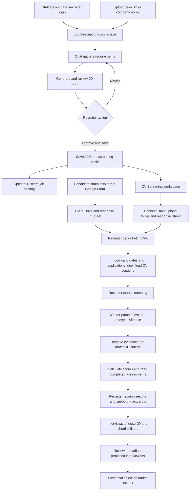

# Distill AI — Project Progress Tracker

**Pre-commit review — 12 October 2026:** Pre-commit review fixed the screening failure path to retain the job ID across rollback, and made score/evidence rendering tolerate invalid or incomplete score objects. Five real-results/worker PostgreSQL tests passed, including the new failure-path regression. Earlier SMTP/MCP focused checks remain recorded; no real email was sent. Live browser save/reload verification remains pending.

**Email MCP update — 12 October 2026:** Authenticated email MCP server/client and Docker service are implemented. Eight focused checks passed in the existing backend container, including an actual MCP protocol round trip with SMTP mocked; Compose configuration validated. No real email was sent and the new service was not started. Configure EMAIL_MCP_SECRET and the appropriate client URL before use. Invitation links, confirmation, durable queue, UI/chatbot sending and live shortlist browser verification remain pending.

**Latest email update:** Email transport switched to Gmail SMTP with an app password on 12 October 2026. The existing gmail.py adapter and its tests were replaced; OAuth settings/token loading were removed. Eleven focused fake-SMTP tests passed; no real email was sent. MCP transport/client, invitation links, queue and UI/chatbot sending remain pending. Earlier OAuth design notes below are historical and superseded.

Last updated: **12 October 2026 (Asia/Dhaka)**
Baseline: review of the current source code, migrations, tests, and repository documentation.

This is the working record of what the project currently provides, how its flows connect, and what remains to be delivered. Update it after each meaningful feature or verification milestone.


## Latest shortlisting follow-up — 12 October 2026

Backend preview now includes never-assessed applications, explicitly excludes missing/invalid aggregate scores, and fingerprints the owned application roster. Worker writes and shortlist saves share the per-job transaction lock; save previews run in the save session. Actual batch-worker ranking concurrency was checked against PostgreSQL with real result/save services: prior changes reject previews, concurrent writes wait for save, and later changes mark persisted selections outdated. Only model-version discovery was substituted; synthetic assessments were seeded.

Latest checks passed: 29 focused backend tests, 14 selection/request PostgreSQL tests, 4 real-results/worker-workflow PostgreSQL tests, frontend build and lint. Live browser login, owned JD listing and Interviews navigation succeeded using the actual stack. User requested validation stop before complete browser save/reload and edge-case interactions; that gap remains open. Disposable browser fixtures were removed. Email step 1 now uses personal Gmail SMTP with an app password; 11 focused fake-SMTP tests passed. MCP server/client is implemented with mocked-delivery checks; invitation links/queue and UI/chatbot sending remain pending. No real emails were sent. This update supersedes older pending score/roster and worker-concurrency notes below.

See `DAILY_WORK_2026-10-12.md` for commands and limits.

## 1. Current project position

Distill AI is a recruitment and interview intelligence platform. The current implementation covers creating job descriptions (JDs), importing CVs, extracting candidate evidence, scoring/ranking applications, and reviewing/saving JD-scoped interviewee selections.

The implemented recruiter workspaces are **Job Descriptions**, **CV Screening**, and **Interviews** for shortlisting. Dashboard, Candidates and Assessments still show placeholders. The Interviews UI supports filters, manual selection, evidence review and saved-selection display; invitation sending is disabled pending its backend. Candidate records are displayed in CV Screening and Interviews; the dedicated Candidates workspace is unfinished. Live full-stack shortlisting verification and actual screening-worker concurrency checks remain pending.

**Status definitions**

- **Implemented:** connected source code exists; this does not by itself establish that the feature passed a live end-to-end check.
- **Partial:** some supporting functionality exists, with a remaining product or operational gap.
- **Planned:** a placeholder or documented future scope; no working flow identified.
- **Verified:** only use this label with a dated check and recorded result.

No overall completion percentage is assigned because the full acceptance criteria and milestone weights have not been reconciled with the planning artifacts.

## 2. Feature inventory

| Area | Status | What exists now | Evidence |
| --- | --- | --- | --- |
| Application foundation | Implemented | React/TypeScript/Vite frontend, FastAPI backend, PostgreSQL, logging, error handling, API and DB health endpoints | [App](../frontend/src/app/App.tsx), [API setup](../backend/app/main.py) |
| Staff authentication | Implemented | Account creation script, password hashing, JWT login, active-user checks, recruiter access restrictions; recruiter and interviewer account roles | [Authentication](../backend/app/auth.py), [Account script](../backend/app/scripts/create_user.py) |
| Recruiter assistant | Implemented | Persistent chats and history; routes JD creation and approved-job posting through tools | [Assistant graph](../backend/app/workflows/assistant/graph.py), [Chat UI](../frontend/src/features/jd/RecruiterChat.tsx) |
| JD creation and revision | Implemented | Conversational requirement gathering, draft generation, review, revisions, approval/save, cancellation and recovery paths | [JD graph](../backend/app/workflows/jd/graph.py), [Conversation service](../backend/app/services/jd/conversations.py) |
| Saved JD management | Implemented | Stable JD numbers, paginated listing, viewing saved descriptions, reopening a JD in a conversation | [JD API](../backend/app/jd.py), [JD list UI](../frontend/src/features/jd/MyJobDescriptions.tsx) |
| JD reference knowledge | Implemented | PDF/DOCX upload for prior JDs and company policies, duplicate detection, extraction, embedding/indexing, scoped retrieval and indexing retry | [Reference API](../backend/app/jd_reference_routes.py), [Retrieval](../backend/app/services/jd/reference_retrieval.py) |
| Screening profile | Implemented | Versioned criteria across technical skills, work experience, qualifications, and additional criteria; Must-have/Preferred priorities and recruiter-confirmed dimension weights | [Profile validation](../backend/app/services/jd/screening_profiles.py) |
| Discord job posting | Implemented | Assistant tool posts a recruiter's saved approved JD to a configured webhook, with persisted posting state/receipt and duplicate controls | [Posting service](../backend/app/services/jd/discord_job_posts.py) |
| Google Drive/Sheets connection | Implemented | A JD can link a CV upload folder and response Sheet tab; service-account access and source validation | [Source API](../backend/app/cv_routes.py), [Connection UI](../frontend/src/features/cv/CVScreening.tsx) |
| Candidate import and CV download | Implemented | Imports response rows, maps candidates to job applications and CV files, downloads versioned files, checks integrity and records download outcomes | [Sheet import](../backend/app/services/cv/sheet_import.py), [Ingestion](../backend/app/services/cv/ingestion.py) |
| CV parsing | Implemented | PDF/DOCX extraction, local OCR when needed, structured model extraction, source-checked claims, versioned results, reuse/retry and profile inspection | [Parsing graph](../backend/app/workflows/cv_parsing.py), [Parsing service](../backend/app/services/cv/parsing.py) |
| CV model providers | Implemented | Ollama and Gemini adapters; configurable provider selection, structured output and bounded error handling | [Model integration](../backend/app/integrations/cv_model.py) |
| CV evidence search and MCP | Implemented | Evidence indexing and authenticated MCP tools for parsing, profiles, scoped evidence retrieval, screening start and results | [Indexing](../backend/app/services/cv/indexing.py), [MCP tools](../backend/app/mcp_cv.py) |
| Screening, scoring and ranking | Implemented | Durable screening runs, per-criterion semantic matching, evidence validation, deterministic weighted scoring, ranking and outdated-input detection | [Screening graph](../backend/app/workflows/cv_screening.py), [Scoring](../backend/app/services/cv/scoring.py) |
| Screening results UI | Implemented | Progress polling, start/resume action, ranked candidates, score breakdowns, excerpts, review flags, incomplete results and previous-run summaries | [Results UI](../frontend/src/features/cv/CVResults.tsx) |
| Processing recovery | Implemented | PostgreSQL checkpoints, persisted parsing/screening states, worker restart recovery and retry/resume paths | [Workflow runtime](../backend/app/workflows/runtime.py), [Worker](../backend/app/scripts/cv_screening_worker.py) |
| Development containers | Implemented; runtime verification pending | Compose services for PostgreSQL, ChromaDB, Ollama, backend, CV worker and frontend, with persistent volumes and health/dependency checks | [Compose](../compose.yaml) |
| Dedicated Candidates workspace | Partial | Candidate/application storage and CV Screening tables exist; dedicated page is a placeholder | [Candidate models](../backend/app/models/cv.py), [Routes](../frontend/src/app/App.tsx) |
| Dashboard | Planned | Navigation and placeholder page | [Routes](../frontend/src/app/App.tsx) |
| Candidate shortlisting and persistence | Implemented; verification gaps remain | Top K/minimum score/combined preview, preview fingerprints, authenticated save/load, applied shortlist tables, manual-adjustment provenance and saved score/rank snapshots | [Shortlisting](../backend/app/services/interviews/shortlisting.py), [Selections](../backend/app/services/interviews/selections.py), [Models](../backend/app/models/interviews.py) |
| Interviews shortlisting workspace | Implemented; mocked browser checks passed | JD selection, current ranks/scores before preview, filters, checkboxes, evidence reuse, save/restore, separate saved list, cutoff ties and stale/error/empty states | [Interviews UI](../frontend/src/features/interviews/Interviews.tsx), [API helpers](../frontend/src/features/interviews/api.ts) |
| Interview links and Gmail delivery | Planned; design confirmed | Personal Gmail OAuth and custom email MCP server selected; shared backend preview/confirmation/queue for button and chatbot. No link or email delivery implementation yet | [Daily plan](DAILY_WORK_2026-10-12.md) |
| Assessments and interview execution | Planned | Assessment placeholder and interviewer account role exist; full interview execution remains separate from invitation/entry-page scope | [Routes](../frontend/src/app/App.tsx) |
| Candidate data deletion | Pending | Foreign-key deletion rules exist, but no complete user-facing deletion workflow was identified | [Models](../backend/app/models/cv.py), [Root scope notes](../README.md) |

## 3. Current project flow

### 3.1 Recruiter journey



Google Form creation and submissions happen outside Distill AI. The application uses the resulting Drive files and response Sheet. Discord posting is optional and requires a configured webhook.

### 3.2 JD creation flow

1. The recruiter opens or starts an assistant conversation.
2. The assistant starts the JD workflow and gathers role requirements. Reference tools can retrieve relevant prior-JD or policy context.
3. The workflow builds a draft and associated screening criteria, preserving recruiter-supplied evidence and distinguishing authorized suggestions.
4. The recruiter reviews, requests revisions, cancels, or approves/saves the draft.
5. Saved JDs appear in the JD list and become available in CV Screening. Existing descriptions can be reopened in chat.
6. The assistant can post a selected approved job to Discord on request.

**Drafting and screening readiness are separate.** A JD can be drafted and saved with incomplete screening information. Starting screening requires a valid profile, explicit criterion priorities, and confirmed dimension weights totaling 100%, with criteria in every positively weighted dimension.

### 3.3 CV intake and parsing flow

1. Select a saved JD and link its Drive folder and Sheet tab. The response tab needs Name, Email and CV File columns; Timestamp is optional.
2. Share the sources with the configured Google service account. The upload folder must satisfy the configured parent-folder scope.
3. Click **Fetch CVs**. The backend imports rows, links candidate applications and documents, and downloads supported CV files.
4. Persist file versions, hashes, paths, statuses and errors. Show downloaded/skipped/failed counts and row-level import issues.
5. Parsing verifies the exact downloaded file, extracts native text, assesses readability, and uses local Tesseract OCR where needed.
6. Save text and source locations before model extraction. The configured CV model returns contact, education, work history, skills, certifications and projects.
7. Validate claims against source excerpts and persist the profile, evidence, warnings and processing versions. Unusable/incomplete text is routed to review; retained text supports later retry.

### 3.4 Screening and scoring flow

1. Validate the owned JD/profile and snapshot screening inputs, versions and rubric.
2. Create a durable queued run. The separate CV worker processes candidate applications using PostgreSQL-backed checkpoints.
3. Parse or reuse each candidate's CV results, then index the evidence. The current workflow limits an application to five CV documents.
4. Retrieve scoped evidence through MCP and match each criterion. Validate decisions and quoted evidence before scoring.
5. Apply the current `initial-1` rubric:

   | Decision or priority | Credit or weight |
   | --- | --- |
   | Met | 1 |
   | Partially met | 0.5 |
   | Unmet / insufficient evidence | 0 |
   | Must have | 2 |
   | Preferred | 1 |

6. Calculate each dimension's earned-credit percentage, then multiply by the recruiter's approved dimension weight to calculate the aggregate score.
7. Rank completed assessments by aggregate score. Equal scores share a rank; application IDs provide stable ordering within ties.
8. Show scores, contributions, justifications, checked excerpts, evidence coverage, warnings and Must-have review flags. Incomplete assessments are shown separately.
9. Resume failed/issue-bearing runs as supported. Changed inputs mark runs/results outdated and require a new screening run.

The initial rubric is not scientifically validated. Scores represent documented support in the supplied CVs; missing evidence is not proof of inability. Must-have flags prompt recruiter review and do not trigger automatic rejection.

### 3.5 Interviewee selection flow — implemented

1. Select an owned JD in Interviews and load its imported applications, current screening results and saved selection. Scores/ranks/evidence load independently of preview generation.
2. Choose Top K, minimum score or both; compare stored scores at full precision and preserve existing stable ranking order. Display cutoff ties for review.
3. Adjust eligible applications with checkboxes, including manual additions outside the filter's proposal.
4. Send filters, preview key and final application IDs to the authenticated save route. Recreate the preview, check ownership/membership/eligibility and reject changed previews.
5. Persist one shortlist per JD plus unique application members, assessment references, score/rank snapshots and original proposal IDs. Reload saved names/emails and flag outdated references.
6. Show saved interviewees separately from unsaved checkbox edits. Saving does not send emails.

The schema is applied and synthetic PostgreSQL tests passed with mocked screening responses. Missing-score/never-assessed backend preview cases, actual screening-worker concurrency and complete live frontend/backend/database verification remain pending.

### 3.6 Interview invitations — confirmed design, not implemented

```text
Saved interviewees -> UI button OR central chatbot
  -> backend recipient/message preview -> recruiter confirmation
  -> unique per-application links and durable email queue
  -> queue worker -> custom email MCP server -> Gmail API
  -> developer's personal Gmail mailbox -> candidate
  -> persisted sending outcomes in the UI and chatbot
```

The custom MCP server will authenticate to Gmail using **user OAuth**, the send-only `gmail.send` scope and a securely stored refresh token. Personal Gmail cannot use the existing Drive/Sheets service account for mailbox access. The same Google Cloud project can host separate Gmail OAuth client credentials; the service account continues supporting Drive/Sheets.

The application backend owns recipient authorization, exact-preview confirmation, link generation, queueing, duplicate prevention, retries and statuses. Both entry points use this shared path; the chatbot does not send directly around confirmation or the queue. The MCP server performs authenticated provider calls and returns message IDs and safe failure/uncertain outcomes. Gmail acceptance is not proof of recipient delivery.

The exact sender address, OAuth client/callback setup, token storage, public URL, instructions and expiry still need configuration. No Gmail credentials, custom email MCP implementation or invitation sending are currently added. See [Gmail OAuth](https://developers.google.com/workspace/gmail/api/auth/web-server) and [Gmail scopes](https://developers.google.com/workspace/gmail/api/auth/scopes). No credentials or raw link tokens belong in this tracker.

## 4. Technical flow and storage

```text
React UI -> FastAPI authenticated routes -> services / LangGraph workflows
                                      |-> PostgreSQL: users, conversations,
                                      |   JDs/profiles, sources, candidates,
                                      |   applications, file versions, parse
                                      |   results, screening results/checkpoints,
                                      |   interview shortlists and members
                                      |-> local CV storage: downloaded documents
                                      |-> ChromaDB: reference/CV evidence index
                                      |-> Ollama: embeddings and optional CV model
                                      |-> Gemini: optional CV model
                                      |-> Groq: JD/assistant model integration
                                      |-> Google Drive / Sheets: CV intake
                                      |-> Discord webhook: approved-job posting

Separate CV worker -> queued screening runs -> candidate workflow -> results

Planned: invitation queue worker -> custom email MCP -> Gmail API (personal OAuth)
```

Backend responsibilities are separated into routes, services, integrations, workflows, models, workers and scripts. See the [backend structure guide](../backend/README.md).

Compose defines the existing development stack. Services/models/credentials were not comprehensively runtime-checked for the original baseline. The later shortlist migration was applied by the developer and verified at `e7c142d9a630`; both new tables and their constraints/indexes exist. The planned email MCP server and invitation queue worker are not part of the implemented stack yet. Keep secrets in local configuration and out of this tracker.

## 5. Verification record

| Date | Check | Recorded outcome | Basis |
| --- | --- | --- | --- |
| October 2; year not stated | Authentication and role checks in Swagger | Passed, as reported in README | Historical documentation; not rerun here |
| October 3; year not stated | Dependencies, backend/DB health, users migration on home PC | Passed, as reported in README | Historical documentation; not rerun here |
| 2026-10-12 | Source review of routes, UI, services, workflows, models, tests and Compose | Current feature/flow baseline documented | Static review only; no runtime tests executed |
| 2026-10-12 | Screening-results regression, scoring, shortlist filters and preview HTTP tests | Passed: 8 + 3 + 7 + 7 tests | Focused suites; database/model/service dependencies mocked where appropriate |
| 2026-10-12 | Save-request and selection PostgreSQL tests | Passed: 14 tests, including 12 database checks | Disposable synthetic records; real ownership/storage queries; screening responses mocked; Windows Selector event loop |
| 2026-10-12 | Shortlist migration and live schema inspection | Passed; database at `e7c142d9a630` | Developer applied migration; read-only checks of revision, columns, table links, unique constraints and indexes |
| 2026-10-12 | Frontend build, ESLint and desktop/mobile browser checks | Passed for the Interviews UI | Browser API responses mocked; preview, save/restore, job isolation, evidence, ties, stale/empty states, independent score display and saved panel checked |
| 2026-10-12 | Read-only saved-selection lookup | JD 81 had two persisted shortlist members | Confirms existing database records; not a complete automated live UI/API/database check |

Existing verification assets include:

- JD profile/approval validation, chat actions, history, reference/model behavior and assistant error tests.
- CV document extraction/OCR, schema/evidence validation, provider adapter and scoring tests.
- PostgreSQL integration suites for JD and CV parsing, gated by `RUN_JD_DB_TESTS=1` and `RUN_CV_DB_TESTS=1`.
- Synthetic CV screening/UI verification scripts and an MCP verification script.

Their presence does not establish a current passing result. Record commands, environment, date, outcome and any skipped checks when they are run. Use synthetic data for verification.

## 6. Open work and next checkpoints

### Verify the implemented recruitment flow

- [ ] Confirm migrations and all required development services start from a clean setup.
- [ ] Verify configured JD/assistant model, CV provider, embedding model and OCR dependencies.
- [ ] Run relevant unit/integration checks and record results above.
- [ ] Verify JD draft -> revise -> approve -> reopen, including incomplete-profile behavior.
- [ ] Verify reference upload/retrieval/retry and recruiter ownership boundaries.
- [ ] Verify Drive/Sheets intake, repeated fetches, file changes and import/download failures.
- [ ] Verify parsing on native, scanned, malformed and unreadable synthetic CVs.
- [ ] Verify screening evidence, scoring, ties, partial failures, resume and worker restart recovery.
- [ ] Verify outdated-input handling and results display after profile or CV changes.
- [ ] Verify optional Discord posting and duplicate/error behavior in a test channel.

### Complete remaining product scope

- [x] Implement JD-scoped shortlist preview, manual selection, database save/load and recruiter UI. See [today's work file](DAILY_WORK_2026-10-12.md).
- [ ] Close shortlist backend edge cases and verify live full-stack flow and actual screening-worker concurrency before treating Task #648356 as fully verified.
- [ ] Implement unique invitation links, expiry/revocation/replacement and a functional candidate entry page (Task #648358).
- [ ] Configure personal Gmail OAuth and implement a custom email MCP server for Gmail API delivery; retain existing Drive/Sheets service-account setup.
- [ ] Implement backend invitation preview/confirmation, durable queue, duplicate prevention, statuses/retries, the UI send button and central chatbot tools using the shared custom MCP delivery path (Task #648359).
- [ ] Verify controlled Gmail sends, unique links, changed confirmations, partial/uncertain failures and duplicate prevention across both entry points.
- [ ] Define and implement Dashboard metrics and activity views.
- [ ] Implement the dedicated Candidates workspace and agreed candidate-management actions.
- [ ] Define and implement the interview workflow and interviewer workspace.
- [ ] Define and implement interview assessments/evaluation storage and UI.
- [ ] Implement candidate data deletion across database records, local documents and vector indexes.
- [ ] Reconcile this tracker with the business document, architecture diagrams and WBS in `docs/`, then assign owners and acceptance criteria.

### Documentation and delivery readiness

- [ ] Refresh root README sections that still describe foundation-only features and local-only runtime.
- [ ] Restore or replace the missing guides linked by README: `cv-parsing-stage-verification.md` and `cv-screening-stages-verification.md`.
- [ ] Replace the frontend template README with application-specific development instructions.
- [ ] Record a reproducible setup and operational checks before declaring deployment readiness.

These checkpoints are proposed follow-up work, not committed delivery dates.

## 7. Progress update log

Add the newest entry first. Move a feature to Verified only when an explicit result is recorded.

| Date | Change / milestone | Status | Verification / evidence | Next action |
| --- | --- | --- | --- | --- |
| 2026-10-12 | Confirmed personal Gmail via OAuth and custom email MCP delivery for both UI button and chatbot | Planned; design confirmed | User selected personal Gmail; [daily plan](DAILY_WORK_2026-10-12.md) records backend preview/confirmation/queue -> custom MCP -> Gmail API | Set up OAuth and implement invitation/link/queue/MCP components after remaining shortlist checks |
| 2026-10-12 | Implemented shortlisting backend, persistence and Interviews UI | Implemented; focused/DB/mocked-browser checks passed | Commits `31f42c5`, `8934622`, `f9f1574`; 39 tests across five suites, applied schema, build/lint and mocked browser flows | Live full-stack and worker concurrency checks; backend missing-score/never-assessed cases |
| 2026-10-12 | Added unique interview links sent by email to today's scope; later expanded to button and chatbot | Planned; requirements documented | [Daily work file](DAILY_WORK_2026-10-12.md); implementation pending | Build invitation generation, email queue, UI confirmation and chatbot tools |
| 2026-10-12 | Recorded initial interviewee-shortlisting scope and checklist | Historical planning checkpoint; implementation added later | [Daily work file](DAILY_WORK_2026-10-12.md); superseded by implementation updates above | Keep verification gaps and acceptance criteria current |
| 2026-10-12 | Created current feature inventory, project flows, verification record and open-work checklist | Baseline documented | Reviewed source and existing documentation; no runtime tests executed | Verify the implemented recruiter journey and record results |

For each future update, record the change, owner if known, relevant source or PR, checks performed, remaining gap and next action. Tick completed checklist items and revise the inventory/flows when behavior changes.
